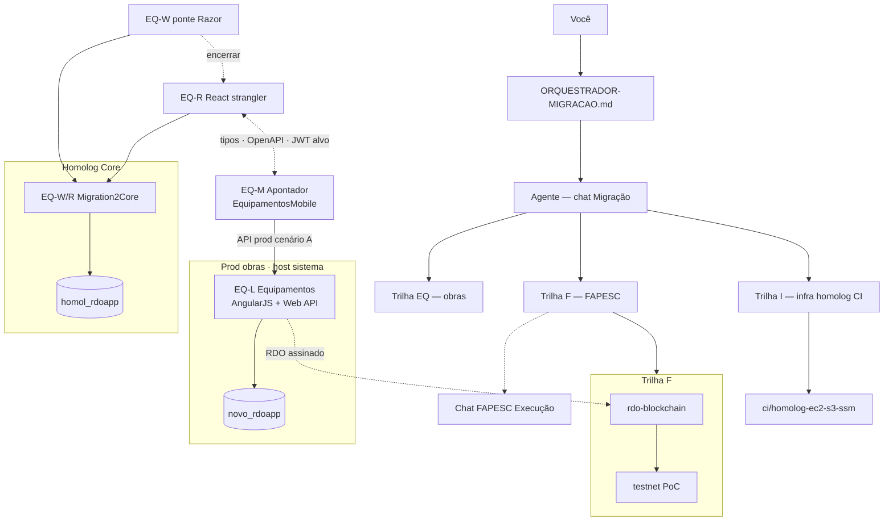

# Orquestrador — Migração (Equipamentos × FAPESC × infra)

**Atualizado:** 2026-10-29 — roteamento **obra demo assinatura** (Loja) · **M7 7a-P0** `3c061b6` · Git **`05999d6`** (`ci/homolog-ec2-s3-ssm`) · stack UI por página: [`pendencias-melhorias-ui-stack.md`](migracao/pendencias-melhorias-ui-stack.md) · [`m5-web-paridade-prod-ordem.md`](migracao/m5-web-paridade-prod-ordem.md) · **I0** B1/B2  
**Ler primeiro** em toda sessão do chat **Migração .NET Core** — depois [`migracao/dimas-tsk-rastreio-m.md`](migracao/dimas-tsk-rastreio-m.md) (TSK × M\*).

**Fonte única docs:** este arquivo e irmãos em **`Migration2Core/docs/`** no GitHub — índice [`README.md`](README.md).

### Repositório Git (canônico)

| O quê | Repo | Não commitar aqui |
|-------|------|-------------------|
| Core homolog, `client/`, CI, **docs M0/M1/orquestrador** | **`RDO-APP/Migration2Core`** | — |
| Legado prod obras IIS / AngularJS (**EQ-L**) | **`RDO-APP/Equipamentos`** · `novo_rdoapp` | docs de migração homolog |
| Legado prod Piscinas web (**PQ-L**) | **`RDO-APP/EquipoToPiscina`** · `piscinas.rdoapp.com.br` · `piscinas_rdoapp` | ≠ `Equipamentos` · ≠ `Migration2Core/EquipoToPiscina-1/` |
| Apontador (**EQ-M**) | **`RDO-APP/EquipamentosMobile`** | — |
| Piscineiro (**PQ-M**) | **`RDO-APP/RDOAppPiscinasMobile`** (ref. `PiscinasMobile`) | — |
| FAPESC 031/2026 · PoC imutabilidade (**F**) | **`RDO-APP/rdo-blockchain`** · docs [`imutabilidade/`](imutabilidade/README.md) · [`editais-fapesc/`](editais-fapesc/README.md) | **≠** Migration2Core prod · **≠** chat Migração · rascunhos MD FAPESC **fora** da raiz deste repo (`.gitignore`) |

Workspace Cursor **Equipamentos** (OneDrive) espelha `docs/` — **fonte da verdade = Git** `C:\Dev\Migration2Core`. **Regra:** OneDrive **100% alinhado** ao Git após cada push/pull de docs ([`sync-docs-onedrive-from-git.ps1`](migracao/sync-docs-onedrive-from-git.ps1)). Clone repo legado **Equipamentos** = **EQ-L** somente — **não** commitar docs migração lá.

Plano mestre: [`plano-estudo-execucao-migracao-fapesc-mobile.md`](plano-estudo-execucao-migracao-fapesc-mobile.md) · execução: [`plano-execucao-migracao-v1.md`](plano-execucao-migracao-v1.md) · **TSK Dimas × M\*:** [`migracao/dimas-tsk-rastreio-m.md`](migracao/dimas-tsk-rastreio-m.md) · M0 sem Dimas: [`m0-duvidas-dimas-solucoes.md`](m0-duvidas-dimas-solucoes.md)

**Modelo:** orquestrador → agente (mesmo chat) → **uma sub-trilha por sessão**.  
**Web + App:** stack de produto = **React** (web **EQ-R** + Apontador **EQ-M**); compartilhar API, tipos e pacotes TS — não o mesmo bundle de componentes DOM/RN.

**Diagrama (2026-10-20):** topologia **inalterada** — homolog continua **EQ-W** (Login/Escolher Razor) + **EQ-R** (Cards React + BFF `homol_rdoapp`). M4.1 só adiciona **shell React na rota Cards**; seta EQ-W → encerrar → EQ-R segue válida quando SPA cobrir as 3 telas. Diagrama **5 vetores** (prod/mobile): [`manual-frontend-rdo-equipamentos-prod-core-mobile.md`](manual-frontend-rdo-equipamentos-prod-core-mobile.md) §0 — **não** muda com M4.1.

**Apps (EQ-M):** cliente do **EQ-L** (`/api/*` prod) — **não** filho visual do homolog; **não** substituem telas Angular. Ver manual M0′ diagrama § arquitetura.

| Sigla | Papel | Foco | Repo / doc |
|:-----:|-------|------|------------|
| **EQ** | Guarda-chuva | Obras web + campo | — |
| **EQ-L** | Prod hoje | Referência, API prod, hotfix IIS | `Equipamentos` |
| **EQ-R** | **UI web alvo** | Login, Escolher, Cards, RBAC — React homolog → strangler | Dimas TSK-10+, `Migration2Core` (host/API) |
| **EQ-M** | **App campo** | Apontador; mesma API/pacotes que EQ-R | `EquipamentosMobile`, E3 |
| **EQ-W** | **Ponte W1** | Razor Kiro já no ar — **só** bugfix + E2E legado até EQ-R assumir | `RdoApp.Core` Razor |
| **F** | Cronograma | Capacidade, marcos M* | E4; PoC no chat FAPESC |
| **I** | Deploy homolog | S3 + SSM + Actions | `PLANO-CI-HOMOLOG-EC2.md` |

### Encerramento da ponte EQ-W

Parar investimento em **features Razor** quando **qualquer** critério:

1. **EQ-R homolog:** login → Escolher → Cards **com dados** (substitui placeholder EQ-W), **ou**
2. SPA React servida no mesmo host homolog (`homolog.sistema`) com backend Core estável.

Até lá: EQ-W mantém o que já funciona (login, Escolher, Selecionar); **não** expandir Cards Razor salvo fallback explícito Lucio.

### Evolução futura — Piscinas (**PQ**)

Espelhar **EQ** com **PQ-L / PQ-R / PQ-M** (Piscineiro); **PQ-W** só se houver ponte Razor residual. Ajustar numa sessão dedicada — fora do escopo Hub B2G Equipamentos.

*(Fases estudo **E0–E6** ≠ siglas **EQ-***.)*

---

## Fase atual

**Marco ativo:** **M4** (fechamento UI shell) **+ M5 web Onda B** (paridade prod) — **M4.4–M4.6 ☑** · **M4.7** código **B–D** **`7e19d47`** · **P5a RDO:** listagem **T5 classe E** (`056eb29`) · paridade visual **W1/W2** no Git **`fd8a144`** (smoke homolog **T6** pendente) · **falta M4:** G5/G6 · **UI-M1/UI-M2c** (fontello/FA, incl. ícones ação RDO **W3**) · **P1** = **M4.8** · **P4** = **M7+**. Checklist: [`migracao/m4-execucao-checklist.md`](migracao/m4-execucao-checklist.md) · M5 fila: [`migracao/m5-web-paridade-prod-ordem.md`](migracao/m5-web-paridade-prod-ordem.md).

**Numeração P (canônica):** **P1** Login · **P2** Escolher/cards obra · **P3** Etapas/Tarefas · **P4** Nova medição (= matriz **#1–#4**).

**Manual front-end (M0′):** [`manual-frontend-rdo-equipamentos-prod-core-mobile.md`](manual-frontend-rdo-equipamentos-prod-core-mobile.md) — produto **①–⑤** (§1–§4 Login→Nova medição) · **§6b cruzamento P2/P3 (web + Apontador + Piscineiro)** · **§10 paridade ①↔②** · **⑥ FAPESC** [`rdo-blockchain`](https://github.com/RDO-APP/rdo-blockchain) · PQ-L = **[EquipoToPiscina](https://github.com/RDO-APP/EquipoToPiscina)**.

### Plano de execução (A → E)

| Fase | Marco | Passos | Status |
|------|-------|--------|--------|
| **A** | **M0′** doc | A1 RDS/hosts · A2 smoke prod + evidências · A3 aceite | **A executada** — ver [`m0-prime-fase-a-evidencias.md`](m0-prime-fase-a-evidencias.md) · HAR API ○ opcional |
| **B** | **I0** | B1 publish/SSM · B2 smoke homolog · B3 runway &lt;2 min | **parcial** — B1/B2 OK · **SSM/apply** endurecido **`7e19d47`**; B3 serviço Windows / runway &lt;2 min na EC2 pendente |
| **C** | **M2 produto** | C1 BFF agrupador · C2 DTO card · C3 React accordion/cards · C5 redeploy | **C1–C3 + C5 homolog OK** — `/Tarefa/Cards` obra 42: 3 etapas · **13** tarefas · head/datas/%/status; **M2.5+** toolbar/ações · **M3** gate |
| **D** | **M3** | D1–D4 E2E [`e2e-fase0-checklist.md`](e2e-fase0-checklist.md) · D5 assinatura | **PASS 2026-10-19** (passos 1–5 · Lucio) |
| **E** | **M4+** | E1 congela EQ-W · E2 M5 Apontador · E3 M6+ | **E1 ativo** — shell/layout · Escolher React |

**Paralelo:** trilha **F** (⑥ FAPESC) · **PQ** (④⑤) — não bloqueiam B–D.

**Próxima ação (ordem):** ver § [Próxima ação (1)](#próxima-ação-1) — **agora:** deploy **D→E** pacote **`fd8a144`** · smoke **P5a RDO T6** (W1/W2 header/CSS) · depois **W3** ícones ação **ou** **M5 web #2** `/Chart/Index`.

**Histórico:** **M1** FECHADO 2026-10-17. **M3** PASS 2026-10-19. **M4.4–M4.6** deploy 2026-10-21. **2026-10-26** M4.7 + RDO BFF (`7aee0f2`→`3a7f5ad`). **2026-10-27** P5a: T0–T4b redirects · **T5 E** listagem (`056eb29`) · **W1/W2** paridade RDO (`fd8a144`).

**Deploy:** roteiro [`migracao/roteiro-deploy-homolog-operador.md`](migracao/roteiro-deploy-homolog-operador.md) · pacote P2+P3 **2026-10-21** (ver runbook) · pré-check `Test-Path C:\Dev\Migration2Core`.

### Pendências por marco (snapshot)

| Marco | Feito | Ainda pendente |
|-------|--------|----------------|
| **M0** | Decisões A1–A5; inventário mobile `14cf5d3`; v0 API; Vite `client/` + build; `dotnet build` Core; E2E login→Escolher (7 obras); docs E0–E6/orquestrador | branding homolog; Escolher CSS STRATEGY-2; E2 localhost completo |
| **M0′** | Matriz; manual ①–⑥; diagrama; **Fase A** PASS doc ([`m0-prime-fase-a-evidencias.md`](m0-prime-fase-a-evidencias.md)) | M0′ **FECHADO** formal opcional: HAR API prod Lucio |
| **M1** | Cenário **A**; v1 endpoints; tipos TS Auth/Obra/Cards; mapa Core vs legado | Pacote npm publicado; EQ-M ainda não consome tipos |
| **W0.5 / E2E** | Selecionar + Cards **React** homolog; **M3 PASS** | toolbar/ações · M4.4 Escolher React |
| **M2** | **FECHADO** | — |
| **M3** | **FECHADO** | passos 6–7 E2E opcional |
| **M4** | **M4.1–M4.7g** ☑ · **M4.8** Login SPA ☑ | Smoke **G5/G6** · **UI-M1/M2c** · congela EQ-W formal |
| **M5 web** (Onda B) | **#1 RDO** listagem **T5 E** · **W1/W2** `fd8a144` | Smoke **T6** · **W3** · **M7** ações · **#2 Chart** · **#3 Dashboard** |
| **M5 EQ-M** | — | **⏸ adiado** — retomar no **G-M5** web ou **M6** |
| **M6** | — | JWT/OpenAPI spike · contrato mobile homolog |
| **M7+** | Rotas stub P3 · RBAC shell | CRUD/escrita · **P4** medição · PDF/assinar RDO |
| **M8** | Branch CI · deploy D→E documentado | Runway &lt;2 min · workflow gate |
| **M9** | — | D1–D7 pacote homolog v1 |
| **M10** | — | Onda 2 / L1 prep |

---

## Decisões fechadas

- **UI web de produto** = **React (EQ-R)**, compartilhada com **EQ-M** via API/contratos TS (não duplicar regra em Razor).
- **Ordem de execução** = **marcos M\*** ([`plano-execucao-migracao-v1.md`](plano-execucao-migracao-v1.md)); backlog **TSK Dimas** = referência técnica + gap check ([`migracao/dimas-tsk-rastreio-m.md`](migracao/dimas-tsk-rastreio-m.md)) — **não** inverter para Sprint linear 346 h até reunião explícita.
- **Dimas no time** = **incerto** (2026-10-25); homolog v1 pode fechar **sem** Dimas; entrada dele = revalidar TSK/issues, **sem** trocar M4→M8 de dono automaticamente.
- **Execução até nova decisão (2026-10-25):** **Lucio + Cursor** seguem **marcos M\*** (EQ-R homolog → M4.8 → M5…). **Dimas não é pré-requisito.** Se entrar depois: trabalho **em paralelo e independente** (Application, OpenAPI, U-05, revisão Core) **reutilizando** BFF/React/homolog já no Git — ver § [Rastreio Dimas](#rastreio-dimas-tsk--vigilância-vs-plano-m) e [`migracao/dimas-entrada-paralela-pos-m4.md`](migracao/dimas-entrada-paralela-pos-m4.md). Pós-cutover operador: “adaptar ao PDF Dimas” = refator/hardening (**M6+**), não re-migrar front — ver doc acima § imposto Dimas.
- **Transição suave → estratégia Dimas (com ou sem Dimas):** rampa **Ondas A→D** + gates **G-M4…G-M8** — canônico [`migracao/dimas-entrada-paralela-pos-m4.md`](migracao/dimas-entrada-paralela-pos-m4.md) § *Transição suave*. **Não** big-bang PDF; **sim** convergência Application/OpenAPI em **M6**.
- **EQ-W (Razor)** = ponte W1 no `Migration2Core` — **sem** roadmap de features novas.
- **Migration2Core** = homolog only até Linux L1; backend + host; **sem** prod `:80`.
- RDS homolog Core: **`homol_rdoapp`** (47 tbl).
- URL homolog: **`https://homolog.sistema.rdoapp.com.br`** (:5081).
- **EQ-M** prod hoje → API legado; alvo = mesma API que EQ-R (JWT / U-05).
- **Trilha I (CI):** pausada até E2E homolog com Cards **com dados** (EQ-R preferencial).
- **M2 BFF Cards:** **homolog-only** (EF `homol_rdoapp`) — não proxy prod API (ids de obra divergem).
- Branch CI: `ci/homolog-ec2-s3-ssm`.
- Prod web: **EQ-L** até cutover Onda 6.
- **PQ-L** web Piscinas prod: repo **`EquipoToPiscina`** · RDS **`piscinas_rdoapp`** — manual M0′ § referência rápida.
- **M5 EQ-M (Apontador) adiado (2026-10-26):** prioridade = **sintonizar telas web homolog ↔ prod** ([`m5-web-paridade-prod-ordem.md`](migracao/m5-web-paridade-prod-ordem.md)). Prod mobile **continua EQ-L** (cenário A). **Reabrir** EQ-M: revisão ao **G-M5** web **ou** ao iniciar **M6** — **obrigatório** antes **M9 D4** e cutover Onda 6.

---

## Decisões abertas

- Monorepo vs pacotes npm (`@rdo/api-client`, etc.) — Dimas + Lucio.
- Onde hospedar build EQ-R no homolog (static no Core vs CDN vs subpath).
- ~~Cenário mobile homolog E3~~ → **A** fechado M1 ([`api-client-equipamentos-v1.md`](api-client-equipamentos-v1.md)).
- **EQ-M pós-adiamento:** merge/plano `feature/alteracoes_apontador` — **só** quando retomar marco mobile (ver decisão fechada acima).
- Marco FAPESC vs horas TSK (**Trilha F**).
- Abertura trilha **PQ** (Piscinas).

---

## Entregáveis estudo (índice)

| Marco / doc | Documento |
|:----:|-----------|
| **M0′ manual UI** | [`manual-frontend-rdo-equipamentos-prod-core-mobile.md`](manual-frontend-rdo-equipamentos-prod-core-mobile.md) — **5 vetores** · §1–§4 · **§10 paridade P2/P3** (**P1**–**P4** canônico) |
| M0′ Fase A evidências | [`m0-prime-fase-a-evidencias.md`](m0-prime-fase-a-evidencias.md) |
| M0′ matriz 4 telas | [`matriz-4-paginas-prod-kiro-mobile.md`](matriz-4-paginas-prod-kiro-mobile.md) |

| Fase | Documento |
|:----:|-----------|
| E0 | `migracao-kiro-mapa-estudo.md` |
| E1 | `migracao-frontend-razor-react-decisao.md` (+ decisão EQ-R) |
| E2 | `migracao-matriz-rotas-legado-core.md` |
| E3 | `migracao-mobile-apontador-core-api.md` |
| E4 | `estudo-migracao-fapesc-anexo-2026-q4.md` |
| E5 | `plano-execucao-migracao-v1.md` |
| E6 | `estudo-ci-homolog-readiness-e6.md` |

---

## Ponte FAPESC (Trilha F)

- Chat: **Edital FAPESC — Execução** (`6a7186f9-…`) · mapa [`CURSOR_MAPA_CHATS.md`](CURSOR_MAPA_CHATS.md)
- **Repo PoC:** [**`RDO-APP/rdo-blockchain`**](https://github.com/RDO-APP/rdo-blockchain) (contratos + API verify; testnet)
- **Docs hub:** [`imutabilidade/README.md`](imutabilidade/README.md) · stub edital [`editais-fapesc/README.md`](editais-fapesc/README.md)
- **Dados:** RDO assinado origina **`novo_rdoapp`** (web **Equipamentos**); âncora = metadados + tx (tabela aditiva `rdo_ancoragem` — plano PoC)
- **EDI / token pós-Termo:** chat **EDI · Smart contract · Token** (`9b8c1df2-…`) · [`edi-token-projeto/README.md`](edi-token-projeto/README.md)
- Cronograma: `estudos-lucio-apps-plano-migracao-core/estudo-migracao-fapesc-9-meses.md` · anexo `estudo-migracao-fapesc-anexo-2026-q4.md`
- **Não** implementar PoC blockchain neste chat (**Migração**).

---

## Par EQ-R + EQ-M

| Camada | EQ-R (web) | EQ-M (Apontador) |
|--------|------------|------------------|
| UI | React 19 + Vite | Expo / React Native |
| Compartilhável | OpenAPI, Zod/types, hooks auth, tokens UI | idem (pacotes TS) |
| Backend alvo | Core API + legado strangler | mesma base URL homolog/prod |
| Doc | E1, TSK-10+ | E3 |

---

## 4 páginas × marcos M (visão única)

**Propósito:** cada **página operador** não é um marco M separado; entra como **critério**, **dono de trilha** ou **passo E2E** nos marcos abaixo. **E0–E6** = estudo; **M\*** = execução. **M0′** não substitui M0–M10 — é **gate de realinhamento** antes de declarar M2/M3 produto.

**Legenda colunas M:** ● = foco principal do marco · ○ = pré-requisito ou smoke · — = fora do escopo · ✅ = já coberto na ponte · ❌ = dívida ativa

| # | Página (prod EQ-L) | E2E | Dono alvo | M0 | M0′ | M1 | I0 | M2 | M3 | M4 | M5 | M6 | M7+ | M9 (D*) |
|---|-------------------|:---:|-----------|:--:|:---:|:--:|:--:|:--:|:--:|:--:|:--:|:--:|:---:|:-------:|
| **1** | **Login** (`#/login` · `LoginUser`) | 1 | EQ-W → EQ-R | ○ EQ-W login homolog OK | ● comparar prod/Kiro/mobile | ● contrato `LoginUser` / tipos | ○ smoke pós-deploy | ○ pré passo 1 | ● passo 1 assinado | ○ EQ-R assume UI | ○ app login prod | ○ JWT homolog | ○ RBAC pós-login | **D1** início · **D2** branding |
| **2** | **Escolher** (`#/obra/escolher` · **LoginObra**) | 2–3 | EQ-W → EQ-R | ○ lista 7 obras | ● matriz + **W0.5** Selecionar | ● `LoginObra` no api-client | — | ○ bloqueado se Selecionar ❌ | ● passos 2–3 | ○ EQ-R opcional | ● mobile LoginObra ref | ○ mesma API | ○ filtros/RBAC header | **D1** meio |
| **3** | **Etapas / Cards** (`#/tarefa/cards`) | 4 | **EQ-R** (+ BFF) | — placeholder citado | ● gap Cards vs `cards.html` | ● etapa/Get no contrato | — | ● **foco M2** React+BFF | ● passo 4 E2E | ● critério encerrar EQ-W | ● fluxo campo espelho | ○ auth API | ○ strangler +1 tela | **D1** fim |
| **4** | **Nova medição** (modal em `cards.html`) | — (pós-M3) | EQ-R / Onda 2 | — | ○ escopo prod vs Kiro laudo | ○ endpoints medição | — | — | — fora gate M3 | — | ● regras EQ-M | ○ API | ● **M7+** web modal | fora D1–D2 |

**Ordem de gates (não mudou a direção React+RN):** M0 (parcial) → M1 (fechado) → **M0′** (matriz) → **Selecionar (W0.5)** + **I0** → **M2** produto → **M3** → **M4** (congela EQ-W) → M5–M9.

Detalhe por página: [`matriz-4-paginas-prod-kiro-mobile.md`](matriz-4-paginas-prod-kiro-mobile.md) · sequência marcos: [`plano-execucao-migracao-v1.md`](plano-execucao-migracao-v1.md) §3.

---

## Paridade visual prod ① vs homolog ② (blocos por tela)

**Numeração P (canônica):** **P1** Login (#1) · **P2** Escolher (#2) · **P3** Etapas/Cards (#3) · **P4** Nova medição (#4). Tabela abaixo foca **P2–P3** (M4); **P1** → **M4.8** · **P4** → **M7+**. Matriz: [4 páginas × M](#4-páginas--marcos-m-visão-única).

**Estratégia (fechada):** **não** investir STRATEGY-2 / CSS pesado em **Razor Escolher** — **P2** vira **React** (M4.4). **P3** evolui no **mesmo `client/`** (`OperadorShell` compartilhado). Referência: prod **`escolher.html`** · **`cards.html`** (EQ-L); capítulo UX: [`manual-frontend-rdo-equipamentos-prod-core-mobile.md`](manual-frontend-rdo-equipamentos-prod-core-mobile.md) **§10**.

### Resumo por bloco

| Tela | Blocos (ordem na página) | Marco principal |
|------|--------------------------|-----------------|
| **P2** Escolher | header → chrome lista → filtros → **card de obra** → legenda | **M4.4** |
| **P3** Cards | header → toolbar → **accordion etapa** → **card de tarefa** → placeholder nova tarefa | **M4.1** (header) · **M4.5–M4.6** |

### Detalhe por item (evidência prints homolog 2026-10-20)

**P2 — Escolher** (`/Obra/Escolher` · matriz #2)

| Bloco | Item | Prod ① | Homolog ② | Marco |
|-------|------|--------|-----------|-------|
| Header | Barra logo, menu, ícones, perfil | `layout-interno` | Header “EQUIPAMENTOS”; **≠** nav prod | **M4.4** |
| Header | Ícones gráfico / grid / relatório | Presentes | Ausentes ou reduzidos | **M4.4** |
| Chrome | Fundo + “Selecione uma das obras abaixo:” | Sim | Layout simplificado | **M4.4** |
| Filtros | Obra + Município (alvo ②; ref. §2.1) | ① sem UI; alvo = filtros | **Ausente** | **M4.4** |
| **Card de obra** | Ícone (capacete / obra) | Sim | **Ausente** | **M4.4** |
| **Card de obra** | Título | No card | Título + **ID** solto | **M4.4** |
| **Card de obra** | Cidade/UF + papel + licença | Sim | **Ausente** | **M4.4** |
| **Card de obra** | Barra progresso + % | Sim | **Ausente** | **M4.4** |
| Legenda | Cores / status obras | Sim | **Ausente** | **M4.4** |
| Grid | Colunas de cards | ~5 colunas prod | Poucos cards, visual lista branca | **M4.4** |

**P3 — Etapas / Cards** (`/Tarefa/Cards` · matriz #3)

| Bloco | Item | Prod ① | Homolog ② | Marco |
|-------|------|--------|-----------|-------|
| Header | Nome da obra no topo | Sim | **≈ prod** (**M4.1** ✅) | **M4.1** ✅ |
| Header | Ícones nav completos + RBAC | Sim | Parcial | **M4.5+** |
| Toolbar | “Etapas / Tarefas” + lista/grid | Sim | **Ausente** | **M4.5** |
| Toolbar | FILTRO · + tarefa · + etapa | Sim | **Ausente** | **M4.5** |
| Toolbar | LISTA · SELECIONAR TUDO | Sim | **Ausente** | **M4.5** |
| Accordion | Faixa azul escuro + **+ / −** | Sim | Accordion M2; estilo **≠** | **M4.5** |
| Accordion | Títulos etapa (CIVIL, …) | Sim | Dados OK; visual diferente | **M4.5** |
| **Card tarefa** | Faixa verde + mão + menu ⋮ | Sim | Verde + **só título** | **M4.6** |
| **Card tarefa** | Contadores efetivo / equipamento | Sim | **Ausente** | **M4.6** |
| **Card tarefa** | Ícones ação (olho, relógio, …) | Sim | **Ausente** | **M4.6** · API **M7+** |
| **Card tarefa** | Datas + ícone calendário | Sim | Datas sem ícones | **M4.6** |
| **Card tarefa** | Status + checkbox + barra % | Sim | % sim; **sem** checkbox | **M4.6** |
| **Card tarefa** | Placeholder “Adicionar nova tarefa” | Sim | **Ausente** | **M4.6** |
| Dados | “N etapa(s) M tarefa(s)” | Pode divergir por RDS | BFF OK — **não** confundir com gap visual | **M2** ✅ |

**P1 / P4 (fora desta tabela):** **P1** Login → **M4.8** · **P4** Nova medição → **M7+**.

**Ordem de implementação (não trocar):** **M4.4** **P2** (Escolher React: header + card obra + filtros) → **M4.5–M4.6** **P3** (toolbar + accordion + card tarefa) → **M4.7/M4.8** **P1** Login SPA + congela EQ-W → **M7+** ações/**P4** medição/RBAC fino.

**Gate vs pixel-perfect:** **M3** exigiu **fluxo + dados**; **M9 (D1)** exige paridade **operável** web — não exige clone pixel a pixel antes de M4.7.

---

## Gap técnico #1 — P3 (Cards · matriz #3)

**Blocos pendentes:** toolbar · accordion etapa prod · **card de tarefa** completo · slot “Adicionar nova tarefa”. M2/C3 entregou **dados + accordion mínimo**. **Nova medição** = **M7+**. BFF agrupador **OK** — gap é **UI**, não RDS. Itens: manual **§10.4**.

## Gap técnico #2 — P2 (Escolher · matriz #2)

**M4.4 (2026-10-21):** polish — sem h2 convite; empty “+”; header dropdown prod; deploy homolog. Ajuste fino pixel/RBAC → pós-smoke. Itens: manual **§10.3** · cruzamento apps **§6b.1**.

**Dados homol vs prod:** contagem de cards por agrupador pode divergir entre `homol_rdoapp` e `novo_rdoapp` (ex. obra 42: 13 vs 8) — comparar UI com o **mesmo RDS** alvo.

---

## Histórico de marcos

| Marco | Status | Doc |
|:-----:|:------:|-----|
| M0 | PARCIAL PASS | [`m0-registro-encerramento.md`](m0-registro-encerramento.md) |
| M1 | FECHADO | [`m1-execucao-checklist.md`](m1-execucao-checklist.md) |
| M0′ | **PASS doc** (Fase A) · ativo até HAR opcional | [`m0-prime-fase-a-evidencias.md`](m0-prime-fase-a-evidencias.md) · matriz · manual |
| I0 | **parcial** (B1/B2 OK · scripts B3 no repo) | [`homolog-core-deploy-rapido-plano.md`](homolog-core-deploy-rapido-plano.md) |
| M2 | **FECHADO** | [`migracao/m2-execucao-checklist.md`](migracao/m2-execucao-checklist.md) |
| M3 | **FECHADO** | [`e2e-fase0-checklist.md`](e2e-fase0-checklist.md) · [`migracao/m3-execucao-runbook.md`](migracao/m3-execucao-runbook.md) |
| M4 | **M4.1/M4.3 OK** · **M4.4–M4.7** paridade **P2–P3** | [`migracao/m4-execucao-checklist.md`](migracao/m4-execucao-checklist.md) |

---

## Rastreio Dimas (TSK) — vigilância vs plano M*

**Canônico:** [`migracao/dimas-tsk-rastreio-m.md`](migracao/dimas-tsk-rastreio-m.md) · cruzamento TSK-01…56: [`estudos-lucio-apps-plano-migracao-core/comparativo-dimas-v20260818.md`](estudos-lucio-apps-plano-migracao-core/comparativo-dimas-v20260818.md).

| Quando | Agente / Lucio |
|--------|----------------|
| **Início de sessão EQ-R/I** | Ler snapshot §3 do rastreio — saber **gap TSK** do cluster touched |
| **Fechou marco M\*** | Atualizar §3 + **Próxima ação** aqui |
| **Entrega cobre TSK** | Marcar ◐→☑ no rastreio (1 linha) |
| **Descobriu lacuna U/TSK sem M\*** | Registrar §4; **não** desviar M4/M4.8 salvo pedido Lucio |

**Regra:** seguir **M\***; usar Dimas para **não esquecer escopo** (ETL, JWT, domínio apontamento, gestor), não para **repriorizar** big-bang.

**Modo atual (2026-10-26):** **sem Dimas na execução** — dono homolog operador web = **Lucio + Cursor**. Dimas (se vier) **não substitui** M4.7/M4.8; encaixa em **M5/M6** (domínio, API v1, mobile) ou trilha **EQ-L** prod. Checklist entrada: [`migracao/dimas-entrada-paralela-pos-m4.md`](migracao/dimas-entrada-paralela-pos-m4.md).

### M5 — Apontador homolog (EQ-M) vs M5-nav (web)

| Nome | Trilha | O quê |
|------|--------|--------|
| **M5** (marco plano v1) | **EQ-M** | App **RDO Apontador** (`RDO-APP/EquipamentosMobile`): entrar no **mesmo plano** de migração que a web — homolog testável, API documentada (M1), **sem** rebuild greenfield (TSK mobile ⏸). |
| **`feature/alteracoes_apontador`** | Git mobile | Branch de **trabalho em campo** (apontamentos, ajustes Apontador) inventariada em M0 @ **`14cf5d3`**. **Decisão aberta:** merge na main mobile **ou** plano escrito (o que fica, o que descarta) **antes** de APK homolog oficial. |
| **M5-nav** (doc UI) | **EQ-R** | Só **menu drawer web** (9 itens → stubs). **Não** é o marco M5 do plano — nome colide; ver [`m4-7-menu-nav-stubs.md`](migracao/m4-7-menu-nav-stubs.md). |

**Hoje:** Apontador em **prod** fala com **EQ-L** (`POST /api/login/LoginUser`, LoginObra, etc.) — cenário **A** ([`api-client-equipamentos-v1.md`](api-client-equipamentos-v1.md)). **Homolog web** usa **Core + BFF + cookie** (`homol_rdoapp`). **M5** fecha o gap: APK apontando para **homolog Core** (ou cenário B/C/D documentado), mesma obra/CPF teste que web, branch mobile alinhada.

---

## Próximos passos (ordem)

Ordem **validada** contra gates do orquestrador (M2→M3→M4), matriz 4 páginas e decisão **não** expandir EQ-W antes do E2E.

| # | Ação | Dono | Bloqueia M4? | Paralelo? |
|---|------|------|:------------:|:---------:|
| **1** | ~~**M3** E2E~~ | Lucio | — | **✅ 2026-10-19** |
| **2** | ~~**M2/M3 FECHADO**~~ | docs | — | **✅** |
| **3** | ~~Commit docs M3/M4.1~~ | — | — | **✅ `d9dce0b`** |
| **4** | ~~**M4.3** deploy~~ | Lucio | — | **✅ 20261020-100219** |
| **5** | ~~**M4.4** Escolher React + polish~~ | **EQ-R** | — | **✅ deploy 2026-10-21** |
| **6** | ~~**M4.5–M4.6** P3 toolbar + accordion fix~~ | **EQ-R** | — | **✅ deploy 2026-10-21** · smoke Lucio |
| **7** | **M4.7** smoke G5/G6 + UI-M1/M2c · depois **M4.8** Login SPA / congela EQ-W | **EQ-R** | — | código B–D **`7e19d47`** |
| **8** | **M5 web (Onda B)** — **RDO** listagem ☑ **E** + W1/W2 ☑ Git · smoke **T6** · **Chart** → **Dashboard** (**G-M5**) | **EQ-R** | — | [`m5-web-paridade-prod-ordem.md`](migracao/m5-web-paridade-prod-ordem.md) |
| **9** | **M7+** cadastros/modais/menu admin · **M4.8** em paralelo curto | **EQ-R** | — | |
| **10** | **M6** contratos/JWT · **I0 B3** | **I** / EQ-R | não | |
| — | ~~**M5 EQ-M** Apontador~~ | **EQ-M** | — | **⏸ adiado** 2026-10-26 |

**Por que não inverter:** M4 antes de M3 viola critério de encerramento EQ-W (M2+M3 OK). I0 B3 antes de M3 **não** é necessário (B1/B2 já OK). Toolbar Escolher/Cards **antes** do shell M4 gera UI solta — estratégia acordada: **shell → Escolher → Cards polish**.

**Paralelo seguro:** HAR prod (M0′ formal) · trilha **F** · **PQ** — não alteram a ordem 1→5.

---

## Pendências — melhorias (stack UI)

**Docs canônicos:**

- [`migracao/pendencias-melhorias-ui-stack.md`](migracao/pendencias-melhorias-ui-stack.md) — **tabela por página** (Bootstrap/stack legado · **Por que ainda está assim** · **Quando vamos mudar**) · tabela **P1–P4** camada a camada · backlog **UI-M1…UI-M6** · regra **anti-Kiro** para **UI-M3**.
- [`migracao/fontello-fa-legado-marcos-ui.md`](migracao/fontello-fa-legado-marcos-ui.md) — **quando** copiar legado (Fase A **M4.7**) vs **quando** aposentar fontello/FA na SPA (Fase B **UI-M3**); inventário toolbar; checklist de atualização de marcos.
- Manual §**10.7** · plano §**2.1** — resumo executivo + link para a tabela por página.

| Prioridade | IDs | O quê |
|:----------:|-----|--------|
| **Agora (M4.7)** | UI-M1, **UI-M2c**, UI-M2, UI-M2b | **Copiar** FA + **fontello** do prod; flex card; barra % — paridade híbrida (**não** trocar motor de ícone) |
| **Em seguida** | M4.8, UI-M5 | Login SPA / Esqueci senha smoke |
| **Adiado** | **UI-M3** (+ M3a/M3b) | Redesign SPA **sem** BS3/`panel-*` **e sem** fontello/FA parcial — **só após M4.7 ☑ + M7** (gates no doc fontello) |

Homolog **não executa** AngularJS/jQuery/BS3 JS na SPA; o “legado” visível é **Bootstrap 5 CSS (link)** + **CSS de paridade** + fontes (fontello/FA) + **nomes de classe** copiados de `escolher.html` / `cards.html` / RDO. **Impacto:** UI/manutenção front — **não** bloqueia BFF/RDS/M7. **Redesign (UI-M3)** adiado de propósito — ver coluna *Quando vamos mudar* na tabela por página.

---

## Próxima ação (1)

1. **Deploy homolog D→E** — pacote **`3c061b6`** (M7 **7a-P0** + SPA) — [`migracao/roteiro-deploy-homolog-operador.md`](migracao/roteiro-deploy-homolog-operador.md).
2. **Smoke T7 cadastro:** `cadastro/etapas` **200** → salvar RDO — gap prod: [`migracao/m7-rdo-cadastro-paridade-homolog-prod.md`](migracao/m7-rdo-cadastro-paridade-homolog-prod.md) · [`migracao/homolog-p5-rdo-tentativas.md`](migracao/homolog-p5-rdo-tentativas.md).
3. **P5a RDO restante:** **W3** (ícones PDF/assinar) · **M7 7b–7d** (editar/PDF/assinar) · **UI-M3** só após gates (doc stack UI).
4. **M5 web #2** — **`/Chart/Index`** ([`m5-web-paridade-prod-ordem.md`](migracao/m5-web-paridade-prod-ordem.md)) — após T6 OK ou em paralelo se Lucio priorizar fila.
5. **Backlog M4** — **UI-M1/UI-M2c** global · **M4.8** Login SPA · **M5 EQ-M** **adiado**.

**UI-M3:** **não** abrir até M4.7 ☑ + M7 estável — [`fontello-fa-legado-marcos-ui.md`](migracao/fontello-fa-legado-marcos-ui.md).

---

## Links canônicos

| | |
|--|--|
| E2E | `e2e-fase0-checklist.md` |
| Manual UI + FAPESC ⑥ | `manual-frontend-rdo-equipamentos-prod-core-mobile.md` |
| Pendências stack UI (P1–P4 · UI-M3 adiado) | `migracao/pendencias-melhorias-ui-stack.md` |
| Fontello + FA — Fase A (M4.7) vs Fase B (UI-M3) | `migracao/fontello-fa-legado-marcos-ui.md` |
| Dimas TSK × marcos M* (rastreio) | `migracao/dimas-tsk-rastreio-m.md` |
| Dimas entrada paralela / pós-Core sem Dimas | `migracao/dimas-entrada-paralela-pos-m4.md` |
| Imutabilidade FAPESC | `imutabilidade/README.md` |
| Repo PoC blockchain | https://github.com/RDO-APP/rdo-blockchain |
| Matriz 4 telas | `matriz-4-paginas-prod-kiro-mobile.md` |
| RDS | `rds-equipamentos-governanca-catalogos.md` |
| Chats | `CURSOR_MAPA_CHATS.md` |
| CI (I) | `PLANO-CI-HOMOLOG-EC2.md` |
| Ponte Razor (W) | `C:\Dev\Migration2Core\...\RdoApp.Core` |
| Legado (L) | repo `Equipamentos` |

---

## Regras rápidas (roteamento)

| Pedido | Dono / trilha | Não fazer no chat **Migração** |
|--------|---------------|--------------------------------|
| Cards / telas web homolog | **EQ-R** | Feature nova em Razor (**EQ-W**) |
| API mobile / Expo | **EQ-M** | Assumir Core homolog sem E3 |
| Hotfix prod IIS / AngularJS | **EQ-L** | Deploy Core em `:80` prod |
| OIDC / S3 / SSM homolog | **I** | CI antes gate E6 (Cards EQ-R) |
| PoC blockchain / Termo | **F** | Redirecionar chat **FAPESC Execução** |
| **Obra demo pós-assinatura** (bat, tenant lead) | Chat **Loja RDO App** `65b6e329-2ae6-4468-9f01-485f21d9d68c` · skill **`criar-obra-assinatura`** · ponte Loja×Sistema | **Rodar** o bat · **Gravar** `homol_rdoapp` · **Commit** Migration2Core para provisionamento · Confundir com **P3** (abaixo) |

### Obra demo assinatura (prod EQ-L — só roteamento)

| Fact | Detalhe |
|------|---------|
| **Onde grava o bat** | **Prod** `sistema.rdoapp.com.br` · RDS **`novo_rdoapp`** (EQ-L) — obra **Contratada**, etapa **Serviços Preliminares**, tarefa **Terraplanagem** (Planejada) |
| **Quem executa** | **Lucio** / chat **Loja** — agente **Migração documenta**, **não** dispara bat |
| **Licença Equipamentos (18)** | Sem perfil **Diretor Contratada**; na demo a empresa costuma ficar na **licença 1** + menu **Gratuita** — regra **loja/legado**, **não** desenho Core homolog |
| **≠ P3 (M2/M4)** | **P3** = `/Tarefa/Cards` no **homolog** Core · BFF `GET /api/bff/etapas` · RDS **`homol_rdoapp`** · React — **independente** do bat prod |

**Fora deste bloco:** FAPESC · EDI/token · mobile homolog · Hub GovTech.

---

## Mapa de impacto (canônico)

Antes de codar ou editar doc de migração, cruzar **sub-trilha** × **superfícies**. Regra Cursor: `.cursor/rules/orquestrador-migracao-impacto.mdc`.

| Tipo de mudança | Trilha dona | Onde commitar | Impacto cruzado (avisar / revisar) |
|-----------------|-------------|---------------|-------------------------------------|
| UI web React (telas, RBAC) | **EQ-R** | `Migration2Core` (+ SPA repo quando existir) | **EQ-M** se mesma regra de negócio; **EQ-W** só se ponte quebrar E2E; matriz E2 |
| UI web Razor (bugfix ponte) | **EQ-W** | `Migration2Core` `RdoApp.Core` | Não duplicar feature em EQ-W se alvo é **EQ-R**; homolog :5081 |
| Apontador / services mobile | **EQ-M** | `EquipamentosMobile` | **EQ-L** `api/*` prod hoje; **EQ-R** pacote TS/OpenAPI; E3 cenário homolog |
| Web API legado AngularJS | **EQ-L** | `Equipamentos` | **EQ-M** consumidores; strangler **EQ-R**; **não** confundir com Core homolog |
| EF / entidades / DDL homolog | **EQ-W/R** backend | `Migration2Core` + SQL `docs/scripts/` | **`homol_rdoapp`** · `rds-equipamentos-governanca-catalogos.md` · **EQ-M** se apontar homolog |
| EF / prod `novo_rdoapp` | **EQ-L** | `Equipamentos` + Dimas publish | Prod `:80`; **fora** Migration2Core até Onda 6 |
| Auth (cookie vs JWT) | **EQ-R** + **EQ-M** | Core + mobile | **EQ-W** cookie legado; Loja×Sistema só se licença/login loja |
| Deploy homolog EC2/CI | **I** | `Migration2Core` branch `ci/*` | Preservar `appsettings.Staging.json`; E6 gate Cards **EQ-R** |
| Cronograma / horas / M* FAPESC | **F** | `docs/` anexo E4 | Chat **FAPESC Execução** — não PoC aqui |
| Prontidão B2G / W4 Hub | — | `docs/hub-*` | Regra **hub-govtech-equipamentos-only** — só Equipamentos+Apontador |
| **Obra demo pós-assinatura** (bat prod) | **Loja** + skill `criar-obra-assinatura` | **Fora** Migration2Core · **≠** `homol_rdoapp` | **`novo_rdoapp` prod** · **≠ P3** homolog · ver **Regras rápidas** acima |
| Piscinas (futuro) | **PQ-*** | TBD | Fora escopo EQ; nova sessão orquestrador |

**Saída obrigatória do agente** (1 parágrafo + bullets): sub-trilha escolhida · repos tocados · impacto cruzado · chat/repo **fora** deste workspace se houver.

---

## Como usar (agente)

1. Ler este arquivo + **Mapa de impacto** + **Gap #1** / **Decisões abertas**.
2. Uma sessão = **EQ-R**, **EQ-M**, **EQ-W** (só ponte/bugfix), **EQ-L**, **F** ou **I**.
3. Features web novas → **EQ-R**, não EQ-W.
4. Atualizar **Próxima ação** ao fechar sessão.
5. Commit: **Migration2Core** (código + docs migração/orquestrador) · **EQ-M** → `EquipamentosMobile` · **EQ-L** → `Equipamentos` só hotfix prod. **Não** push docs M* para Equipamentos.

---

## Git push (agente — obrigatório)

Repo de execução: `C:\Dev\Migration2Core` · detalhe: [`migracao/git-push-checklist.md`](migracao/git-push-checklist.md) (espelho em `Migration2Core/docs/migracao/`).

| # | Regra |
|---|--------|
| 1 | Arquivo **existente no disco** antes de `git add` (path novo → criar/gravar primeiro). |
| 2 | Sequência: `git status` → `git add` → **`git status` com “Changes to be committed”** → `commit` → `push` → confirmar **hash novo** no remoto. |
| 3 | Se `add` falhar, **não** commitar nem dizer “push feito”. |
| 4 | PowerShell: **`;`** entre comandos (não `&&`). |
| 5 | Só avisar Lucio após push OK; branch explícita (ex. `ci/homolog-ec2-s3-ssm`). |
| 6 | **OneDrive:** após push/pull de `docs/`, executar [`migracao/sync-docs-onedrive-from-git.ps1`](migracao/sync-docs-onedrive-from-git.ps1) — espelho Cursor = Git (obrigatório). |

**Incidente 2026-10-18:** `git add` com doc inexistente → stage vazio → push “up-to-date” sem commit — não repetir.
