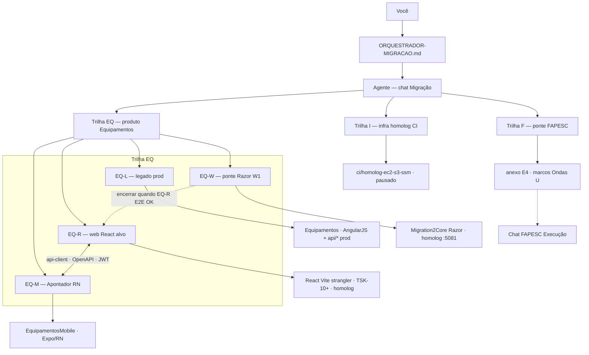

# Orquestrador — Migração (Equipamentos × FAPESC × infra)

**Atualizado:** 2026-10-19 — **M0′** manual **5 vetores** (GitHub/RDS + diagrama + Login→Nova medição) · matriz 4 páginas · M1 FECHADO · M0 PARCIAL PASS · M2 produto **bloqueado** (paridade Cards) · **4 páginas × M** § abaixo  
**Ler primeiro** em toda sessão do chat **Migração .NET Core**.

**Fonte única docs:** este arquivo e irmãos em **`Migration2Core/docs/`** no GitHub — índice [`README.md`](README.md).

### Repositório Git (canônico)

| O quê | Repo | Não commitar aqui |
|-------|------|-------------------|
| Core homolog, `client/`, CI, **docs M0/M1/orquestrador** | **`RDO-APP/Migration2Core`** | — |
| Legado prod obras IIS / AngularJS (**EQ-L**) | **`RDO-APP/Equipamentos`** · `novo_rdoapp` | docs de migração homolog |
| Legado prod Piscinas web (**PQ-L**) | **`RDO-APP/EquipoToPiscina`** · `piscinas.rdoapp.com.br` · `piscinas_rdoapp` | ≠ `Equipamentos` · ≠ `Migration2Core/EquipoToPiscina-1/` |
| Apontador (**EQ-M**) | **`RDO-APP/EquipamentosMobile`** | — |
| Piscineiro (**PQ-M**) | **`RDO-APP/RDOAppPiscinasMobile`** (ref. `PiscinasMobile`) | — |

Workspace Cursor **Equipamentos** (OneDrive) pode ter cópia local dos `.md` — **push = Migration2Core** (`C:\Dev\Migration2Core`). Clone legado Equipamentos = referência **EQ-L** somente.

Plano mestre: [`plano-estudo-execucao-migracao-fapesc-mobile.md`](plano-estudo-execucao-migracao-fapesc-mobile.md) · execução: [`plano-execucao-migracao-v1.md`](plano-execucao-migracao-v1.md) · M0 sem Dimas: [`m0-duvidas-dimas-solucoes.md`](m0-duvidas-dimas-solucoes.md)

**Modelo:** orquestrador → agente (mesmo chat) → **uma sub-trilha por sessão**.  
**Web + App:** stack de produto = **React** (web **EQ-R** + Apontador **EQ-M**); compartilhar API, tipos e pacotes TS — não o mesmo bundle de componentes DOM/RN.

| Sigla | Papel | Foco | Repo / doc |
|:-----:|-------|------|------------|
| **EQ** | Guarda-chuva | Obras web + campo | — |
| **EQ-L** | Prod hoje | Referência, API prod, hotfix IIS | `Equipamentos` |
| **EQ-R** | **UI web alvo** | Login, Escolher, Cards, RBAC — React homolog → strangler | Dimas TSK-10+, `Migration2Core` (host/API) |
| **EQ-M** | **App campo** | Apontador; mesma API/pacotes que EQ-R | `EquipamentosMobile`, E3 |
| **EQ-W** | **Ponte W1** | Razor Kiro já no ar — **só** bugfix + E2E legado até EQ-R assumir | `RdoApp.Core` Razor |
| **F** | Cronograma | Capacidade, marcos M* | E4; PoC no chat FAPESC |
| **I** | Deploy homolog | S3 + SSM + Actions | `PLANO-CI-HOMOLOG-EC2.md` |

### Encerramento da ponte EQ-W

Parar investimento em **features Razor** quando **qualquer** critério:

1. **EQ-R homolog:** login → Escolher → Cards **com dados** (substitui placeholder EQ-W), **ou**
2. SPA React servida no mesmo host homolog (`homolog.sistema`) com backend Core estável.

Até lá: EQ-W mantém o que já funciona (login, Escolher, Selecionar); **não** expandir Cards Razor salvo fallback explícito Lucio.

### Evolução futura — Piscinas (**PQ**)

Espelhar **EQ** com **PQ-L / PQ-R / PQ-M** (Piscineiro); **PQ-W** só se houver ponte Razor residual. Ajustar numa sessão dedicada — fora do escopo Hub B2G Equipamentos.

*(Fases estudo **E0–E6** ≠ siglas **EQ-***.)*

---

## Fase atual

**Marco ativo:** **M0′** — matriz **prod × Kiro × mobile** (4 páginas) — [`matriz-4-paginas-prod-kiro-mobile.md`](matriz-4-paginas-prod-kiro-mobile.md). **Cruzamento com marcos M:** § [4 páginas × marcos M](#4-páginas--marcos-m-visão-única).

**Manual front-end (5 vetores — M0′):** [`manual-frontend-rdo-equipamentos-prod-core-mobile.md`](manual-frontend-rdo-equipamentos-prod-core-mobile.md) — **diagrama Mermaid** · tabela **GitHub + RDS** (①–⑤) · tabelas **§0–§4** (casca → Login → Escolher → Cards → Nova medição) · PQ-L = **[EquipoToPiscina](https://github.com/RDO-APP/EquipoToPiscina)**.

**Próxima ação (ordem):** (1) Lucio OK restante manual §10 (RDS/homolog PQ) + Network prod 4 telas obras · (2) **M2.1** BFF agrupador + UI Cards (paridade ①) · (3) **I0** deploy [`homolog-core-deploy-rapido-plano.md`](homolog-core-deploy-rapido-plano.md) · (4) gate M3 parcial E2E [`e2e-fase0-checklist.md`](e2e-fase0-checklist.md).

**Histórico:** **M1** FECHADO 2026-10-17. **M0** PARCIAL PASS — [`m0-registro-encerramento.md`](m0-registro-encerramento.md). **M2** código (BFF + React) em branch; **não** declarar M2 fechado até gate M3 parcial.

**Deploy:** agente **não** executa SSM full; Lucio ou **I0** (hotfix/CI). Roteiro: [`migracao/roteiro-deploy-homolog-operador.md`](migracao/roteiro-deploy-homolog-operador.md) · pré-check `Test-Path C:\Dev\Migration2Core`.

### Pendências por marco (snapshot)

| Marco | Feito | Ainda pendente |
|-------|--------|----------------|
| **M0** | Decisões A1–A5; inventário mobile `14cf5d3`; v0 API; Vite `client/` + build; `dotnet build` Core; E2E login→Escolher (7 obras); docs E0–E6/orquestrador | branding homolog; Escolher CSS STRATEGY-2; E2 localhost completo |
| **M0′** | Matriz 4 páginas; **manual 5 vetores**; **EquipoToPiscina** fechado (PQ-L) | OK §10 manual (RDS/homolog PQ); capturas Network prod |
| **M1** | Cenário **A**; v1 endpoints; tipos TS Auth/Obra/Cards; mapa Core vs legado | Pacote npm publicado; EQ-M ainda não consome tipos |
| **W0.5 / E2E** | **Selecionar** + sessão obra; Cards com **dados** BFF (smoke obra 42) | Paridade **UI** Cards vs `cards.html`; agrupador BFF |

---

## Decisões fechadas

- **UI web de produto** = **React (EQ-R)**, compartilhada com **EQ-M** via API/contratos TS (não duplicar regra em Razor).
- **EQ-W (Razor)** = ponte W1 no `Migration2Core` — **sem** roadmap de features novas.
- **Migration2Core** = homolog only até Linux L1; backend + host; **sem** prod `:80`.
- RDS homolog Core: **`homol_rdoapp`** (47 tbl).
- URL homolog: **`https://homolog.sistema.rdoapp.com.br`** (:5081).
- **EQ-M** prod hoje → API legado; alvo = mesma API que EQ-R (JWT / U-05).
- **Trilha I (CI):** pausada até E2E homolog com Cards **com dados** (EQ-R preferencial).
- **M2 BFF Cards:** **homolog-only** (EF `homol_rdoapp`) — não proxy prod API (ids de obra divergem).
- Branch CI: `ci/homolog-ec2-s3-ssm`.
- Prod web: **EQ-L** até cutover Onda 6.
- **PQ-L** web Piscinas prod: repo **`EquipoToPiscina`** · RDS **`piscinas_rdoapp`** — manual M0′ § referência rápida.

---

## Decisões abertas

- Monorepo vs pacotes npm (`@rdo/api-client`, etc.) — Dimas + Lucio.
- Onde hospedar build EQ-R no homolog (static no Core vs CDN vs subpath).
- ~~Cenário mobile homolog E3~~ → **A** fechado M1 ([`api-client-equipamentos-v1.md`](api-client-equipamentos-v1.md)).
- Merge `EquipamentosMobile` `feature/alteracoes_apontador`.
- Marco FAPESC vs horas TSK (**Trilha F**).
- Abertura trilha **PQ** (Piscinas).

---

## Entregáveis estudo (índice)

| Marco / doc | Documento |
|:----:|-----------|
| **M0′ manual UI** | [`manual-frontend-rdo-equipamentos-prod-core-mobile.md`](manual-frontend-rdo-equipamentos-prod-core-mobile.md) — **5 vetores** · repos + RDS · páginas §0–§5 |
| M0′ matriz 4 telas | [`matriz-4-paginas-prod-kiro-mobile.md`](matriz-4-paginas-prod-kiro-mobile.md) |

| Fase | Documento |
|:----:|-----------|
| E0 | `migracao-kiro-mapa-estudo.md` |
| E1 | `migracao-frontend-razor-react-decisao.md` (+ decisão EQ-R) |
| E2 | `migracao-matriz-rotas-legado-core.md` |
| E3 | `migracao-mobile-apontador-core-api.md` |
| E4 | `estudo-migracao-fapesc-anexo-2026-q4.md` |
| E5 | `plano-execucao-migracao-v1.md` |
| E6 | `estudo-ci-homolog-readiness-e6.md` |

---

## Ponte FAPESC (Trilha F)

- Chat: **Edital FAPESC — Execução** (`6a7186f9-…`)
- Cronograma: `estudos-lucio-apps-plano-migracao-core/estudo-migracao-fapesc-9-meses.md`
- Anexo: `estudo-migracao-fapesc-anexo-2026-q4.md`
- **Não** implementar PoC blockchain neste chat.

---

## Par EQ-R + EQ-M

| Camada | EQ-R (web) | EQ-M (Apontador) |
|--------|------------|------------------|
| UI | React 19 + Vite | Expo / React Native |
| Compartilhável | OpenAPI, Zod/types, hooks auth, tokens UI | idem (pacotes TS) |
| Backend alvo | Core API + legado strangler | mesma base URL homolog/prod |
| Doc | E1, TSK-10+ | E3 |

---

## 4 páginas × marcos M (visão única)

**Propósito:** cada **página operador** não é um marco M separado; entra como **critério**, **dono de trilha** ou **passo E2E** nos marcos abaixo. **E0–E6** = estudo; **M\*** = execução. **M0′** não substitui M0–M10 — é **gate de realinhamento** antes de declarar M2/M3 produto.

**Legenda colunas M:** ● = foco principal do marco · ○ = pré-requisito ou smoke · — = fora do escopo · ✅ = já coberto na ponte · ❌ = dívida ativa

| # | Página (prod EQ-L) | E2E | Dono alvo | M0 | M0′ | M1 | I0 | M2 | M3 | M4 | M5 | M6 | M7+ | M9 (D*) |
|---|-------------------|:---:|-----------|:--:|:---:|:--:|:--:|:--:|:--:|:--:|:--:|:--:|:---:|:-------:|
| **1** | **Login** (`#/login` · `LoginUser`) | 1 | EQ-W → EQ-R | ○ EQ-W login homolog OK | ● comparar prod/Kiro/mobile | ● contrato `LoginUser` / tipos | ○ smoke pós-deploy | ○ pré passo 1 | ● passo 1 assinado | ○ EQ-R assume UI | ○ app login prod | ○ JWT homolog | ○ RBAC pós-login | **D1** início · **D2** branding |
| **2** | **Escolher** (`#/obra/escolher` · **LoginObra**) | 2–3 | EQ-W → EQ-R | ○ lista 7 obras | ● matriz + **W0.5** Selecionar | ● `LoginObra` no api-client | — | ○ bloqueado se Selecionar ❌ | ● passos 2–3 | ○ EQ-R opcional | ● mobile LoginObra ref | ○ mesma API | ○ filtros/RBAC header | **D1** meio |
| **3** | **Etapas / Cards** (`#/tarefa/cards`) | 4 | **EQ-R** (+ BFF) | — placeholder citado | ● gap Cards vs `cards.html` | ● etapa/Get no contrato | — | ● **foco M2** React+BFF | ● passo 4 E2E | ● critério encerrar EQ-W | ● fluxo campo espelho | ○ auth API | ○ strangler +1 tela | **D1** fim |
| **4** | **Nova medição** (modal em `cards.html`) | — (pós-M3) | EQ-R / Onda 2 | — | ○ escopo prod vs Kiro laudo | ○ endpoints medição | — | — | — fora gate M3 | — | ● regras EQ-M | ○ API | ● **M7+** web modal | fora D1–D2 |

**Ordem de gates (não mudou a direção React+RN):** M0 (parcial) → M1 (fechado) → **M0′** (matriz) → **Selecionar (W0.5)** + **I0** → **M2** produto → **M3** → **M4** (congela EQ-W) → M5–M9.

Detalhe por página: [`matriz-4-paginas-prod-kiro-mobile.md`](matriz-4-paginas-prod-kiro-mobile.md) · sequência marcos: [`plano-execucao-migracao-v1.md`](plano-execucao-migracao-v1.md) §3.

---

## Gap técnico #1

**EQ-W0.5 / página 2:** **`POST /Obra/Selecionar`** (= LoginObra web) — ver [`matriz-4-paginas-prod-kiro-mobile.md`](matriz-4-paginas-prod-kiro-mobile.md). **M2 Cards** bloqueado até passo 3 do gate E2E.

---

## Histórico de marcos

| Marco | Status | Doc |
|:-----:|:------:|-----|
| M0 | PARCIAL PASS | [`m0-registro-encerramento.md`](m0-registro-encerramento.md) |
| M1 | FECHADO | [`m1-execucao-checklist.md`](m1-execucao-checklist.md) |
| M0′ | **ativo** | [`matriz-4-paginas-prod-kiro-mobile.md`](matriz-4-paginas-prod-kiro-mobile.md) · [`manual-frontend-rdo-equipamentos-prod-core-mobile.md`](manual-frontend-rdo-equipamentos-prod-core-mobile.md) |
| I0 | pendente | [`homolog-core-deploy-rapido-plano.md`](homolog-core-deploy-rapido-plano.md) |
| M2 | código branch; produto **pausado** | [`migracao/m2-execucao-checklist.md`](migracao/m2-execucao-checklist.md) |

---

## Próxima ação (1)

Ver **§ Fase atual** acima (fonte única). Resumo: **M2 paridade Cards** · **I0** · E2E obras passos 1–4 [`e2e-fase0-checklist.md`](e2e-fase0-checklist.md).

---

## Links canônicos

| | |
|--|--|
| E2E | `e2e-fase0-checklist.md` |
| Manual UI 5 vetores | `manual-frontend-rdo-equipamentos-prod-core-mobile.md` |
| Matriz 4 telas | `matriz-4-paginas-prod-kiro-mobile.md` |
| RDS | `rds-equipamentos-governanca-catalogos.md` |
| Chats | `CURSOR_MAPA_CHATS.md` |
| CI (I) | `PLANO-CI-HOMOLOG-EC2.md` |
| Ponte Razor (W) | `C:\Dev\Migration2Core\...\RdoApp.Core` |
| Legado (L) | repo `Equipamentos` |

---

## Mapa de impacto (canônico)

Antes de codar ou editar doc de migração, cruzar **sub-trilha** × **superfícies**. Regra Cursor: `.cursor/rules/orquestrador-migracao-impacto.mdc`.

| Tipo de mudança | Trilha dona | Onde commitar | Impacto cruzado (avisar / revisar) |
|-----------------|-------------|---------------|-------------------------------------|
| UI web React (telas, RBAC) | **EQ-R** | `Migration2Core` (+ SPA repo quando existir) | **EQ-M** se mesma regra de negócio; **EQ-W** só se ponte quebrar E2E; matriz E2 |
| UI web Razor (bugfix ponte) | **EQ-W** | `Migration2Core` `RdoApp.Core` | Não duplicar feature em EQ-W se alvo é **EQ-R**; homolog :5081 |
| Apontador / services mobile | **EQ-M** | `EquipamentosMobile` | **EQ-L** `api/*` prod hoje; **EQ-R** pacote TS/OpenAPI; E3 cenário homolog |
| Web API legado AngularJS | **EQ-L** | `Equipamentos` | **EQ-M** consumidores; strangler **EQ-R**; **não** confundir com Core homolog |
| EF / entidades / DDL homolog | **EQ-W/R** backend | `Migration2Core` + SQL `docs/scripts/` | **`homol_rdoapp`** · `rds-equipamentos-governanca-catalogos.md` · **EQ-M** se apontar homolog |
| EF / prod `novo_rdoapp` | **EQ-L** | `Equipamentos` + Dimas publish | Prod `:80`; **fora** Migration2Core até Onda 6 |
| Auth (cookie vs JWT) | **EQ-R** + **EQ-M** | Core + mobile | **EQ-W** cookie legado; Loja×Sistema só se licença/login loja |
| Deploy homolog EC2/CI | **I** | `Migration2Core` branch `ci/*` | Preservar `appsettings.Staging.json`; E6 gate Cards **EQ-R** |
| Cronograma / horas / M* FAPESC | **F** | `docs/` anexo E4 | Chat **FAPESC Execução** — não PoC aqui |
| Prontidão B2G / W4 Hub | — | `docs/hub-*` | Regra **hub-govtech-equipamentos-only** — só Equipamentos+Apontador |
| Piscinas (futuro) | **PQ-*** | TBD | Fora escopo EQ; nova sessão orquestrador |

**Saída obrigatória do agente** (1 parágrafo + bullets): sub-trilha escolhida · repos tocados · impacto cruzado · chat/repo **fora** deste workspace se houver.

---

## Como usar (agente)

1. Ler este arquivo + **Mapa de impacto** + **Gap #1** / **Decisões abertas**.
2. Uma sessão = **EQ-R**, **EQ-M**, **EQ-W** (só ponte/bugfix), **EQ-L**, **F** ou **I**.
3. Features web novas → **EQ-R**, não EQ-W.
4. Atualizar **Próxima ação** ao fechar sessão.
5. Commit: **Migration2Core** (código + docs migração/orquestrador) · **EQ-M** → `EquipamentosMobile` · **EQ-L** → `Equipamentos` só hotfix prod. **Não** push docs M* para Equipamentos.

---

## Git push (agente — obrigatório)

Repo de execução: `C:\Dev\Migration2Core` · detalhe: [`migracao/git-push-checklist.md`](migracao/git-push-checklist.md) (espelho em `Migration2Core/docs/migracao/`).

| # | Regra |
|---|--------|
| 1 | Arquivo **existente no disco** antes de `git add` (path novo → criar/gravar primeiro). |
| 2 | Sequência: `git status` → `git add` → **`git status` com “Changes to be committed”** → `commit` → `push` → confirmar **hash novo** no remoto. |
| 3 | Se `add` falhar, **não** commitar nem dizer “push feito”. |
| 4 | PowerShell: **`;`** entre comandos (não `&&`). |
| 5 | Só avisar Lucio após push OK; branch explícita (ex. `ci/homolog-ec2-s3-ssm`). |

**Incidente 2026-10-18:** `git add` com doc inexistente → stage vazio → push “up-to-date” sem commit — não repetir.
