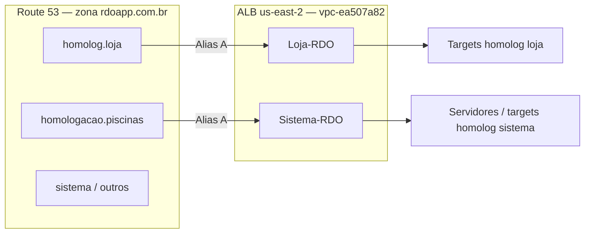
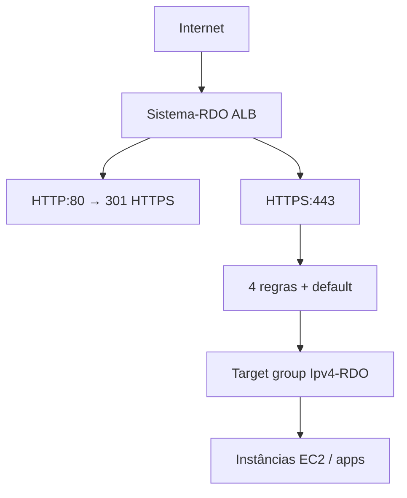

# Documentação técnica — AWS (Route 53 + ALB + RDS) · homolog Equipamentos

**Escopo:** DNS, **Application Load Balancers** e **RDS MySQL** (catálogos) para **Sistema Equipamentos (obras)** e deploy **Migration2Core** em homolog.  
**Conta AWS:** RDOApp · **Região:** us-east-2 (Ohio) · **Route 53:** global.  
**Evidência console:** 2026-10-17 (Route 53, ALB **Sistema-RDO** / **Loja-RDO**, testes browser).

---

## 1. Visão geral



- **Subdomínios não são listados em um menu único** — ficam como **registros** dentro da **zona hospedada** `rdoapp.com.br`.
- Padrão usado pela RDO App para homolog web: **`homolog.<serviço>.rdoapp.com.br`** (ex.: `homolog.loja`).
- Homolog **web do sistema (legado)** hoje usa outro nome histórico: **`homologacao.piscinas.rdoapp.com.br`** (mesmo stack obras/equipamentos, nome “piscinas” legado).

---

## 2. Zonas hospedadas na conta (inventário)

| Zona | Tipo | Registros (approx.) | Uso migração |
|------|------|---------------------|--------------|
| **rdoapp.com.br** | Pública | 35 | **Principal** — sistema, homolog, loja |
| livrodeordem.com.br | Pública | 5 | Fora do escopo |
| relatoriodiariodeobra.com.br | Pública | 5 | Fora do escopo |
| thermopyla.com.br | Pública | 5 | Fora do escopo |

**Caminho console:** Route 53 → **Zonas hospedadas** → clicar **`rdoapp.com.br`** → aba **Registros**.

---

## 3. Registros com `homolog` (filtro Route 53, 2026-10-17)

Total na zona: **35** registros · Filtro **`homolog`:** **3** linhas.

| Nome (FQDN) | Tipo | Alias | Destino (resumo) | Função |
|-------------|------|-------|------------------|--------|
| **homolog.loja.rdoapp.com.br** | A | Sim | ALB `dualstack.loja-rdo-54827259…` | Homolog web **Loja** (referência de padrão DNS) |
| **_7cc3a3fbc8…homolog.loja.rdoapp.com.br** | CNAME | — | Validação ACM (`_0c47b9b5…`) | Certificado TLS homolog.loja |
| **homologacao.piscinas.rdoapp.com.br** | A | Sim | ALB `dualstack.sistema-rdo-67414…` | Homolog web **sistema / obras** (legado) |

### 3.1 O que **não** aparece no filtro

| Nome esperado | Status |
|---------------|--------|
| **homolog.sistema.rdoapp.com.br** | **Ausente** — não há registro na zona (confirmado DNS público + console) |
| **homolog.sistema** (record name) | **Não criado** |

### 3.2 Interpretação para Migration2Core

| Opção | Descrição |
|-------|-----------|
| **A — Reutilizar URL existente** | Publicar/testar em **`https://homologacao.piscinas.rdoapp.com.br`** (ALB **sistema-rdo**), novo path ou site no mesmo ALB — **sem DNS novo** |
| **B — Novo nome alinhado ao padrão** | Criar **`homolog.sistema.rdoapp.com.br`** (Alias A → **mesmo ALB** `sistema-rdo-67414…` que `homologacao.piscinas`) + ACM + listener rule |
| **C — Manter só legado** | Até cutover, só legado nessa URL; Core só localhost (não atende OK na nuvem do Lucio) |

**Recomendação técnica:** homolog **Equipamentos** na nuvem → ALB **`sistema-rdo-*`**, não o **`loja-rdo-*`**. Copiar **tipo Alias A** de `homologacao.piscinas` ou `homolog.loja`, trocando apenas o **record name** se optar por **B**.

---

## 3.3 Filtro **`sistema`** (Route 53 — mesma zona)

O filtro da console busca **`sistema` no nome do registro e/ou no destino Alias** (por isso **`homologacao.piscinas`** aparece: o ALB contém **`sistema-rdo-67414`**). Registros só com **`homolog.loja`** continuam no filtro **`homolog`**, ALB **`loja-rdo`**.

### O que você deve ver (padrão esperado)

| Registro típico | Aparece no filtro `sistema`? | Papel |
|-----------------|------------------------------|--------|
| **`sistema.rdoapp.com.br`** (nome `sistema`) | **Sim** | **Produção** Equipamentos — Alias A → ALB produção (IPs ex.: `3.151.60.22`, `18.191.114.223`) |
| **`homolog.sistema.rdoapp.com.br`** | Sim (se existir) | **Não existe hoje** |
| **`homologacao.piscinas.rdoapp.com.br`** | **Sim** (filtro casa no **Alias** `sistema-rdo-67414`) | Homolog web obras |
| CNAME `_xxxx.sistema…` (ACM) | Sim (se houver) | Validação certificado TLS de `sistema.rdoapp.com.br` |

### Como ler os dois filtros juntos

```text
Filtro "homolog"  → homolog LOJA + homologacao PISCINAS (homolog obras) + CNAME ACM loja
Filtro "sistema"  → produção sistema.rdoapp.com.br (+ CNAME ACM sistema, se existir)
Filtro "piscinas" → provável: piscinas prod/homolog, homologacao.piscinas, etc.
```

**Conclusão:** homolog **web** do stack obras está no nome **`homologacao.piscinas`**, mas o **ALB** já se chama **`sistema-rdo-*`** — alinhado ao produto Equipamentos, não ao hostname `homolog.sistema`.

### Inventário filtro **`sistema`** (console 2026-10-17 — 6 registros)

Todos são **A · Simples · Alias Sim** → **mesmo ALB:** `dualstack.sistema-rdo-67414…`

| Nome do registro (FQDN) | Função provável |
|-------------------------|-----------------|
| **sistema.rdoapp.com.br** | **Produção** Equipamentos (obras) — URL comercial principal |
| **homologacao.piscinas.rdoapp.com.br** | **Homolog web** obras (legado) — banco homolog |
| **piscinas.rdoapp.com.br** | Host legado / vertical nome “piscinas” (mesmo ALB) |
| **app.rdoapp.com.br** | App / entrada alternativa (mesmo ALB) |
| **fapesc.rdoapp.com.br** | Host PoC / FAPESC ou demo (mesmo ALB) |
| **hm.rdoapp.com.br** | Atalho **homolog** (mesmo ALB **sistema-rdo**); **502** em 2026-10-17 — ver §3.4 |

**`homolog.sistema.rdoapp.com.br`** — **não** está na lista (continua inexistente).

### O que isso significa (roteamento)

```text
                    ┌─────────────────────────────────────┐
   Route 53         │  ALB dualstack.sistema-rdo-67414…   │
   (6 hostnames) ──►│  (um balanceador, vários Host:)     │
                    └──────────────┬──────────────────────┘
                                   │
                    Listener HTTPS — regras por Host header
                    (nginx/IIS/Kestrel atrás dos target groups)
```

- **DNS não separa prod vs homolog** — separa só **nome**; **prod e homolog compartilham o mesmo ALB**.
- Quem decide o ambiente é **certificado + regra de host** no ALB e **vhost** no servidor (e **connection string** do app: prod vs catálogo homolog).
- **Migration2Core homolog:** publicar atrás deste ALB com **novo Host** (ex. criar `homolog.sistema` **ou** path em `homologacao.piscinas` / `hm`) — **não** usar ALB `loja-rdo-54827259…`.

### 3.4 Teste browser (2026-10-17)

| URL | Resultado | Interpretação |
|-----|-----------|---------------|
| **https://sistema.rdoapp.com.br/** | **OK** → `/login` “RDO App” | Prod **Equipamentos** no ALB **sistema-rdo** |
| **https://hm.rdoapp.com.br/** | **502 Bad Gateway** | DNS/ALB ok; **backend ou regra Host** para `hm` sem target saudável |
| **https://homologacao.piscinas.rdoapp.com.br/** | **502 Bad Gateway** | Idem — **homolog web** provavelmente **parado** no target group |

**502** = load balancer responde, **instância/app atrás não** (serviço off, target unhealthy, ou `server_name` sem upstream).

### 3.5 `hm` — piscinas ou equipamentos?

| Evidência | Conclusão |
|-----------|-----------|
| Regra ALB **2** e **3** | **`hm`** e **`homologacao.piscinas`** → **`tg-equipamentos`** (homolog **Equipamentos/obras**) |
| Regra ALB **1** | **`piscinas.rdoapp.com.br`** → **`tg-piscinas`** (stack distinto) |
| Regra **padrão** | **`sistema.rdoapp.com.br`** → **`Ipv4-RDO`** (prod) |

**Resposta curta:** **`hm` é homolog equipamentos** (mesmo TG que `homologacao.piscinas`), **não** `tg-piscinas`.

### Próxima checagem infra (com SSM ou console EC2)

1. **EC2 → Load Balancers** → abrir **`sistema-rdo-67414…`** → aba **Listeners** → regras por **host**.  
2. Abrir no browser: `https://homologacao.piscinas.rdoapp.com.br`, `https://hm.rdoapp.com.br`, `https://sistema.rdoapp.com.br` — anotar qual é legado homolog vs prod.  
3. Decidir URL do OK Migration2Core: reutilizar **`homologacao.piscinas`** / **`hm`** ou **criar** `homolog.sistema` (Alias → **mesmo** ALB).

---

## 4. Produção vs homolog (DNS)

| Host (web) | Papel | ALB (homolog / prod) |
|------------|--------|------------------------|
| **sistema.rdoapp.com.br** | Produção Equipamentos | **sistema-rdo-67414…** (mesmo ALB que homolog abaixo) |
| **homologacao.piscinas.rdoapp.com.br** | Homolog web obras | **sistema-rdo-67414…** |
| **hm.rdoapp.com.br** | Possível atalho homolog | **sistema-rdo-67414…** |
| **homolog.loja.rdoapp.com.br** | Homolog Loja | **loja-rdo-54827259…** (ALB **diferente**) |

**Banco homolog** é **independente** do hostname — vários hosts podem apontar para apps que usam o mesmo catálogo (política **A** no plano de migração). Inventário completo dos schemas na instância RDS: **§8.1**.

---

## 5. Como listar todos os subdomínios

1. Route 53 → **Zonas hospedadas** → **rdoapp.com.br**.  
2. Aba **Registros** — lista completa (35).  
3. Filtros úteis:

| Filtro | Encontra |
|--------|----------|
| `homolog` | Homolog loja + homologacao.piscinas + CNAME ACM |
| `sistema` | Produção e possíveis variantes |
| `piscinas` | Legado naming |
| `loja` | Loja prod/homolog |

4. **Export:** botão **Importar/Exportar** → exportar arquivo de zona (backup antes de editar).

---

## 6. Criar `homolog.sistema.rdoapp.com.br` (procedimento)

**Pré-requisito:** decidir opção **A** ou **B** (§3.2). Se **B**:

1. **Criar registro** (Criar registro).  
2. **Nome do registro:** `homolog.sistema`  
3. **Tipo:** **A**  
4. **Alias:** **Sim**  
5. **Tráfego para:** Application Load Balancer → região **us-east-2** → selecionar o **mesmo ALB** que **`homologacao.piscinas.rdoapp.com.br`** (`sistema-rdo-67414…`).  
6. **Política de roteamento:** Simples.  
7. Salvar.

**TLS:** solicitar certificado ACM para `homolog.sistema.rdoapp.com.br` (região do ALB). Route 53 pode criar CNAME de validação automático (como em `_7cc3…homolog.loja`).

**ALB / EC2:** adicionar **regra de host** no listener HTTPS (443) → target group do app **RdoApp.Core** ou path `/` para site homolog.

Verificação:

```powershell
nslookup homolog.sistema.rdoapp.com.br
```

---

## 7. Application Load Balancers (EC2 → Load balancers)

**Caminho console:** EC2 → **Load balancers** · região **us-east-2**.

### 7.1 Inventário (2026-10-17)

| Nome | Estado | Tipo | Esquema | VPC | AZs |
|------|--------|------|---------|-----|-----|
| **Sistema-RDO** | Ativo | application | Internet-facing | `vpc-ea507a82` | 2 |
| **Loja-RDO** | Ativo | application | Internet-facing | `vpc-ea507a82` | 2 |

- **Equipamentos / Migration2Core homolog** → ALB **Sistema-RDO** apenas.  
- **Loja-RDO** → tráfego Loja (`homolog.loja` no Route 53 aponta para ALB **Loja-RDO**, não documentado em detalhe aqui).

### 7.2 Sistema-RDO — identificação

| Campo | Valor |
|-------|--------|
| **Nome** | Sistema-RDO |
| **DNS AWS** | `Sistema-RDO-674143510.us-east-2.elb.amazonaws.com` |
| **Alias Route 53 (console)** | `dualstack.sistema-rdo-67414…` |
| **ARN** | `arn:aws:elasticloadbalancing:us-east-2:775387704919:loadbalancer/app/Sistema-RDO/f52257982e76a385` |
| **Hosted zone ID (Alias)** | `Z3AADJGX6KTTL2` |
| **Criação** | 21/10/2018 |
| **Subnets** | `us-east-2a` → `subnet-c1a2ffa9` · `us-east-2c` → `subnet-513cce1d` |

**Correlação Route 53:** todos os hosts §3.3 (`sistema`, `homologacao.piscinas`, `hm`, `piscinas`, `app`, `fapesc`) → Alias A → este ALB.

### 7.3 Sistema-RDO — receptores (listeners)

| Protocolo:porta | Ação padrão | Regras | TLS |
|-----------------|-------------|--------|-----|
| **HTTPS:443** | Encaminhar para target group **`Ipv4-RDO`** (100%) | **4 regras** (detalhar na console — ver §7.5) | Certificado **`rdoapp.com.br`** · política `ELBSecurityPolicy-2016-08` |
| **HTTP:80** | Redirecionar → **HTTPS:443** (301) | **1 regra** | — |



### 7.4 Diagnóstico **502** (hm / homologacao.piscinas vs sistema OK)

| Observação | Implicação |
|------------|------------|
| **`sistema.rdoapp.com.br`** responde (login RDO App) | ALB, certificado e target group **`Ipv4-RDO`** **funcionam** para o fluxo prod |
| **`hm`** e **`homologacao.piscinas`** → **502 Bad Gateway** | Tráfego chega ao ALB; falha **depois** — tipicamente **nginx/IIS** no target (`server_name` sem upstream), **app homolog parado**, ou **regra listener** (uma das 4) apontando para TG vazio/unhealthy |

**Hipóteses (confirmar na console):**

1. Abrir **HTTPS:443** → **Ver regras** → listar condições **Host header** e target group de cada regra.  
2. **EC2 → Target groups → Ipv4-RDO** → aba **Targets** → status **healthy/unhealthy**.  
3. No servidor (SSM): configs `server_name` para `homologacao.piscinas`, `hm`, `sistema`.

### 7.5 Regras HTTPS:443 (documentado 2026-10-17)

**Listener ARN:** `arn:aws:elasticloadbalancing:us-east-2:775387704919:listener/app/Sistema-RDO/f52257982e76a385/6eeeb0f73dc55fd0`  
**Certificado default:** `rdoapp.com.br` (ID `469c1581-d55a-4142-a3ac-274c48750401`)

| Prioridade | Tag / nome | Host header | Target group |
|------------|------------|-------------|--------------|
| **1** | `piscinas.rdoapp` | `piscinas.rdoapp.com.br` | **`tg-piscinas`** |
| **2** | `hm.rdoapp.com.br` | `hm.rdoapp.com.br` | **`tg-equipamentos`** |
| **3** | — | `homologacao.piscinas.rdoapp.com.br` | **`tg-equipamentos`** |
| **Última (padrão)** | Padrão | (demais hosts, ex. `sistema.rdoapp.com.br`) | **`Ipv4-RDO`** |

**Conclusão ALB:**

- **`hm`** e **`homologacao.piscinas`** → **mesmo** target group **`tg-equipamentos`** (homolog **Equipamentos/obras**).  
- **`piscinas.rdoapp.com.br`** (sem `homologacao.`) → **`tg-piscinas`** (outro backend).  
- **502** em `hm` e `homologacao.piscinas` → investigar **`tg-equipamentos`** (targets unhealthy / app off), **não** DNS nem regra errada entre os dois.  
- **Prod** `sistema.rdoapp.com.br` → regra **padrão** → **`Ipv4-RDO`**.

### 7.6 URL homolog Equipamentos — decisão de nomenclatura (Lucio)

**Objetivo:** não misturar **Piscinas** com **Equipamentos** na URL de homolog do sistema obras / Migration2Core.

| URL | Target group | Uso recomendado |
|-----|--------------|-----------------|
| **`homolog.sistema.rdoapp.com.br`** | **`tg-equipamentos`** (após criar) | **Canônica Equipamentos homolog** — criar do zero |
| **`hm.rdoapp.com.br`** | `tg-equipamentos` | **Descontinuar** após migrar para `homolog.sistema` (ver §7.8) |
| **`homologacao.piscinas.rdoapp.com.br`** | `tg-equipamentos` | Legado / nome piscinas — **não** usar para Migration2Core |
| **`piscinas.rdoapp.com.br`** | `tg-piscinas` | Vertical piscinas — **separado** |
| **`sistema.rdoapp.com.br`** | `Ipv4-RDO` (padrão) | **Produção** |

### 7.7 Criar `homolog.sistema` (recomendado vs “renomear” `hm`)

**Não existe “renomear” DNS/ALB em um clique** — são dois hostnames. Caminho limpo:

1. **Route 53** — Criar registro **`homolog.sistema`** · A · Alias → ALB **Sistema-RDO** (igual `hm`).
2. **ALB** — Nova regra HTTPS:443 · Host = **`homolog.sistema.rdoapp.com.br`** → **`tg-equipamentos`** (mesma ação que regra 2/3).
3. **ACM** — Incluir **`homolog.sistema.rdoapp.com.br`** no certificado do listener (ou wildcard `*.rdoapp.com.br` se já existir).
4. **Servidor** — `server_name homolog.sistema.rdoapp.com.br` no nginx/IIS (ou reutilizar bloco de `hm` / homolog equipamentos).
5. **Corrigir** targets **`tg-equipamentos`** (502).
6. **Migration2Core** — deploy + E2E na URL nova.

**Por que criar do zero em vez de só renomear `hm`:**

- Mantém **`hm`** funcionando até cutover (zero downtime).
- **`homolog.sistema`** alinha ao padrão **`homolog.loja`** (produto explícito).
- **`homologacao.piscinas`** deixa de ser referência para Equipamentos.

### 7.8 Apagar `hm` (logo após E2E OK)

**Sem uso planejado** após **`homolog.sistema`** — não manter “por precaução”. Apagar **na mesma sessão** após homolog.sistema verde (ALB regra + Route 53 + nginx). Procedimento: [`plano-homolog-sistema-clique-a-clique.md`](plano-homolog-sistema-clique-a-clique.md) **Fase 9**.

**Não** apagar **`homologacao.piscinas`** neste ciclo (legado Piscinas).

### 7.7 Loja-RDO (referência cruzada)

| Campo | Valor conhecido |
|-------|-----------------|
| Nome | Loja-RDO |
| Route 53 | `homolog.loja` → `dualstack.loja-rdo-54827259…` |
| Papel | Homolog/prod **Loja** — **fora** do path Migration2Core Equipamentos |

---

## 8. RDS MySQL (Equipamentos SaaS)

**Região:** us-east-2 · **Engine:** MySQL/MariaDB (porta **3306**).  
**Endpoint (hostname):** `equipamentos.cslrikufb7hm.us-east-2.rds.amazonaws.com`  
**Evidência:** DBeaver + scan `Web.config` na EC2 **(Equipamentos)** — **2026-10-17**.

Sem credenciais neste documento. Acesso: perfil RDS / usuário de aplicação configurado em `Web.config` ou `appsettings.Staging.json` na EC2.

### 8.1 Inventário de catálogos (schemas)

Lista **completa** visível no DBeaver na instância acima (**18** entradas na árvore):

| Catálogo | Tipo / uso (inferido) | Evidência / notas |
|----------|------------------------|-------------------|
| **`novo_rdoapp`** | **Produção Equipamentos (obras)** | `C:\inetpub\wwwroot\rdoapp\Web.config` |
| **`piscinas_rdoapp`** | **Produção vertical Piscinas** | `C:\inetpub\wwwroot\piscinas\Web.config` |
| **`piscinas_rdoapp_homologa`** | **Homolog vertical Piscinas** (dados ≈ `piscinas_rdoapp`) | `homologacao\piscinas_hm\Web.config` — **não** usar para Migration2Core Equipamentos (confirmado 2026-10-17) |
| **`rdoapp`** | Legado / backup naming | `rdoapp_bkp\Web.config` |
| **`rdoapp_homologa`** | Homolog (variante nome) | Só RDS — **confirmar** se ainda usado por algum site |
| **`homol_rdoapp`** | Homolog (variante nome) | Só RDS — **confirmar** uso ativo |
| **`Piscinas_Homologa`** | Homolog Piscinas (capitalização distinta) | Só RDS — MySQL pode tratar case conforme `lower_case_table_names` |
| **`rdoapp_loja`** | **Loja** produção | Naming padrão Loja |
| **`rdoapp_loja_homologa`** | **Loja** homolog | Naming padrão Loja homolog |
| **`rdoapp_net8_test`** | Testes .NET 8 / migração | Candidato experimental — não substituir prod sem decisão |
| **`RDOApp`** | Legado / genérico | Só RDS — **confirmar** |
| **`GilbertoLegacy`** | Legado / cópia pontual | Só RDS — **confirmar** |
| **`tmp`** | Temporário / utilitário | Evitar como destino de homolog Core |
| **`information_schema`** | Sistema MySQL | — |
| **`mysql`** | Sistema MySQL | — |
| **`performance_schema`** | Sistema MySQL | — |
| **`sys`** | Sistema MySQL | — |
| **`innodb`** | Sistema / interno | Não usar como app database |

### 8.2 Mapa rápido — Equipamentos vs Piscinas vs Loja

```text
Produção obras (Equipamentos)       → novo_rdoapp          (site rdoapp :80)
Homolog Piscinas (IIS piscinas_hm)    → piscinas_rdoapp_homologa   (5081 — stack Piscinas)
Produção Piscinas                     → piscinas_rdoapp
Candidatos homolog Equipamentos (RDS) → homol_rdoapp, rdoapp_homologa (gêmeos), rdoapp_net8_test (reformar)
Loja                                  → rdoapp_loja / rdoapp_loja_homologa
Migration2Core homolog (RdoApp.Core)  → catálogo Equipamentos dedicado (§8.6) — NÃO piscinas_rdoapp_homologa
```

**Importante:** schema parecido com `novo_rdoapp` **≠** conteúdo Equipamentos. `piscinas_rdoapp_homologa` reutiliza o **modelo** de tabelas do sistema obras, mas os **registros** são do produto **Piscinas** (obras tipo CETI/escolas — evidência E2E login 2026-10-17).

### 8.3 Correlation EC2 `Web.config` → catálogo (2026-10-17)

Scan recursivo `Get-ChildItem C:\inetpub\wwwroot -Recurse -Filter Web.config` (regex `database=` — pode incluir artefatos `&quot` em trechos EF):

| Pasta site (EC2) | Catálogo referenciado |
|------------------|------------------------|
| `C:\inetpub\wwwroot\rdoapp` | `novo_rdoapp` |
| `C:\inetpub\wwwroot\homologacao\piscinas_hm` | `piscinas_rdoapp_homologa` (+ refs legadas `piscinas_rdoapp` no mesmo arquivo) |
| `C:\inetpub\wwwroot\piscinas` | `piscinas_rdoapp` |
| `C:\inetpub\wwwroot\EquipoToPiscinas_hm` | `piscinas_rdoapp` |
| `C:\inetpub\wwwroot\rdoapp_bkp` | `rdoapp`, `novo_rdoapp` |

### 8.6 Catálogo Migration2Core Equipamentos — decisão (2026-10-17)

**Por que o Core apontou para `piscinas_rdoapp_homologa`:** connection copiada do site IIS **`piscinas_hm`** (5081) + docs “política A” assumindo homolog obras compartilhado. Esse site é homolog **Piscinas**, não Equipamentos.

**Meta:** um catálogo só para **homolog Equipamentos / .NET 8**, com **schema alinhado a `novo_rdoapp`** e **dados de teste obras** (não CETI/Piscinas).

| Opção | Catálogo | Prós | Contras |
|-------|----------|------|---------|
| **Reformar in-place** | **`homol_rdoapp`** (**adotado**) | 43 obras Equipamentos; schema **47 tbl** = prod (DDL 2026-10-17) | Subset de dados vs prod; gêmeo `rdoapp_homologa` ainda redundante |
| **Sandbox limpo** | **`rdoapp_net8_test`** | Isola Piscinas/prod; nome já sugere .NET 8 | Pode estar vazio — exige carga/schema (dump estrutura + seed) |

**Não usar:** `piscinas_rdoapp_homologa`, `Piscinas_Homologa`, **`novo_rdoapp`** (prod).

**Passos técnicos (ordem):**

1. ~~Escolher catálogo~~ → **`homol_rdoapp`** (fechado 2026-10-17).
2. ~~Equalizar schema~~ → **47 tbl**; script [`rds-equipamentos-governanca-catalogos.md`](rds-equipamentos-governanca-catalogos.md) §3 passo C / `docs/scripts/homol_rdoapp-sync-tables-from-prod.sql`.
3. **Dados:** manter subset homolog (43 obras) — **sem** clone completo de prod sem decisão explícita.
4. **Runtime:** `appsettings.Staging.json` na EC2 (`database=homol_rdoapp`) + `ASPNETCORE_URLS=http://0.0.0.0:5081` + publish Core atualizado.
5. **UI:** branding **Equipamentos** nas views Core — validar pós-deploy.
6. **E2E:** login + `historico_login` + Escolher obra ([`e2e-fase0-checklist.md`](e2e-fase0-checklist.md)).

**Política de dados (substitui A para Core):** escritas no homolog Equipamentos ficam **somente** no catálogo escolhido em §8.6; homolog Piscinas permanece em `piscinas_rdoapp_homologa`.

### 8.4 Outros serviços AWS (resumo)

| Serviço | Para quê |
|---------|----------|
| **Target groups** | **`Ipv4-RDO`**, **`tg-equipamentos`**, **`tg-piscinas`** — saúde dos targets Sistema-RDO |
| **Certificate Manager** | Cert **`rdoapp.com.br`** no listener 443 (SAN/wildcard cobre hosts?) |
| **RDS** | Todos os catálogos §8.1 — **independente** do ALB e do hostname |

---

## 9. Relação com Migration2Core

| Artefato | Repo / path |
|----------|-------------|
| App .NET 8 | `RDO-APP/Migration2Core` → `RdoApp.Core` |
| Plano homolog EC2 | [`homolog-ec2-migration2core-proximo.md`](homolog-ec2-migration2core-proximo.md) |
| Catálogo RDS Equipamentos homolog | §8.6 neste arquivo · [`rds-equipamentos-governanca-catalogos.md`](rds-equipamentos-governanca-catalogos.md) |
| E2E Fase 0 (URL cloud) | [`e2e-fase0-checklist.md`](e2e-fase0-checklist.md) — usar base `https://homologacao.piscinas…` **ou** `https://homolog.sistema…` após criar |

**Critério de aceite (Lucio):** URL HTTPS na nuvem abre login → obra → Cards; DNS documentado neste arquivo.

---

## 10. Histórico de descoberta

| Data | Fato |
|------|------|
| 2026-10-17 | Route 53: 4 zonas; `rdoapp.com.br` 35 registros |
| 2026-10-17 | Filtro `homolog`: 3 registros; **homolog.sistema ausente** |
| 2026-10-17 | Filtro **sistema**: 6 hosts → ALB **Sistema-RDO-674143510** |
| 2026-10-17 | ALB **Sistema-RDO** + **Loja-RDO**, VPC **vpc-ea507a82**, HTTPS → **Ipv4-RDO**, 4 regras |
| 2026-10-17 | Browser: **sistema** OK · **hm** / **homologacao.piscinas** 502 |
| 2026-10-17 | **RDS:** inventário DBeaver (18 catálogos) + scan `Web.config` EC2 — §8 |
| 2026-10-17 | **Confirmado:** `piscinas_rdoapp_homologa` = dados Piscinas; Core Equipamentos → §8.6 |

---

## 11. Manutenção deste documento

Atualizar após: exportar **4 regras HTTPS**, mudança de target group, deploy Migration2Core, ou sanear política TLS `ELBSecurityPolicy-2016-08`. Sem secrets.
