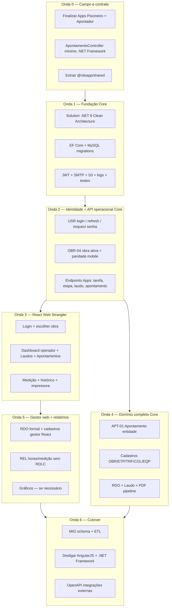

# Estudo — Comparação de planos (Dimas × Lucio/Cursor) e plano unificado

**Autores:** Lucio + Cursor (estudo) · Dimas (backlog PDF 15/07/2026)  
**Branch:** `docs/estudos-lucio-apps-plano-migracao-core`  
**Documentos base:**

| Origem | Arquivo |
|---|---|
| Lucio/Cursor | [plano-trabalho-migracao-rdoapp.md](./plano-trabalho-migracao-rdoapp.md) |
| Lucio/Cursor | [especificacao-app-apontador-dimas.md](./especificacao-app-apontador-dimas.md) |
| Dimas (IA) | `Backlog-Reescrita-RDO-Piscinas.pdf` (64 itens, 7 fases) |

---

# Parte 1 — Comparação entre os dois planos

## 1.1 Resumo executivo

| | Plano Dimas (PDF) | Plano Lucio/Cursor |
|---|---|---|
| **Natureza** | Backlog de **reescrita completa** | Roteiro de **transição incremental** |
| **Escopo declarado** | 64 histórias (50 Must, 14 Should) | 3 blocos: Apps → AngularJS→React → Core |
| **Estimativa** | 240–448 dias úteis (1 dev pleno) | Sem cronograma; priorização por valor |
| **Backend alvo** | .NET 8 Clean Architecture desde o início | .NET Framework convive → Strangler para Core |
| **Frontend alvo** | Angular 18 **ou** React (decisão aberta) | **React** web + React Native mobile |
| **Mobile** | Citado como “app externo” + OpenAPI no fim | **Centro da v1** — Apps Piscineiro e Apontador |
| **Banco** | Schema novo + ETL completo (Fase 6) | MySQL atual; Apontamento novo; tenant/unificação depois |
| **Repo analisado no prompt** | EquipoToPiscina | Equipamentos + EquipoToPiscina + RDOAppPiscinasMobile |

---

## 1.2 Filosofia de entrega

```mermaid
flowchart TB
    subgraph dimas [Plano Dimas — Reescrita]
        D0[Fundação Core completa]
        D1[Cadastros API nova]
        D2[Apontamentos domínio novo]
        D3[RDO + Laudo Core]
        D4[Front novo scaffold]
        D5[ETL + cutover]
        D0 --> D1 --> D2 --> D3 --> D4 --> D5
    end

    subgraph lucio [Plano Lucio — Strangler]
        L0[Apps mobile prontos]
        L1[API mínima Framework se necessário]
        L2[React web rota a rota]
        L3[Core em ondas]
        L4[Desligar AngularJS + Framework]
        L0 --> L1 --> L2 --> L3 --> L4
    end
```

**Dimas:** valor entregue quando o **sistema novo** substitui o legado.  
**Lucio:** valor entregue **continuamente** — mobile → web parcial → Core parcial → cutover.

---

## 1.3 Matriz de alinhamento (concordâncias)

| Tema | Dimas | Lucio | Grau |
|---|---|---|---|
| Apontamento como entidade própria | APT-01 (XL) | Página Apontamentos + upsert | ✅ Total |
| Laudo separado de RDO | LAU-01…05 | laudo-list-screen + LaudoController | ✅ Total |
| User ≠ Colaborador | USR-01, USR-07 | Implícito no mobile/web | ✅ Total |
| EF Core + migrations MySQL 8.4 | FND-02 | Core C2 | ✅ Total |
| JWT no servidor | FND-09 | Core C3 | ✅ Total |
| Arquivos em S3 | FND-11, APT-05 | Não detalhado | ✅ Dimas + |
| PDF sem RDLC legado | RDO-04, REL-02 | Mobile já usa base64 da API | ✅ Total |
| Obras → Etapas → Tarefas | Fase 1 | Etapa trancada mobile + web accordion | ✅ Total |
| Não migrar dados antes de fechar Apontamento | Nota explícita no PDF | Apps validam modelo primeiro | ✅ Total |
| RBAC simplificado vs ACL menu/página | USR-05; ACL fora v1 | Perfil Operador/Diretor | ✅ Total |
| Testes unitários na Application | FND-13, APT-08 | Não detalhado | ✅ Dimas + |
| SMTP esqueci senha | FND-10, USR-04 | Mobile tem recuperar senha | ✅ Total |

---

## 1.4 Matriz de divergência (pontos de conversa)

| # | Tema | Dimas | Lucio | Risco se não alinhar |
|---|---|---|---|---|
| 1 | **Estratégia** | Big bang / reescrita | Strangler Fig | Paralisar operação ou duplicar esforço |
| 2 | **Mobile na v1** | Ausente como fase | Prioridade 1 | Reconstruir telas já prontas |
| 3 | **Front web** | Angular 18 ou React | React (sinergia mobile) | Duas stacks front (RN + Angular) |
| 4 | **Reuso de código** | Scaffold novo FND-12 | `@rdoapp/shared` do mobile | Retrabalho services/DTOs |
| 5 | **Dois produtos** | Sistema único (prompt Piscinas) | Equipamentos + Piscinas + 2 schemas | Backlog incompleto para Apontador |
| 6 | **Licença / perfil comercial** | Fora do escopo v1 | Etapa trancada + `statusBasicaGratuita` | Quebra modelo de negócio mobile |
| 7 | **API durante transição** | Core desde Fase 0 | Framework até ondas Core | Dois backends sem plano de roteamento |
| 8 | **Estimativa** | 240–448 d (1 dev) | Paralelo mobile+Core+web | Expectativa irreal de prazo |
| 9 | **Clean Architecture** | Detalhada (5 camadas) | Esboço leve Core | Core frágil ou over-engineering |
| 10 | **Itens legado temporários** | Efetivo, gráficos, licença loja fora v1 | Manter no Angular até substituir | Funcionalidade perdida na v1 |

---

## 1.5 Cobertura funcional — quem cobre o quê

| Funcionalidade | Dimas (PDF) | Lucio/Cursor | Legado hoje |
|---|---|---|---|
| Login / esqueci senha | USR-02…04 | Mobile + AngularJS | ✅ |
| Escolher obra | OBR-04 | Mobile + AngularJS | ✅ |
| Cards operador (etapa trancada) | — | Spec Apontador + Piscineiro | Parcial mobile |
| Medição colaborador/equipamento | APT-02, APT-03 | add-register-screen | ✅ mobile/web |
| Página Laudos | LAU-05 | laudo-list-screen | ✅ Piscinas |
| Página Apontamentos | APT-01 (domínio) | apontamento-list-screen (spec) | ❌ criar |
| Impressora PDF diário | REL-01 | ReportPrintModal | Web período; mobile parcial |
| RDO formal | RDO-01…04 | Plano bloco 2/3 | ✅ web |
| CRUD Obra/Etapa/Tarefa gestor | Fase 1 | React Fase 2–3 | ✅ AngularJS |
| Gráficos / dashboard | Fora v1 | dashboard-history (mobile) | ✅ AngularJS |
| Efetivo diário | Fora v1 | Plano: manter legado temp. | ✅ AngularJS |
| Relatórios medição/produtividade | REL-03 Should | Fora v1 inicial | ✅ AngularJS |
| ACL Grupo/Menu/Página | Fora v1 | RBAC simplificado | ✅ AngularJS |

---

## 1.6 Fases Dimas × Blocos Lucio

| Fase Dimas | Itens | Bloco Lucio equivalente | Observação |
|---|---|---|---|
| 0 · Fundação | FND-01…14 | Core C1–C3 + infra | Dimas muito mais detalhado |
| 1 · Cadastros | OBR, ETP, TRF, COL, EQP | Angular→React Fase 2–3 | Lucio pode manter API Framework primeiro |
| 2 · Apontamentos | APT-01…08 | Apps A1–A10 + ApontamentoController | **Mesclar** — UX Lucio + domínio Dimas |
| 3 · RDO & Laudo | RDO, LAU | Laudo mobile + RDO web | Alinhados |
| 4 · Identidade | USR-01…07 | Auth mobile + Core JWT | Dimas desacopla User/Colaborador |
| 5 · Relatórios & S3 | REL, S3 | PDF base64 hoje → pipeline Core | Dimas substitui RDLC |
| 6 · Migração | MIG-01…06 | Core C10–C11 | Só após modelo Apontamento fechado |
| **—** | **—** | **Onda 0 Apps mobile** | **Só no plano Lucio** |

---

## 1.7 Veredicto da comparação

| Força do plano Dimas | Força do plano Lucio |
|---|---|
| Arquitetura de destino (.NET 8, DDD, SOLID) | Produto de campo já construído (mobile) |
| Domínio bem cortado (Apontamento, Identity) | Transição sem parar operação (Strangler) |
| Infra completa (JWT, S3, SMTP, auditoria, testes) | Mapa concreto AngularJS → React com reuso |
| ETL e schema pensados desde o início | Modelo comercial (perfil, etapa trancada) |
| Estimativa quantificada por história | Priorização MVP operacional |

**Conclusão:** os planos são **complementares**, não concorrentes. Dimas define **para onde ir**; Lucio define **como chegar sem jogar fora o mobile e o legado**.

---

# Parte 2 — Plano unificado (mescla)

## 2.1 Princípios do plano mesclado

1. **Strangler Fig** — legado convive até paridade mínima por módulo.  
2. **Mobile primeiro valida domínio** — Apontamento/Laudo/RDO operacional testados no campo.  
3. **Core Clean Architecture** — visão Dimas (Domain / Application / Infrastructure / API / Tests).  
4. **Front web React** — shared com mobile (`@rdoapp/shared`); AngularJS desligado por rota.  
5. **Dois produtos, um código mobile** — variant `appPiscinas` / `appApontador`; APIs Equipamentos e Piscinas.  
6. **ETL por último** — só após APT-01 + Apps + API mínima estáveis (regra Dimas).  
7. **Licença/perfil na v1** — Operador Básica vs Diretor; etapa trancada **só no Piscineiro** (`LIMPEZA`). **Apontador: não trancar etapa Equipamentos** (decisão ago/2026).

---

## 2.2 Visão em ondas (sem cronograma)

---

## 2.3 Backlog unificado por onda

### Onda 0 — Campo pronto + contrato API (origem: Lucio + pontos Dimas)

| ID | Entrega | Origem | Objetivo |
|---|---|---|---|
| U-01 | Impressora no TaskCard Piscineiro | Lucio P1–P4 | PDF diário no card; paridade UX web |
| U-02 | UX operador Apontador (cards por equipamento; **sem** trancar etapa) | Lucio A1–A3 revisado | Accordion/todas etapas OK; perfil Operador vs Diretor se necessário |
| U-03 | Página Apontamentos (lista + assinar + PDF) | Lucio A4–A6 | Espelho Laudos; upsert `(obra,tarefa,dia)` |
| U-04 | Impressora Apontador + upsert apontamento | Lucio A7–A8 | Geração diária por equipamento |
| U-05 | `ApontamentoController` no **Framework** (paridade Laudo) | Mescla | Validar API antes do Core |
| U-06 | Pacote `@rdoapp/shared` | Lucio | Services/types mobile → web |
| U-07 | Corrigir `salvarLaudo` → `salvarApontamento` no mobile Equipamentos | Lucio A9 | Bug atual |
| U-08 | Documentar contrato OpenAPI dos endpoints mobile | Dimas MIG-06 antecipado | Contrato vivo para Core |

**Critério de done Onda 0:** operador usa Apps em produção; Apontamento/Laudo/PDF diário funcionando; shared publicado.

---

### Onda 1 — Fundação Core (origem: Dimas FND)

| ID | Entrega | Ref Dimas | Objetivo |
|---|---|---|---|
| U-10 | Solution Clean Architecture | FND-01 | Domain, Application, Infrastructure, API, Tests |
| U-11 | EF Core + MySQL 8.4 migrations | FND-02 | DDL só via migrations |
| U-12 | Bounded contexts DDD | FND-03 | Obras, RH, Apontamentos, RDO, Laudo, Identity |
| U-13 | Repositories + UoW | FND-04 | DIP; Application sem EF |
| U-14 | Logs + auditoria + ProblemDetails | FND-05…07 | Serilog, audit_log, RFC 7807 |
| U-15 | FluentValidation | FND-08 | Regras na Application |
| U-16 | JWT + refresh + hardening | FND-09, FND-14 | Substituir localStorage; Argon2/BCrypt |
| U-17 | SMTP + S3 abstrações | FND-10, FND-11 | IEmailSender, IFileStorage |
| U-18 | Testes unitários Application | FND-13 | xUnit + CI mínimo |
| U-19 | Scaffold React Web (não Angular 18) | FND-12 adaptado | SPA + auth client JWT |

**Decisão mesclada:** **React** (não Angular 18).

---

### Onda 2 — Identidade + API operacional Core (Dimas USR + OBR-04 + paridade mobile)

| ID | Entrega | Ref Dimas | Objetivo |
|---|---|---|---|
| U-20 | User ≠ Colaborador | USR-01, USR-07 | Identity desacoplado |
| U-21 | Login / logout / refresh | USR-02 | Claims: userId, roles, obras |
| U-22 | Troca + esqueci senha | USR-03, USR-04 | Autoatendimento SMTP |
| U-23 | Obra ativa no contexto | OBR-04 | Paridade `/obra/escolher` + mobile |
| U-24 | RBAC por recurso | USR-05 | Substituir ACL granular gradualmente |
| U-25 | Portar endpoints mobile para Core | — | Auth, Obra, Etapa, Tarefa, Laudo, Apontamento |
| U-26 | Licença/perfil comercial | Lucio | `statusBasicaGratuita`, Operador/Diretor |

**Critério de done Onda 2:** mobile e React web podem apontar para Core nos fluxos operacionais (feature flag por endpoint).

---

### Onda 3 — React Web Strangler (origem: Lucio bloco 2)

| ID | Entrega | Substitui AngularJS | Reuso mobile |
|---|---|---|---|
| U-30 | Login + escolher obra | Login, Obra/escolher | authService, obraService |
| U-31 | Dashboard operador (TaskCard) | Tarefa/cards (operador) | taskCard, piscineiro/apontador-screen |
| U-32 | Lista Laudos | — (Piscinas) | laudo-list-screen |
| U-33 | Lista Apontamentos | — (novo) | apontamento-list-screen |
| U-34 | Medição + histórico | Tarefa/cadastro parcial, modal histórico | add-register, history-screen |
| U-35 | Modal impressora | Modal relatório horas | report-print-screen |
| U-36 | Desligar rotas Angular equivalentes | Strangler por rota | — |

---

### Onda 4 — Domínio Core completo (Dimas Fases 1–3)

| ID | Entrega | Ref Dimas | Objetivo |
|---|---|---|---|
| U-40 | CRUD Obra + vínculos | OBR-01…03 | Cadastro gestor |
| U-41 | CRUD Etapa + ordem | ETP-01, ETP-02 | Paridade web gestor |
| U-42 | CRUD Tarefa + auxiliares | TRF-01…03 | Planejamento vs apontamento |
| U-43 | CRUD Colaborador + Equipamento | COL-01, EQP-01 | RH + frota |
| U-44 | **Apontamento entidade** | APT-01 | Quebrar acoplamento legado |
| U-45 | Horas colaborador/equipamento | APT-02, APT-03 | Regras normais/extras/horímetro |
| U-46 | Medição avanço físico + fotos S3 | APT-04, APT-05 | Histórico + imagens |
| U-47 | Indicadores piscina | APT-06 | Alimentam laudo |
| U-48 | RDO diário + assinatura + PDF | RDO-01…04 | Documento formal |
| U-49 | Laudo CRUD + PDF | LAU-01…04 | Paridade Piscinas |
| U-50 | Testes cálculo horas | APT-08 | Edge cases críticos |

---

### Onda 5 — Gestor web + relatórios (Dimas REL + Lucio bloco 2 restante)

| ID | Entrega | Ref Dimas | Objetivo |
|---|---|---|---|
| U-51 | RDO lista/cadastro React | RDO + Lucio | Gestor escritório |
| U-52 | Tarefa accordion + cadastro gestor | TRF + Lucio | Substituir Tarefa/index e cadastro |
| U-53 | CRUD cadastros admin React | OBR, COL, EQP, EMP | Obra, colaborador, equipamento, empresa |
| U-54 | Pipeline PDF/Excel | REL-02 | Substituir RDLC (QuestPDF/similar) |
| U-55 | Relatório controle horas | REL-01 | Período gestor; diário operador |
| U-56 | Gráficos (opcional) | Fora v1 Dimas | Recharts; priorizar se cliente exigir |
| U-57 | Efetivo diário (opcional) | Fora v1 Dimas | Manter Angular até demanda |

---

### Onda 6 — Migração e cutover (Dimas MIG)

| ID | Entrega | Ref Dimas | Objetivo |
|---|---|---|---|
| U-60 | Matriz legado → novo schema | MIG-01 | Migrar vs reinserir por tabela |
| U-61 | ETL cadastros | MIG-02 | Obras, etapas, tarefas, colab, equip |
| U-62 | ETL apontamentos + RDO + laudos | MIG-03 | **Só após U-44 + Onda 0 validada** |
| U-63 | ETL usuários Identity | MIG-04 | Reset senha obrigatório |
| U-64 | Homolog + cutover | MIG-05 | Checklist paridade |
| U-65 | OpenAPI integrações | MIG-06 | Apps e terceiros |
| U-66 | Desligar AngularJS + Framework | Lucio C11 | Remover `Client/` legado |

---

## 2.4 Mapa de origem — item unificado ← de onde veio

| Fonte | Contribuição no plano unificado |
|---|---|
| **Dimas FND** | Onda 1 inteira (infra Core) |
| **Dimas APT** | Onda 0 (API mínima) + Onda 4 (domínio) |
| **Dimas RDO/LAU** | Onda 4 |
| **Dimas USR** | Onda 2 |
| **Dimas MIG** | Onda 6 |
| **Lucio Apps** | Onda 0 (prioridade máxima) |
| **Lucio Strangler** | Onda 3 + desligamento Onda 6 |
| **Lucio @rdoapp/shared** | Onda 0 + Onda 3 |
| **Lucio perfil/etapa trancada** | Onda 0 + U-26 |

---

## 2.5 Fora do escopo v1 unificado (acordo Dimas + Lucio)

| Item | Tratamento |
|---|---|
| ACL menu/página/ação granular | RBAC simples (USR-05); legado temporário |
| Licença / loja WSAssinatura | Manter legado; revisar modelo comercial depois |
| Gráficos Highcharts completos | Mobile dashboard básico; web gráficos Onda 5 opcional |
| Acidentes / improdutividade avançada | Legado ou incremento RDO posterior |
| Login por CPF colaborador | Vínculo opcional User→Colaborador (USR-07) |
| Efetivo diário | Legado Angular até demanda explícita |
| Big bang cutover | **Proibido** — só Strangler por onda |

---

## 2.6 Decisões fechadas no plano mesclado

| Decisão | Valor |
|---|---|
| Estratégia | **Strangler Fig** (não big bang) |
| Front web | **React** + TypeScript |
| Mobile | **React Native** existente; variant Piscineiro/Apontador |
| Shared | **`@rdoapp/shared`** entre mobile e web |
| Backend transição | Framework API mínima → Core por endpoint |
| Apontamento | Entidade Core (Dimas) + UX mobile/web (Lucio) **juntos na Onda 0** |
| ETL | **Onda 6** — após modelo Apontamento fechado |
| Auth | **JWT** Core; eliminar hash legado no cutover |
| Arquivos | **S3**; migrar `/uploads` na Onda 5–6 |
| PDF | Pipeline sem RDLC; base64 compatível com mobile |

---

## 2.7 Decisões ainda em aberto (reunião Dimas + Lucio)

> **Atualização ago/2026:** Dimas enviou `Backlog_RDO v20260818.pdf` (56 TSK, 346h, 17 sem). Cruzamento completo em [comparativo-dimas-v20260818.md](./comparativo-dimas-v20260818.md).

1. Quantidade de devs e o que é **MVP operacional** vs **MVP gestor**.  
2. Unificação de schema Equipamentos + Piscinas vs **dois schemas + tenant** (Cenário A vs B).  
3. Quais endpoints mobile migram para Core **primeiro** (lista prioritária).  
4. Licença comercial: portar conceito legado ou redesenhar na v1.  
5. Homolog AWS: quando subir `hml.*.rdoapp.com.br` para Core + React.

---

## 2.8 Referências cruzadas

| Documento | Uso |
|---|---|
| [README.md](./README.md) | Índice do estudo |
| [especificacao-app-apontador-dimas.md](./especificacao-app-apontador-dimas.md) | Detalhe Onda 0 Apontador |
| [plano-trabalho-migracao-rdoapp.md](./plano-trabalho-migracao-rdoapp.md) | Detalhe Strangler + Angular |
| `Backlog-Reescrita-RDO-Piscinas.pdf` | Detalhe histórias FND…MIG |

---

*Estudo gerado para alinhamento Dimas × Lucio — jul/2026.*
