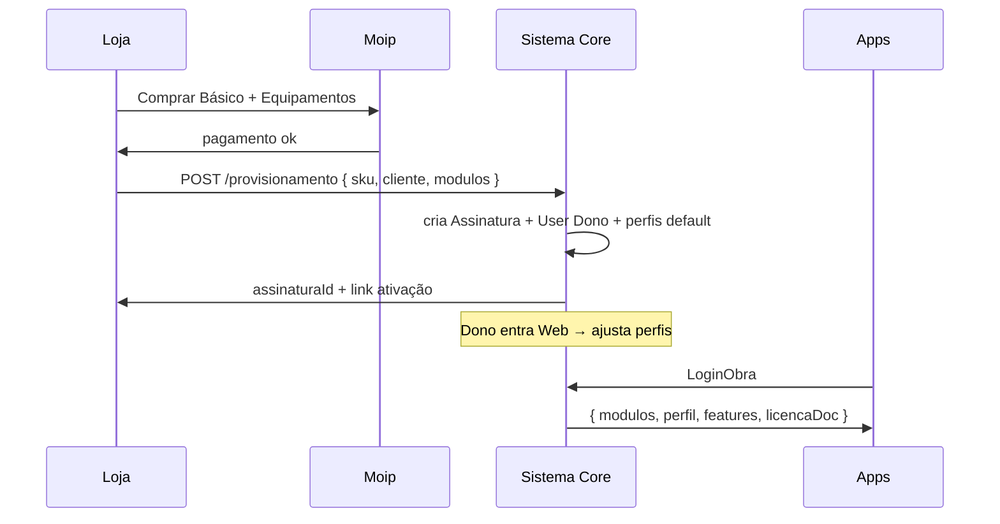

# Proposta — Loja × Sistema × Planos × Perfis (Dono da Assinatura)

**Status:** proposta para alinhamento Dimas + Lucio — **não incluída** no backlog TSK, Ondas U nem código  
**Data:** set/2026  
**Relacionado:** [storytelling-unificado-dimas-migracao-fapesc.md](./storytelling-unificado-dimas-migracao-fapesc.md) · [ponte Loja×Sistema](../ponte-loja-sistema-assinatura.md) · U-26 (lacuna hoje)

---

## 1. Lacuna identificada

Hoje o storytelling fala em **Gratuito / Básico / Equipamentos** e **dono da assinatura**, mas **não amarra**:

| Camada | O que existe hoje | Problema |
|--------|-------------------|----------|
| **Loja** | Página preços → Gratuito / Básico / Equipamentos (404) · Moip · `ServicoLoja` JSON frágil | Compra **não** provisiona perfis no Sistema de forma clara |
| **Sistema (web)** | ACL legado · grupos · `statusBasicaGratuita` na obra | Plano comercial **colado** na obra, não na assinatura |
| **Mobile** | `statusBasicaGratuita` + `contratanteContratada` → dashboard | **Ignora** `routes/permissions` do login |
| **Assinatura laudo** | `idLicenca` 1/2 | Só fluxo **documental** — confundido com “dono da loja” |

**Risco:** reescrever Core (TSK-12 RBAC) **sem** modelar Loja → Sistema → App = repetir ACL legado + strings mágicas (`"Piscineiro (Básica)"`).

---

## 2. Tese — três camadas comerciais

```
┌─────────────────────────────────────────────────────────────────┐
│  LOJA (comercial)                                                │
│  SKU: Gratuito | Básico | +Módulo Equipamentos | +Módulo Piscinas│
│  Dono da Assinatura = cliente PF/PJ que comprou (tenant admin)   │
└────────────────────────────┬────────────────────────────────────┘
                             │ provisiona (webhook / job)
                             ▼
┌─────────────────────────────────────────────────────────────────┐
│  SISTEMA (runtime)                                               │
│  Assinatura · Módulos ativos · Obras · Colaboradores · Perfis    │
│  Dono configura PERFIS DE ACESSO (templates + overrides por obra)│
└────────────────────────────┬────────────────────────────────────┘
                             │ LoginObra / JWT claims
                             ▼
┌─────────────────────────────────────────────────────────────────┐
│  APPS (Apontador · Piscineiro · Web operador)                    │
│  Renderizam só o que `features[]` + `modulos[]` permitirem       │
└─────────────────────────────────────────────────────────────────┘
```

**Regra:** Loja vende **módulos e limites**; Sistema aplica **perfis**; Apps **obedecem** API — não decidem plano sozinhos.

---

## 3. Catálogo comercial (Loja)

| Plano Loja | Preço | Módulos incluídos | Limites típicos (exemplo) |
|------------|-------|-------------------|---------------------------|
| **Gratuito** | R$ 0 | RDO básico **ou** trial | 1 obra · 2 usuários · sem PDF premium |
| **Básico** | Moip mensal | RDO + 1 vertical (Piscinas **ou** Equipamentos leve) | N obras · perfis padrão |
| **Equipamentos** | Add-on ou plano | Módulo **Controle de Equipamentos** + Apontador | Horímetro, paralisação, apontamento, PDF equip. |
| **Piscinas** | Add-on ou plano | Módulo **Piscinas** + Piscineiro | Química, laudo, LIMPEZA |
| **Completo** | Enterprise | Todos módulos | Custom |

> **Nota:** “Comprar Equipamentos” na loja hoje (404) vira **SKU** com provisionamento explícito — não só redirect quebrado.

---

## 4. Dono da Assinatura — quem é e o que faz

### 4.1 Definição

| Termo | Significado |
|-------|-------------|
| **Dono da Assinatura** | Usuário **User** vinculado à **Assinatura** (conta comercial Loja) — admin do tenant |
| **Dono da Obra** (`idDono`) | Entidade jurídica/física na obra — pode ser ≠ dono assinatura (ex.: prefeitura) |
| **Licença documental** (`idLicenca` 1/2) | Papel na **assinatura de laudo/apontamento** — mantém regra atual |

**Dono da Assinatura** configura **perfis de acesso** — não confundir com `idLicenca` de laudo.

### 4.2 O que o Dono configura (painel Web — futuro)

Tela: **Assinatura → Perfis de acesso** (só Dono ou delegado `admin-assinatura`)

Por **perfil template** (ex.: Operador Apontador, Encarregado, Fiscal Contratante):

| Configurável | Exemplo |
|--------------|---------|
| Nome do perfil | "Apontador de campo" |
| App permitido | Apontador / Piscineiro / Web / nenhum |
| Módulos | Equipamentos ✓ · Piscinas ✗ |
| Features | medição ✓ · criar obra ✗ · assinar ✗ · PDF ✓ |
| Etapas visíveis | todas **ou** lista (opcional — Apontador: todas por decisão ago/2026) |
| Cards customizados | layout card obra/tarefa (variante UI) |
| Obras | perfil global ou override por obra |

**Defaults por plano:** ao comprar **Básico + Equipamentos**, Loja provisiona templates **pré-montados**; Dono **ajusta** (não parte do zero).

---

## 5. Fluxo Loja → Sistema (provisionamento)



**Substituir:** `ServicoLoja` JSON frágil → **contrato versionado** (`ProvisionamentoV1`) + fila + idempotência.

---

## 6. Matriz Plano × Módulo × Perfil (defaults — Dono pode restringir, não expandir além do plano)

| Plano | Módulo Equip. | Módulo Piscinas | Perfis default | Apps |
|-------|---------------|-----------------|----------------|------|
| Gratuito | trial limitado | trial limitado | Operador trial | Apontador ou Piscineiro |
| Básico | — | ✓ **ou** — | Piscineiro / Diretor básico | 1 vertical |
| Básico + Equip. | ✓ | — | Apontador / Encarregado | Apontador |
| Completo | ✓ | ✓ | Todos templates | Ambos APKs |

**Teto:** colaborador **nunca** recebe feature que o **plano da assinatura** não comprou — Dono só reparte o que já pagou.

---

## 7. O que muda no mobile/web (contrato API — futuro)

### LoginObra / sessão — payload proposto

```json
{
  "assinaturaId": "uuid",
  "plano": "basico+equipamentos",
  "modulos": ["equipamentos", "rdo"],
  "perfil": "apontador_campo",
  "features": ["medicao", "historico", "pdf_equipamento"],
  "licencaDocumental": 2,
  "ui": { "dashboard": "normal", "cardObraVariant": "contratada" }
}
```

**Mobile deixa de** inferir tudo de `statusBasicaGratuita` string — usa **features** + fallback legado durante transição.

---

## 8. Onde entra no roadmap (referência — não comprometido)

| Onda | Item sugerido | Relação Dimas |
|------|---------------|---------------|
| **Pré-Onda 0** | Contrato Loja↔Sistema + SKU Equipamentos 404 | Fora TSK |
| **Onda 1–2** | Entidades `Assinatura`, `Modulo`, `PerfilTemplate` no Core | Estende TSK-03, TSK-12 |
| **Onda 2** | **U-26b** Painel Dono — perfis de acesso | **Novo** — não está no PDF Dimas |
| **Onda 2** | LoginObra retorna `features[]` | TSK-12 + U-25 |
| **Onda 3** | Apps consomem features | Onda 0 mobile |

**TSK Dimas sozinho:** cobre RBAC genérico — **não** cobre Loja nem “Dono configura perfil”.

---

## 9. Escopo explícito — o que NÃO é Dono Assinatura

| Funcionalidade | Governado por |
|----------------|---------------|
| Assinar laudo/apontamento (ordem contratada→contratante) | **Licença documental** (`idLicenca`) — inalterado |
| FAPESC imutabilidade / hash | Módulo separado — evento pós-assinatura |
| Criar obra/etapa/tarefa | **Feature** `estrutura_obra` — default **off** para operador |
| Preço / cobrança / NF | **Loja + Moip** — Sistema só lê status assinatura |
| ACL menu Angular legado | **Desligar** via Strangler — não portar 1:1 |

---

## 10. Estado atual — respostas com o que temos hoje

**Fontes:** `RDOApp/rdoappProject` (`LoginModel`, `ObraModel`, `GrupoModel`, `LicencaModel`) · Loja `loja.rdoapp.com.br` · `EquipamentosMobile` (`unit-dashboard.tsx`).  
**Atualizado:** set/2026.

### 10.1 Assinatura = 1 por CNPJ ou 1 por obra?

**Hoje: 1 assinatura por CNPJ/empresa → N obras.**

- Loja (`ServicoLoja`) cria `empresa` com CNPJ + `emp_id_token` (Moip) + `emp_id_licenca`.
- Cada `obra.obr_id_dono` aponta para a **empresa** dona da licença.
- `VerificarLicenca(token)` consulta a Loja (`WSAssinatura`) — status ATIVA ou não.
- `ObraModel.PermissaoLicenca` limita **quantidade de obras** por empresa (`lic_nr_qtd_obras`).

**Não existe** assinatura por obra. Várias obras compartilham o mesmo token Moip.

**Para o futuro:** manter modelo CNPJ; melhorar provisionamento e visibilidade para o dono.

---

### 10.2 Gratuito provisiona o quê?

**Hoje: row `licenca` no banco (nome `"gratuita"`) + grupos fixos — não um módulo SKU explícito.**

| Campo `licenca` | Enforçado no código? |
|----------------|---------------------|
| `lic_nr_qtd_obras` | ✅ ao criar obra |
| `lic_qtd_tarefas_obra` | ✅ |
| `lic_qtd_imagens_tarefas` | ✅ |
| `lic_st_permite_logo_rdo` | ✅ em PDF |
| `lic_nr_qtd_usuarios` | ❌ gravado, não validado |

- Loja envia `tipoLicenca` → casa com `licenca.lic_ds_licenca`.
- Grupos disponíveis: `GrupoModel.ListaPeloGrupo` filtra por licença da empresa + contratante/contratada.
- Nomes conhecidos: `"Piscineiro (Básica)"`, `"Diretor Contratada (Básica)"`, etc.
- Web: se `descricaoLicenca != 'basica'` → trata como `'gratuita'` (`ObraController.js`).

**Vertical (Piscinas vs Equipamentos)** vem do **grupo na obra**, não de SKU “Gratuito = Equipamentos” na Loja.

**Em aberto (produto):** Gratuito trial de qual vertical — não está codificado.

---

### 10.3 Dono cria perfis custom ou só templates fixos?

**Hoje: só templates fixos (`grupo`); custom = admin plataforma RDO, não o cliente.**

| Quem | O que pode |
|------|------------|
| Cliente Loja (dono empresa) | Escolher grupo da lista ao vincular colaborador |
| Criador da obra | Auto-atribuído grupo “Diretor” (`gru_st_diretor == 1`) |
| Dono assinatura configurando perfis | **Não existe** |
| `col_st_admin == true` | CRUD Grupo/Página/Menu — **admin RDO**, não tenant |

**Conclusão:** cliente **não** monta perfil com features — escolhe entre grupos **pré-cadastrados**.

**Para o futuro:** painel Dono (proposta §4.2) — **novo**, fora do TSK Dimas.

---

### 10.4 “Comprar Equipamentos” na Loja = o quê?

**Hoje: nada implementado na Loja (404); no backend não há plano “Equipamentos”.**

| Existe | Não existe |
|--------|------------|
| Módulo equipamentos (CRUD, horímetro, relatórios) | SKU / `tipoLicenca` “equipamentos” |
| Acesso via **ACL do grupo** (páginas) | Upgrade automático Loja → Sistema |

Integração Loja genérica: `tipoLicenca` string → row `licenca`. **Equipamentos** = funcionalidade liberada por **grupo/permissões**, não produto comprado.

**Comercial (docs):** “Módulo Equipamentos” como SKU — **ainda não wired**.

**Para o futuro:** upgrade de assinatura (recomendado) vs obra avulsa — **decisão comercial pendente**.

---

### 10.5 `statusBasicaGratuita` — quando aposentar?

**Hoje: campo ativo e crítico — não dá aposentar sem substituto.**

| Onde | Uso |
|------|-----|
| API | `grupo.gru_nm_nome` → `StatusBasicaGratuita` na obra |
| Web | Exibido ao escolher obra |
| Mobile | Roteamento dashboard — ex.: `"Piscineiro (Básica)"` + contratada → cards; senão → NormalDashboard |
| LoginObra | Deriva `tipoLicencaColaboradorGrupo`: contém `"basica"` → `"basica"`, senão `"gratuita"` |

Mobile **ignora** `routes/permissions` do login — depende da string.

**Prazo de convivência:** **não definido** — substituir quando LoginObra retornar `modulos + features[]` (0% feito hoje).

---

### 10.6 Painel Dono — Core React ou CMS legado?

**Hoje: fragmentado; “Dono configura perfis” não existe.**

| Papel | Onde administra |
|-------|-----------------|
| Cobrança / Moip / NF | **Loja** |
| Status assinatura | Sistema lê API Loja |
| Limites obra/tarefa/foto | Sistema (`licenca`) |
| ACL páginas/menus | **CMS Sistema** — só `col_st_admin` |
| Grupos para clientes | Lista fixa; cadastro = admin RDO |
| Cliente pós-compra | Login web — **sem** “minha assinatura / meus perfis” |

Dono Loja (`empresa.idColaborador`) = usuário comum — **sem** UI de configurar perfis.

**Para o futuro:** painel Dono no **Core React** (Onda 2) — **não** estender CMS legado.

---

### 10.7 Diagrama — Loja × Sistema × Apps (como está)

```
LOJA (Moip, tipoLicenca string)
    → cria empresa + token + licenca row
SISTEMA
    → limites numéricos (obras, tarefas, fotos)
    → grupos FIXOS (ACL páginas)
    → obra.statusBasicaGratuita = nome do grupo
APPS
    → leem statusBasicaGratuita (string) para UI
    → idLicenca 1/2 só para assinar laudo
```

**Gaps vs proposta §2–4:** SKU Equipamentos · Dono tenant configura perfis · `features[]` no login.

---

## 11. Ainda em aberto com Dimas (decisão de produto)

Itens que o **código não responde** — só negócio:

1. Gratuito trial: **Equipamentos** ou **Piscinas** por default?  
2. **Comprar Equipamentos:** upgrade assinatura vs obra avulsa?  
3. Dono tenant: **só edita templates** ou **cria perfis novos**?  
4. Prazo alvo para aposentar `statusBasicaGratuita` após `features[]`.

---

## 12. Resumo para storytelling (1 parágrafo)

A Loja vende **Gratuito, Básico e módulos** (Equipamentos, Piscinas); o **Dono da Assinatura** administra **perfis de acesso** (quem vê o quê, em qual app); o **Sistema** entrega `modulos + features` no login; os **Apps** deixam de adivinhar plano por string na obra. Isso **completa** TSK-12 (RBAC) e **substitui** o acoplamento frágil Loja→`ServicoLoja`→Sistema — **sem** reescrever mobile do zero.

---

*Proposta Lucio — set/2026. §10 = evidência do legado; §11 = decisões comerciais pendentes. Não implementar código até reunião de arquitetura.*
