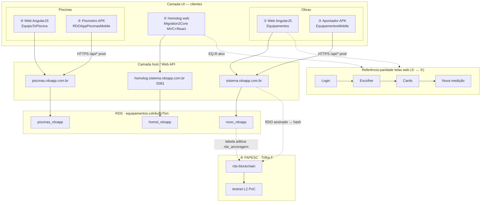

# Manual técnico e gráfico (front-end) — RDO App · 5 vetores produto + FAPESC (⑥)

**Escopo:** Equipamentos (obras) · Migration Core · Apontador · **Piscinas (web)** · **Piscineiro (app)** · **FAPESC 031/2026 · imutabilidade (`rdo-blockchain`)**  
**Data:** 2026-10-20 · **Status:** **M4.4** Escolher React (código) · §10 matriz **3 páginas** · **M4.5** Cards toolbar — próximo  
**Público:** UX, front-end (EQ-R / PQ-R futuro), mobile (EQ-M / PQ-M), QA E2E, migração  

**Instância RDS (comum):** `equipamentos.cslrikufb7hm.us-east-2.rds.amazonaws.com:3306` · governança: [`rds-equipamentos-governanca-catalogos.md`](rds-equipamentos-governanca-catalogos.md)

---

## Referência rápida — repositórios e bancos (produto ①–⑤ + FAPESC ⑥)

Hosts produto: ① `https://sistema.rdoapp.com.br` · ② `https://homolog.sistema.rdoapp.com.br` (:5081) · ③ APK **Apontador** · ④ `https://piscinas.rdoapp.com.br` · ⑤ APK **Piscineiro** · ⑥ **PoC** [`rdo-blockchain`](https://github.com/RDO-APP/rdo-blockchain) (sem host operador tipo Login)

| | **① Equipamentos · produção (EQ-L)** | **② Migration → Core · homolog (EQ-W/R)** | **③ App Apontador (EQ-M)** | **④ Piscinas · web produção (PQ-L)** | **⑤ Piscineiro (PQ-M)** |
|---|------|------|------|------|------|
| **Repositório GitHub** | https://github.com/RDO-APP/Equipamentos | https://github.com/RDO-APP/Migration2Core | https://github.com/RDO-APP/EquipamentosMobile · branch ref. `feature/alteracoes_apontador` | https://github.com/RDO-APP/EquipoToPiscina · IIS `inetpub\piscinas` · **≠** pasta Kiro `Migration2Core/EquipoToPiscina-1/` (só referência) | https://github.com/RDO-APP/RDOAppPiscinasMobile · ref. histórica: https://github.com/RDO-APP/PiscinasMobile |
| **Banco de dados MySQL (catálogo)** | **`novo_rdoapp`** | **`homol_rdoapp`** | Consumo via API → **`novo_rdoapp`** (prod) | **`piscinas_rdoapp`** · homolog web legado: **`piscinas_rdoapp_homologa`** (`homologacao.piscinas.rdoapp.com.br`) | Consumo via API → **`piscinas_rdoapp`** (prod) · homolog: **`piscinas_rdoapp_homologa`** |

**Notas RDS:** não usar `homol_rdoapp` para Piscinas nem `piscinas_rdoapp*` para Core Equipamentos. CPF teste Equipamentos homolog: `53821963549` / `homol_rdoapp` — **não** confundir com dataset Piscinas/Kiro (`567.065.455-20`).

### ⑥ FAPESC · Trilha F (imutabilidade — fora do fluxo Login→Cards)

| | **⑥ FAPESC · PoC imutabilidade (Trilha F)** |
|---|------|
| **Repositório GitHub** | https://github.com/RDO-APP/rdo-blockchain · contratos/API PoC (ex. `RdoAnchor.sol`) |
| **Docs (não substituem o repo)** | [`docs/imutabilidade/`](imutabilidade/README.md) · stub [`docs/editais-fapesc/README.md`](editais-fapesc/README.md) · dossiê local Mercado/FAPESC · chat **Edital FAPESC — Execução** |
| **Banco / persistência** | **Sem** catálogo MySQL próprio do PoC · **origem do documento:** RDO fechado no SaaS (**`novo_rdoapp`**, web **Equipamentos**) · **PoC:** testnet (ex. Base Sepolia / Polygon Amoy — ver `imutabilidade/02_REDES_BLOCKCHAIN.md`) · **futuro prod:** tabela **aditiva** `rdo_ancoragem` (hash, `tx_id`, rede) — **não** reescrever grafo RDO |
| **EDI / token pós-Termo** | Chat **EDI · Smart contract · Token** · [`docs/edi-token-projeto/`](edi-token-projeto/README.md) — **≠** entregáveis FAPESC M1–M3 |

**Fronteira:** PoC e commits **Termo** → chat FAPESC + `rdo-blockchain`. Migração Core (este chat) **não** implementa blockchain em produção.

---

## Diagrama — vetores produto + FAPESC (arquitetura correta)

**Correção (apps):** **③ Apontador** e **⑤ Piscineiro** **não** ficam acima do web nem “dentro” das telas Login→Cards. São **clientes móveis** (Expo/RN) que chamam o **mesmo host/API** que o browser: `sistema…` (obras) e `piscinas…` (piscinas). Cenário **A** (M1): mobile **não** aponta para homolog Core (②).

**Paridade §1–4:** só **web ①** vs **homolog ②** (strangler). Mobile replica **fluxo de negócio** com **UI RN**, via **`/api/*`** do legado prod.

**Leitura:** duas **stacks prod** (obras · piscinas), cada uma **web + app** no **mesmo backend**. **②** isola `homol_rdoapp`. **⑥** dispara **depois** do RDO fechado no **①**, independente do operador mobile.

---

## Colunas do manual (trilhas)

| Coluna | Sigla | Stack / host | Código principal |
|--------|-------|--------------|------------------|
| **Equipamentos produção** | EQ-L | AngularJS 1.x + Bootstrap 3 + Web API · IIS · `novo_rdoapp` | `Equipamentos` → `rdoappProject/Client/` |
| **Core Migration homolog** | EQ-W + EQ-R | ASP.NET Core **host** + cookie · **Razor ponte** (Login/Escolher) · React Cards · alvo **SPA EQ-R** · `homol_rdoapp` | `Migration2Core` → `RDO-CleanMigration-2026/` |
| **Apontador** | EQ-M | Expo / RN · API prod (cenário **A** M1) | `EquipamentosMobile` |
| **Piscinas web** | PQ-L | Mesma família SPA legado (AngularJS) · IIS `piscinas` · `piscinas_rdoapp` | Repo col. ④ · EC2 `Web.config` |
| **Piscineiro** | PQ-M | Expo / RN · variant `appPiscinas` · API `piscinas.rdoapp.com.br` | `RDOAppPiscinasMobile` (base); evolução Apontador em `EquipamentosMobile` |
| **FAPESC PoC** | **F** | Solidity + API verify · testnet · gatilho pós-assinatura RDO | **`RDO-APP/rdo-blockchain`** |

**Legenda de paridade:** ✅ alinhado · 🟡 parcial · ⬜ não feito · 🔀 equivalente intencional · ❌ divergência crítica · **—** não aplicável ao produto

**Regra:** paridade **web operador obras** = colunas ① vs ②. **Apontador** = fluxo campo Equipamentos (③), não layout Angular. **Piscinas / Piscineiro** = produto paralelo (④⑤); Core homolog **não** substitui Piscinas hoje. Trilha **PQ-R** futura espelha **EQ-R** ([`ORQUESTRADOR-MIGRACAO.md`](ORQUESTRADOR-MIGRACAO.md) § PQ).

---

## 0. Casca global (layout interno — pós-login)

| Elemento | ① EQ-L | ② Core homolog | ③ Apontador | ④ Piscinas web | ⑤ Piscineiro |
|----------|--------|----------------|-------------|----------------|--------------|
| Layout shell | `layout-interno*.html` · `ng-view` | MVC `_Layout`; Cards = React sem shell prod | Stack Navigator | 🔀 mesmo padrão legado (nav + ng-view) | Stack Navigator |
| Header `nav.html` | `NavController` · faixa azul | 🟡 partials Kiro; React sem nav prod | App bar | 🔀 nav + contexto unidade/obra piscina | App bar |
| Logo / trocar contexto | `mudarObra()` | Escolher MVC | Lista obras | 🔀 trocar unidade/obra | Lista obras/unidades |
| Menu RBAC | `userData.menu.listaPagina` | 🟡 Escolher | Reduzido | 🔀 | Reduzido |
| Usuário (senha / sair) | Dropdown | ✅ cookie MVC | Auth context | 🔀 | Auth context |
| Stack UI | Bootstrap 3, FA, fontello | Bootstrap + React cru | RN Paper / lucide | 🔀 Bootstrap/fontello | 🔀 compartilhado ~94% c/ ③ |

---

## 1. Página — Login

| Meta | ① `#/login` · `Login/index.html` | ② `/Account/Login` | ③ Auth nativo | ④ `#/login` (PQ-L) | ⑤ Auth nativo |
| API | `POST /api/login/LoginUser` | MVC + cookie | → **`sistema.rdoapp.com.br`** | → **`piscinas.rdoapp.com.br`** | → **`piscinas.rdoapp.com.br`** |

| Elemento | ① | ② | ③ | ④ | ⑤ |
|----------|---|---|---|---|---|
| CPF + senha | ✅ | ✅ | ✅ | 🔀 | 🔀 |
| Branding produto | Equipamentos | 🟡 dívida copy Piscinas em views Kiro | Apontador | Piscinas / RDO piscinas | Piscineiro |
| Redirect | `/obra/escolher` | `/Obra/Escolher` | Dashboard obras | 🔀 escolher unidade/obra | Dashboard cards LIMPEZA |
| RDS | `novo_rdoapp` | `homol_rdoapp` | via API | `piscinas_rdoapp` | via API |

---

## 2. Página — Escolher obra / unidade

| Meta | ① `escolher.html` | ② `/Obra/Escolher` + Selecionar | ③ `normal-dasboard` + `workCard` | ④ `escolher.html` (PQ-L) | ⑤ `PiscineiroDashboard` |
| API lista | `POST api/obra/ObterObras` (+ `filtroParam` no JS) | server MVC lista obras | `ObterObras` + `LoginObra` | `ObterObras` (host piscinas) | idem piscinas |
| API clique | `LoginObra` | `POST /Obra/Selecionar` · `LoginObraService` | `LoginObra` | 🔀 `LoginObra` | `LoginObra` |

### 2.1 Filtros (obra / unidade + município)

**Leitura cruzada (Lucio 2026-10-19):** o padrão **Unidade/Obra + Município** já existe em **Piscinas web** e nos **dois apps**; **Equipamentos web prod (①)** ainda **não** expõe esses campos na tela Escolher — só cards + legenda. **Alvo ②:** trazer filtros **e** cards ricos (STRATEGY-2) no **React**, não duplicar mais Razor.

| Filtro | ① EQ-L | ② Core homolog | ③ Apontador | ④ Piscinas web | ⑤ Piscineiro |
|--------|--------|----------------|-------------|----------------|--------------|
| Campo 1 (nome) | ⬜ (sem UI; API aceita `filtroParam.descricao` etc. na **listagem** `/obra/index`, não em `escolher.html`) | ⬜ | **Obra** · `TextInput` · filtro **cliente** em `descricao` | **Unidade escolar** · `ng-model="filtroUnidade"` · `filter:descricao` | **Unidade escolar** · idem ③ |
| Campo 2 (local) | ⬜ | ⬜ | **Município** · filtro cliente em `cidadeEstado` | **Município** · `filtroMunicipio` · `filter:cidadeEstado` | **Município** · idem ③ |
| Onde no código | `Obra/index.html` (filtros **server** UF/município/contratante…) | `Views/Obra/Escolher.cshtml` | `EquipamentosMobile/.../normal-dasboard.tsx` | `EquipoToPiscina/.../Obra/escolher.html` | `.../piscineiro-screen.tsx` |
| Escopo alvo Migration | — | **EQ-R** Escolher React: copiar **UX ③** (Obra+Município) + **cards/legenda ①** + opcional filtros server depois | referência | referência filtros **web** ④ | referência labels PQ |

**Implementação sugerida (②):** mesma lista `ObterObras` / payload M1 → estado React → `filter` local (como ③④) → `workCard` visual alinhado a ① (`progressoPorcentagem`, `classeStatusCss`, legenda). **Não** estender `Escolher.cshtml` Razor (EQ-W congelado).

### 2.2 Elementos visuais e fluxo

| Elemento | ① | ② | ③ | ④ | ⑤ |
|----------|---|---|---|---|---|
| Título / convite | “Selecione uma das obras…” | 🟡 copy Kiro “unidade escolar” em empty state | dashboard obras | “unidades escolares…” | grid etapas/tarefas piscina |
| Filtros duplos (§2.1) | ⬜ | ⬜ | ✅ | ✅ | ✅ |
| Grid cards + progresso | ✅ `icon-*` + % + legenda | 🟡 lista ID (STRATEGY-2 ⬜) | ✅ `workCard` + legenda | ✅ ≈ ① + filtros | 🟡 cards tarefa limpeza |
| Ícone papel contratante/contratada | `icon-{{contratanteContratada}}` | ⬜ | 🟡 HardHat | 🔀 | 🔀 |
| Legenda progresso | ✅ | ⬜ | ✅ | ✅ (texto unidade) | 🔀 |
| Clique → sessão obra | → `#/tarefa/cards` | ✅ Selecionar | → `NormalWorkDetails` | → cards/laudos | LoginObra + cards LIMPEZA |

### 2.3 Razor no Migration — pode e deve sair?

| Camada | Manter no Core | Substituir por EQ-R (React) |
|--------|----------------|-----------------------------|
| **Host** ASP.NET Core, cookie, sessão, EF, BFF | ✅ | — |
| **Controllers** `Account`, `Obra/Selecionar`, `api/bff/*` | ✅ (viram backing da SPA) | UI não-Razor |
| **Views Razor** Login, Escolher, `_Layout*`, placeholder Cards | 🟡 **ponte EQ-W** hoje | ✅ **sim — alvo M4+** |
| **React** `/app/` Cards | ✅ expandir para **Login + Escolher + shell** | SPA única ou rotas `/app/*` |

**Decisão alinhada ao orquestrador:** **não** investir STRATEGY-2/filtros em **Razor**; próximo incremento Escolher = **React** (mesmo `client/`, layout compartilhado com Cards). Razor encerra quando **Login → Escolher → Cards** rodarem na SPA com shell prod — critério M4 (congela EQ-W). Até lá, Razor só **bugfix** (Selecionar, branding).

**Ordem recomendada (②):** (1) **App shell** `layout-interno` · (2) **Escolher React** filtros ③ + cards ① · (3) Cards toolbar · (4) desligar views Razor de produto.

---

## 3. Página — Etapas / Tarefas (Cards)

| Meta | ① `cards.html` | ② `/Tarefa/Cards` React | ③ `normal-work-details` + `taskCard` | ④ cards/lista PQ-L | ⑤ `PiscineiroCardsContext` / cards LIMPEZA |
| API cards | `ObterEtapaTarefa` (**agrupador**) | `/api/bff/etapas` (**agrupador** M2 C1/C2) | prod Equipamentos | 🔀 `ObterEtapaTarefa` piscinas | 🔀 API piscinas |

### 3.1 Toolbar

| Elemento | ① | ② | ③ | ④ | ⑤ |
|----------|---|---|---|---|---|
| Título “Etapas / Tarefas” | ✅ | 🟡 | 🔀 | 🔀 | 🔀 foco etapa limpeza |
| FILTRO / + tarefa / + etapa | ✅ RBAC | ⬜ | ⬜ removido | 🔀 | ⬜ / 🔀 |
| Alternância Cards ↔ Lista | ✅ | ⬜ | 🔀 | 🔀 | 🔀 |
| Header obra no topo | `nav.html` | ⬜ | app bar | 🔀 | 🔀 |

### 3.2 Etapas (accordion)

| Elemento | ① | ② | ③ | ④ | ⑤ |
|----------|---|---|---|---|---|
| Accordion faixas azuis | ✅ | 🟡 C3 accordion claro (homolog 2026-10-19) | ✅ todas etapas | 🔀 | ✅ accordion |
| Títulos etapas (ex. obra 42) | ✅ 3 etapas | ✅ títulos OK | ✅ | 🔀 | 🔀 OBRA / TESTE / LIMPEZA… |
| Trancar etapa fixa | — | — | **Não** (ago/2026) | 🔀 | 🔀 opcional só LIMPEZA (produto) |

### 3.3 Tarefas (cards)

| Elemento | ① | ② | ③ | ④ | ⑤ |
|----------|---|---|---|---|---|
| Modelo de card | 1 card = **agrupador** | ✅ agrupador BFF | API prod agrupador | 🔀 | 🔀 cards limpeza |
| Grid visual verde/status | ✅ | 🟡 C3 head `classeStatusCss` | ✅ `taskCard` | 🔀 | 🔀 |
| % + datas + colab/equip | ✅ | 🟡 C3 % + datas; colab/equip ⬜ | 🟡 | 🔀 | 🔀 química no card contexto piscina |
| Impressora no card | web relatórios | ⬜ | 🔀 | 🔀 | 🟡 backlog U-01 |

---

## 4. Nova medição / registro de campo

| Elemento | ① EQ-L modal `cards.html` | ② Core | ③ Apontador | ④ Piscinas web | ⑤ Piscineiro |
|----------|---------------------------|--------|-------------|----------------|--------------|
| UI | Modal bootstrap rápido | ⬜ M2+ | `equipamentos.tsx` vertical | 🔀 modal web | `piscinas.tsx` (PH, cloro, …) |
| Campos | horímetro, paralisação, datas | — | equipamentos | 🔀 | química / limpeza |
| RDS | `novo_rdoapp` | — | via API | `piscinas_rdoapp` | via API |

---

## 4b. Trilha F — fluxo PoC imutabilidade (⑥ · não substitui §1–4)

**Gatilho:** RDO **fechado** (assinatura contratada + contratante) no web **Equipamentos** — ver [`imutabilidade/05_ATORES_ASSINATURA.md`](imutabilidade/05_ATORES_ASSINATURA.md).

| Etapa (PoC) | Onde vive | ① EQ-L | ⑥ FAPESC |
|-------------|-----------|--------|----------|
| Operador campo (Login→Medição) | §1–4 deste manual | ✅ | — (só gera dado que vira RDO) |
| Gerar / assinar PDF RDO | Web Equipamentos | ✅ | — |
| Hash documento fechado | Pipeline PoC / API | origem `novo_rdoapp` | ✅ `rdo-blockchain` |
| Registrar âncora (tx) | Testnet | — | ✅ |
| Verificar integridade | API verify / explorer | link UI futuro | ✅ |
| TCE / MP / CREA conferem | Explorer / API (sem login RDO) | — | ✅ plano obj. 4 |
| EDI adaptadores | Pós-Termo | — | chat **EDI · Token** |

---

## 5. Páginas satélite

| Função | ① | ② | ③ | ④ | ⑤ |
|--------|---|---|---|---|---|
| Laudos / Apontamentos | web legado | ⬜ | 🟡 pasta Apontamentos (≠ Laudo) | **Laudos** (`laudo-list-screen` ref.) | laudo / limpeza |
| Histórico medições | modal web | ⬜ | `history-screen` | 🔀 | 🔀 |
| Impressora PDF | web | ⬜ | `report-print-screen` | 🔀 | 🟡 TaskCard |
| Dashboard gráfico obra | `#/dashboard` | ⬜ | removido gráfico | 🔀 | — |

---

## 6. Contratos API (front ↔ backend)

| Operação | ① EQ-L | ② Core homolog | ③ Apontador | ④ Piscinas web | ⑤ Piscineiro |
|----------|--------|----------------|-------------|----------------|--------------|
| Login | `LoginUser` | MVC cookie | prod **sistema** | prod **piscinas** | prod **piscinas** |
| Obras / LoginObra | `sistema…/api/*` | MVC + cookie | prod | `piscinas…/api/*` | prod piscinas |
| Cards etapas/tarefas | `ObterEtapaTarefa` | BFF `homol_rdoapp` | prod sistema | 🔀 ObterEtapaTarefa | 🔀 |
| Homolog dedicado | — | `homolog.sistema…` | — | `homologacao.piscinas…` + `piscinas_rdoapp_homologa` | fraco hoje (E3) |

Tipos Equipamentos: [`equipamentos-api.types.ts`](api-client/equipamentos-api.types.ts). Piscinas: espelhar no api-client quando **PQ** abrir.

---

## 7. Marcos

| Marco | Vetores |
|-------|---------|
| **M0′** | Este manual + [`matriz-4-paginas-prod-kiro-mobile.md`](matriz-4-paginas-prod-kiro-mobile.md) |
| **EQ-W0.5 / M2** | ①②③ §2–§3 |
| **STRATEGY-2 + filtros Escolher** | ① cards + legenda · **④③⑤** filtros Obra/Unidade+Município → **② EQ-R** (não Razor) |
| **M4** | Shell operador + paridade **§10** (P1/P2) + **retirada Razor** Login/Escolher/Cards view · [`m4-execucao-checklist.md`](migracao/m4-execucao-checklist.md) |
| **EQ-M** | ③ `normal-dasboard.tsx` = spec filtros+cards obras |
| **PQ** (futuro) | ④⑤ · **PQ-R** espelha EQ-R |
| **F (FAPESC)** | ⑥ · M1–M3 Termo · **`rdo-blockchain`** |

---

## 8. Referências de código

| Vetor | Onde ler |
|-------|----------|
| ① | `Equipamentos/rdoappProject/Client/` · `Api/Models/EtapaModel.cs` |
| ② | `client/src/pages/EscolherPage.tsx` · `WorkCardObra.tsx` · BFF `/api/bff/obras` · `CardsPage.tsx` |
| ③ | `EquipamentosMobile/src/components/screens/normal-dasboard.tsx` · `workCard.tsx` |
| ④ | `EquipoToPiscina/.../Client/Views/Obra/escolher.html` (filtros + cards) |
| ⑤ | `RDOAppPiscinasMobile` · variant `appPiscinas` · [`storytelling-unificado-dimas-migracao-fapesc.md`](estudos-lucio-apps-plano-migracao-core/storytelling-unificado-dimas-migracao-fapesc.md) §5 |
| ⑥ | https://github.com/RDO-APP/rdo-blockchain · [`imutabilidade/`](imutabilidade/README.md) · chat FAPESC [`CURSOR_MAPA_CHATS.md`](CURSOR_MAPA_CHATS.md) |

---

## 9. Checklist QA (Equipamentos — gate homolog)

1. Login ① vs ②  
2. **P1 Escolher:** percorrer **§10.3** bloco a bloco (header, card obra, filtros, legenda)  
3. **P2 Cards:** percorrer **§10.4** (toolbar, accordion, card tarefa)  
4. Contagem cards = **agrupador**, não rows DB  
5. Medição: ③ ou modal ① — escopo apartado (**M7+** web)

**Piscinas / Piscineiro:** repetir checklist em prod ④⑤ com CPF/dataset **Piscinas** (não misturar com obra 42 Equipamentos).

---

## 10. Paridade visual homolog ② vs prod ① — blocos P1 / P2

**Público:** UX, EQ-R, QA, product owner comparando prints lado a lado.  
**Escopo:** só **web Equipamentos** ① vs ② (não Apontador/Piscinas, salvo referência de filtros).  
**Orquestrador:** espelho executivo em [`ORQUESTRADOR-MIGRACAO.md`](ORQUESTRADOR-MIGRACAO.md) § Paridade visual blocos P1/P2 · checklist [`migracao/m4-execucao-checklist.md`](migracao/m4-execucao-checklist.md).

### 10.1 Três páginas E2E (#1–#3) — rotas e blocos

| Página | Nome | Rota homolog ② | Blocos (ordem) | Dono UI ② | Prod ① |
|:------:|------|----------------|----------------|-----------|--------|
| **#1** | Login | `/Account/Login` | chrome externo (sem header operador) | EQ-W Razor | `Login/index.html` |
| **#2** | **P1** Escolher | `/Obra/Escolher` | **header → título → filtros → card obra → legenda** | EQ-R SPA | `escolher.html` |
| **#3** | **P2** Cards | `/Tarefa/Cards` | **header → toolbar → accordion → card tarefa** | EQ-R SPA | `cards.html` |

Nova medição = matriz **#4** (**M7+**). Detalhe item a item: §10.3–10.4 · resumo executivo §10.1b.

### 10.1b Status por página e bloco (homolog ②)

**Legenda:** ✅ ≈ prod · 🟡 parcial · ⬜ pendente

| Página | Bloco | ② após M4.4 (código) | Marco |
|:------:|-------|----------------------|-------|
| **#1 Login** | Formulário / branding | 🟡 | **M4.8** |
| **#2 P1** | Header | 🟡 OperadorShell | **M4.4** ✅ |
| **#2 P1** | Filtros Obra + Município | ✅ | **M4.4** ✅ |
| **#2 P1** | Card de obra | ✅ | **M4.4** ✅ |
| **#2 P1** | Legenda progresso | ✅ | **M4.4** ✅ |
| **#3 P2** | Header | 🟡 | **M4.1** ✅ |
| **#3 P2** | Toolbar | ⬜ | **M4.5** |
| **#3 P2** | Accordion etapa | 🟡 | **M4.5** |
| **#3 P2** | Card tarefa | 🟡 | **M4.6** |

### 10.2 Estratégia de implementação (M4)

1. **Não** polir Razor de Escolher (EQ-W congelado para produto) — **P1 inteira** migra para React (**M4.4**).
2. **P2** compartilha **`OperadorShell`** e CSS de header com P1 quando Escolher React existir.
3. Ordem: **M4.4** P1 → **M4.5** P2 (toolbar + accordion) → **M4.6** P2 (card tarefa) → **M4.7/M4.8** Login SPA.
4. **M3** validou **fluxo + dados**; este capítulo valida **UI operável** até **M9 (D1)** — não exige pixel-perfect antes de M4.8.

**Mapa para §2–§3:** elementos de Escolher continuam catalogados em **§2.2**; Cards em **§3.1–3.3**. **§10** é a **matriz de gaps homolog 2026-10-20** com marco M4 por item.

### 10.3 P1 — Escolher obra (blocos na página)

Ordem visual de cima para baixo: **header → chrome da lista → filtros → grid de cards de obra → legenda**.

| Bloco | Item (comparar print) | Prod ① | Homolog ② (evidência) | Marco | Ver também |
|-------|------------------------|--------|------------------------|-------|------------|
| **Header** | Barra superior (logo, menu, ícones, perfil) | `layout-interno` / `nav.html` | **OperadorShell** React (🟡 RBAC) | **M4.4** ✅ | §2.2 |
| **Header** | Nome da obra no topo | N/A (obra ainda não escolhida) | N/A | — | |
| **Header** | Ícones gráfico, grid, relatório, + | Conforme RBAC | Parcial (chart, +) | **M4.5+** | §1 shell |
| **Chrome** | Título “Selecione uma das obras abaixo:” | Centrado, fundo azul | ✅ React | **M4.4** ✅ | §2.2 |
| **Filtros** | Campo Obra + Município | ⬜ em ①; **alvo ②** | ✅ filtro cliente | **M4.4** ✅ | §2.1 · ③④ |
| **Card de obra** | Ícone obra (`icon-*` / capacete) | ✅ | ✅ | **M4.4** ✅ | `WorkCardObra` |
| **Card de obra** | Título da obra | No card | ✅ (sem ID solto) | **M4.4** ✅ | §2.2 |
| **Card de obra** | `cidadeEstado` + papel + licença | ✅ | ✅ BFF | **M4.4** ✅ | `/api/bff/obras` |
| **Card de obra** | Barra % + `classeStatusCss` | ✅ | ✅ | **M4.4** ✅ | STRATEGY-2 |
| **Legenda** | Significado das cores de status | ✅ rodapé/lista | ✅ React | **M4.4** ✅ | §2.2 |
| **Grid** | Densidade (várias obras por linha) | ~5 colunas | ✅ `lista-obras` | **M4.4** ✅ | |
| **Fluxo** | Clique → Selecionar → P2 | ✅ | ✅ BFF selecionar | — | E2E passo 2–3 |

**Implementado EQ-R:** `EscolherPage` · `WorkCardObra` · `GET/POST /api/bff/obras`.

### 10.4 P2 — Etapas / Cards (blocos na página)

Ordem visual: **header → toolbar → accordion por etapa → cards de tarefa (+ placeholder)**.

| Bloco | Item (comparar print) | Prod ① | Homolog ② (evidência) | Marco | Ver também |
|-------|------------------------|--------|------------------------|-------|------------|
| **Header** | Nome da obra + perfil | ✅ | **≈ prod** (**M4.1** ✅) | **M4.1** | §3.1 header |
| **Header** | Ícones nav + RBAC | ✅ | Parcial | **M4.5+** | |
| **Toolbar** | Título “Etapas / Tarefas” | ✅ | **Ausente** | **M4.5** | §3.1 |
| **Toolbar** | FILTRO · ADICIONAR TAREFA · ADICIONAR ETAPA | ✅ | **Ausente** | **M4.5** | §3.1 |
| **Toolbar** | Toggle Cards ↔ Lista · SELECIONAR TUDO | ✅ | **Ausente** | **M4.5** | §3.1 |
| **Accordion** | Faixa azul escuro + **+ / −** | ✅ | Accordion M2; cor/typo **≠** | **M4.5** | §3.2 |
| **Accordion** | Títulos etapa (ex. SERVIÇOS PRELIMINARES) | ✅ | Texto OK | **M4.5** estilo | §3.2 |
| **Card tarefa** | Cabeçalho verde + ícone mão + ⋮ | ✅ | Verde + título only | **M4.6** | §3.3 |
| **Card tarefa** | Contadores efetivo / equipamento | ✅ | **Ausente** | **M4.6** | BFF futuro |
| **Card tarefa** | Fila ícones (olho, relógio, editar, impressora, +) | ✅ | **Ausente** | **M4.6** | ações **M7+** |
| **Card tarefa** | Duas linhas de datas + calendário | ✅ | Uma linha; sem ícones | **M4.6** | C3 |
| **Card tarefa** | Status (PLANEJADA, …) | ✅ | Texto + controle “Finalizada” solto | **M4.6** | |
| **Card tarefa** | Checkbox + barra % no rodapé | ✅ | % sim; **sem** checkbox | **M4.6** | §3.3 |
| **Card tarefa** | Card tracejado “Adicionar nova tarefa” | ✅ | **Ausente** | **M4.6** | UI only |
| **Dados** | Contagem etapas/tarefas (obra 42) | Pode divergir RDS | BFF agrupador OK (**M2**) | **M2** ✅ | §3 · gap **UI** |

**Componentes alvo EQ-R:** toolbar `CardsToolbar` · `EtapaAccordion` · `TaskCardAgrupador` (nomes indicativos — ver `client/src/`).

### 10.5 Fora de P1/P2 (referência rápida)

| Matriz # | Tela | Gap vs prod | Marco |
|:--------:|------|-------------|-------|
| 1 | Login | Layout externo; SPA unificada | **M4.8** |
| 4 | Nova medição (modal) | Inexistente no homolog | **M7+** |

### 10.6 Como usar em review (Lucio / QA)

1. Abrir **prod ①** e **homolog ②** na mesma obra (ex. 42 — FACHADA OESTE SHOPPING BARRA).
2. **P1:** marcar cada linha §10.3 — ✅ paridade · 🟡 parcial · ⬜ pendente.
3. **P2:** idem §10.4.
4. Divergência de **contagem** de tarefas: conferir **mesmo catálogo RDS** antes de abrir bug UI ([`ORQUESTRADOR-MIGRACAO.md`](ORQUESTRADOR-MIGRACAO.md) nota homol vs prod).

---

## 11. OK Lucio (preencher)

| Item | OK? | Observação |
|------|:---:|------------|
| Linha GitHub col. ④ (`RDO-APP/EquipoToPiscina`) | ☑ | Lucio 2026-10-19 |
| Catálogos RDS § tabela inicial | ☑ | conferido [`rds-equipamentos-governanca-catalogos.md`](rds-equipamentos-governanca-catalogos.md) · Fase A 2026-10-19 |
| Colunas ④⑤ nas páginas §1–§5 | ☑ | manual §1–§5 · Fase A |
| Host homolog Piscinas | ☑ | `homologacao.piscinas.rdoapp.com.br` + `piscinas_rdoapp_homologa` (legado PQ; ≠ Core obras) |
| Vetor ⑥ `rdo-blockchain` + RDS âncora | ☑ | incluído 2026-10-19 |
| Smoke HTTP prod 4 telas (A2) | ☑ | [`m0-prime-fase-a-evidencias.md`](m0-prime-fase-a-evidencias.md) |
| HAR Network API prod (A2+) | ○ | opcional Lucio |
| Capítulo **§10** paridade P1/P2 (prints homolog) | ☑ | Lucio 2026-10-20 |

Documentos irmãos: [`matriz-4-paginas-prod-kiro-mobile.md`](matriz-4-paginas-prod-kiro-mobile.md) · [`ORQUESTRADOR-MIGRACAO.md`](ORQUESTRADOR-MIGRACAO.md) · [`migracao/m4-execucao-checklist.md`](migracao/m4-execucao-checklist.md).
