# Manual técnico e gráfico (front-end) — RDO App · 5 vetores produto + FAPESC (⑥)

**Escopo:** Equipamentos (obras) · Migration Core · Apontador · **Piscinas (web)** · **Piscineiro (app)** · **FAPESC 031/2026 · imutabilidade (`rdo-blockchain`)**  
**Data:** 2026-10-19 · **Status:** rascunho — col. ④ **EquipoToPiscina** confirmada (Lucio) · demais itens §10  
**Público:** UX, front-end (EQ-R / PQ-R futuro), mobile (EQ-M / PQ-M), QA E2E, migração  

**Instância RDS (comum):** `equipamentos.cslrikufb7hm.us-east-2.rds.amazonaws.com:3306` · governança: [`rds-equipamentos-governanca-catalogos.md`](rds-equipamentos-governanca-catalogos.md)

---

## Referência rápida — repositórios e bancos (produto ①–⑤ + FAPESC ⑥)

Hosts produto: ① `https://sistema.rdoapp.com.br` · ② `https://homolog.sistema.rdoapp.com.br` (:5081) · ③ APK **Apontador** · ④ `https://piscinas.rdoapp.com.br` · ⑤ APK **Piscineiro** · ⑥ **PoC** [`rdo-blockchain`](https://github.com/RDO-APP/rdo-blockchain) (sem host operador tipo Login)

| | **① Equipamentos · produção (EQ-L)** | **② Migration → Core · homolog (EQ-W/R)** | **③ App Apontador (EQ-M)** | **④ Piscinas · web produção (PQ-L)** | **⑤ Piscineiro (PQ-M)** |
|---|------|------|------|------|------|
| **Repositório GitHub** | https://github.com/RDO-APP/Equipamentos | https://github.com/RDO-APP/Migration2Core | https://github.com/RDO-APP/EquipamentosMobile · branch ref. `feature/alteracoes_apontador` | https://github.com/RDO-APP/EquipoToPiscina · IIS `inetpub\piscinas` · **≠** pasta Kiro `Migration2Core/EquipoToPiscina-1/` (só referência) | https://github.com/RDO-APP/RDOAppPiscinasMobile · ref. histórica: https://github.com/RDO-APP/PiscinasMobile |
| **Banco de dados MySQL (catálogo)** | **`novo_rdoapp`** | **`homol_rdoapp`** | Consumo via API → **`novo_rdoapp`** (prod) | **`piscinas_rdoapp`** · homolog web legado: **`piscinas_rdoapp_homologa`** (`homologacao.piscinas.rdoapp.com.br`) | Consumo via API → **`piscinas_rdoapp`** (prod) · homolog: **`piscinas_rdoapp_homologa`** |

**Notas RDS:** não usar `homol_rdoapp` para Piscinas nem `piscinas_rdoapp*` para Core Equipamentos. CPF teste Equipamentos homolog: `53821963549` / `homol_rdoapp` — **não** confundir com dataset Piscinas/Kiro (`567.065.455-20`).

### ⑥ FAPESC · Trilha F (imutabilidade — fora do fluxo Login→Cards)

| | **⑥ FAPESC · PoC imutabilidade (Trilha F)** |
|---|------|
| **Repositório GitHub** | https://github.com/RDO-APP/rdo-blockchain · contratos/API PoC (ex. `RdoAnchor.sol`) |
| **Docs (não substituem o repo)** | [`docs/imutabilidade/`](imutabilidade/README.md) · stub [`docs/editais-fapesc/README.md`](editais-fapesc/README.md) · dossiê local Mercado/FAPESC · chat **Edital FAPESC — Execução** |
| **Banco / persistência** | **Sem** catálogo MySQL próprio do PoC · **origem do documento:** RDO fechado no SaaS (**`novo_rdoapp`**, web **Equipamentos**) · **PoC:** testnet (ex. Base Sepolia / Polygon Amoy — ver `imutabilidade/02_REDES_BLOCKCHAIN.md`) · **futuro prod:** tabela **aditiva** `rdo_ancoragem` (hash, `tx_id`, rede) — **não** reescrever grafo RDO |
| **EDI / token pós-Termo** | Chat **EDI · Smart contract · Token** · [`docs/edi-token-projeto/`](edi-token-projeto/README.md) — **≠** entregáveis FAPESC M1–M3 |

**Fronteira:** PoC e commits **Termo** → chat FAPESC + `rdo-blockchain`. Migração Core (este chat) **não** implementa blockchain em produção.

---

## Diagrama — vetores produto + FAPESC (arquitetura correta)

**Correção (apps):** **③ Apontador** e **⑤ Piscineiro** **não** ficam acima do web nem “dentro” das telas Login→Cards. São **clientes móveis** (Expo/RN) que chamam o **mesmo host/API** que o browser: `sistema…` (obras) e `piscinas…` (piscinas). Cenário **A** (M1): mobile **não** aponta para homolog Core (②).

**Paridade §1–4:** só **web ①** vs **homolog ②** (strangler). Mobile replica **fluxo de negócio** com **UI RN**, via **`/api/*`** do legado prod.

```mermaid
flowchart TB
  subgraph UI["Camada UI — clientes"]
    direction LR
    subgraph COL_OBRAS["Obras"]
      W1["① Web AngularJS<br/>Equipamentos"]
      M3["③ Apontador APK<br/>EquipamentosMobile"]
    end
    subgraph COL_PISC["Piscinas"]
      W4["④ Web AngularJS<br/>EquipoToPiscina"]
      M5["⑤ Piscineiro APK<br/>RDOAppPiscinasMobile"]
    end
    W2["② Homolog web<br/>Migration2Core MVC+React"]
  end

  subgraph API["Camada host / Web API"]
    S1["sistema.rdoapp.com.br"]
    S2["homolog.sistema.rdoapp.com.br :5081"]
    S4["piscinas.rdoapp.com.br"]
  end

  subgraph RDS["RDS · equipamentos.cslrikufb7hm"]
    N["novo_rdoapp"]
    H["homol_rdoapp"]
    P["piscinas_rdoapp"]
  end

  subgraph F6["⑥ FAPESC · Trilha F"]
    RB["rdo-blockchain"]
    TT["testnet L2 PoC"]
    RB --> TT
  end

  W1 --> S1
  M3 -->|"HTTPS /api/* prod"| S1
  W2 --> S2
  W4 --> S4
  M5 -->|"HTTPS /api/* prod"| S4

  S1 --> N
  S2 --> H
  S4 --> P

  S1 -.->|"RDO assinado → hash"| RB
  N -.->|"tabela aditiva rdo_ancoragem"| RB

  subgraph TELAS["Referência paridade telas web (① ↔ ②)"]
    direction LR
    T1[Login] --> T2[Escolher] --> T3[Cards] --> T4[Nova medição]
  end

  W1 -.-> TELAS
  W2 -.->|"EQ-R alvo"| TELAS
```

**Leitura:** duas **stacks prod** (obras · piscinas), cada uma **web + app** no **mesmo backend**. **②** isola `homol_rdoapp`. **⑥** dispara **depois** do RDO fechado no **①**, independente do operador mobile.

---

## Colunas do manual (trilhas)

| Coluna | Sigla | Stack / host | Código principal |
|--------|-------|--------------|------------------|
| **Equipamentos produção** | EQ-L | AngularJS 1.x + Bootstrap 3 + Web API · IIS · `novo_rdoapp` | `Equipamentos` → `rdoappProject/Client/` |
| **Core Migration homolog** | EQ-W + EQ-R | ASP.NET Core MVC + cookie · React (Vite) em `wwwroot/app/` · `homol_rdoapp` | `Migration2Core` → `RDO-CleanMigration-2026/` |
| **Apontador** | EQ-M | Expo / RN · API prod (cenário **A** M1) | `EquipamentosMobile` |
| **Piscinas web** | PQ-L | Mesma família SPA legado (AngularJS) · IIS `piscinas` · `piscinas_rdoapp` | Repo col. ④ · EC2 `Web.config` |
| **Piscineiro** | PQ-M | Expo / RN · variant `appPiscinas` · API `piscinas.rdoapp.com.br` | `RDOAppPiscinasMobile` (base); evolução Apontador em `EquipamentosMobile` |
| **FAPESC PoC** | **F** | Solidity + API verify · testnet · gatilho pós-assinatura RDO | **`RDO-APP/rdo-blockchain`** |

**Legenda de paridade:** ✅ alinhado · 🟡 parcial · ⬜ não feito · 🔀 equivalente intencional · ❌ divergência crítica · **—** não aplicável ao produto

**Regra:** paridade **web operador obras** = colunas ① vs ②. **Apontador** = fluxo campo Equipamentos (③), não layout Angular. **Piscinas / Piscineiro** = produto paralelo (④⑤); Core homolog **não** substitui Piscinas hoje. Trilha **PQ-R** futura espelha **EQ-R** ([`ORQUESTRADOR-MIGRACAO.md`](ORQUESTRADOR-MIGRACAO.md) § PQ).

---

## 0. Casca global (layout interno — pós-login)

| Elemento | ① EQ-L | ② Core homolog | ③ Apontador | ④ Piscinas web | ⑤ Piscineiro |
|----------|--------|----------------|-------------|----------------|--------------|
| Layout shell | `layout-interno*.html` · `ng-view` | MVC `_Layout`; Cards = React sem shell prod | Stack Navigator | 🔀 mesmo padrão legado (nav + ng-view) | Stack Navigator |
| Header `nav.html` | `NavController` · faixa azul | 🟡 partials Kiro; React sem nav prod | App bar | 🔀 nav + contexto unidade/obra piscina | App bar |
| Logo / trocar contexto | `mudarObra()` | Escolher MVC | Lista obras | 🔀 trocar unidade/obra | Lista obras/unidades |
| Menu RBAC | `userData.menu.listaPagina` | 🟡 Escolher | Reduzido | 🔀 | Reduzido |
| Usuário (senha / sair) | Dropdown | ✅ cookie MVC | Auth context | 🔀 | Auth context |
| Stack UI | Bootstrap 3, FA, fontello | Bootstrap + React cru | RN Paper / lucide | 🔀 Bootstrap/fontello | 🔀 compartilhado ~94% c/ ③ |

---

## 1. Página — Login

| Meta | ① `#/login` · `Login/index.html` | ② `/Account/Login` | ③ Auth nativo | ④ `#/login` (PQ-L) | ⑤ Auth nativo |
| API | `POST /api/login/LoginUser` | MVC + cookie | → **`sistema.rdoapp.com.br`** | → **`piscinas.rdoapp.com.br`** | → **`piscinas.rdoapp.com.br`** |

| Elemento | ① | ② | ③ | ④ | ⑤ |
|----------|---|---|---|---|---|
| CPF + senha | ✅ | ✅ | ✅ | 🔀 | 🔀 |
| Branding produto | Equipamentos | 🟡 dívida copy Piscinas em views Kiro | Apontador | Piscinas / RDO piscinas | Piscineiro |
| Redirect | `/obra/escolher` | `/Obra/Escolher` | Dashboard obras | 🔀 escolher unidade/obra | Dashboard cards LIMPEZA |
| RDS | `novo_rdoapp` | `homol_rdoapp` | via API | `piscinas_rdoapp` | via API |

---

## 2. Página — Escolher obra / unidade

| Meta | ① `escolher.html` | ② `/Obra/Escolher` + Selecionar | ③ `normal-dasboard` + `workCard` | ④ escolher (PQ-L) | ⑤ dashboard obras / cards piscina |
| API | `LoginObra` | `LoginObraService` | `ObterObras` + `LoginObra` | 🔀 `LoginObra` piscinas API | 🔀 idem host piscinas |

| Elemento | ① | ② | ③ | ④ | ⑤ |
|----------|---|---|---|---|---|
| Título / convite | “Selecione uma das obras…” | ✅ | Filtro “Obra” | 🔀 terminologia unidade escolar | 🔀 cards piscina |
| Grid cards + progresso | ✅ fontello + % | 🟡 lista (STRATEGY-2 ⬜) | ✅ `workCard` | 🔀 paridade web | 🟡 card menor; ícone obra |
| Ícone `contratanteContratada` | `icon-*` | ⬜ | 🟡 HardHat (gap item 4) | 🔀 | 🔀 |
| Legenda progresso | ✅ | ⬜ | ✅ pós-lista | 🔀 | 🔀 |
| Clique → sessão obra | → `#/tarefa/cards` | ✅ Selecionar | → etapas | 🔀 → cards/laudos | → etapa **LIMPEZA** / cards |

---

## 3. Página — Etapas / Tarefas (Cards)

| Meta | ① `cards.html` | ② `/Tarefa/Cards` React | ③ `normal-work-details` + `taskCard` | ④ cards/lista PQ-L | ⑤ `PiscineiroCardsContext` / cards LIMPEZA |
| API cards | `ObterEtapaTarefa` (**agrupador**) | `/api/bff/etapas` (**sem agrupador**) | prod Equipamentos | 🔀 `ObterEtapaTarefa` piscinas | 🔀 API piscinas |

### 3.1 Toolbar

| Elemento | ① | ② | ③ | ④ | ⑤ |
|----------|---|---|---|---|---|
| Título “Etapas / Tarefas” | ✅ | 🟡 | 🔀 | 🔀 | 🔀 foco etapa limpeza |
| FILTRO / + tarefa / + etapa | ✅ RBAC | ⬜ | ⬜ removido | 🔀 | ⬜ / 🔀 |
| Alternância Cards ↔ Lista | ✅ | ⬜ | 🔀 | 🔀 | 🔀 |
| Header obra no topo | `nav.html` | ⬜ | app bar | 🔀 | 🔀 |

### 3.2 Etapas (accordion)

| Elemento | ① | ② | ③ | ④ | ⑤ |
|----------|---|---|---|---|---|
| Accordion faixas azuis | ✅ | ⬜ | ✅ todas etapas | 🔀 | ✅ accordion |
| Títulos etapas (ex. obra 42) | ✅ 3 etapas | ✅ títulos OK | ✅ | 🔀 | 🔀 OBRA / TESTE / LIMPEZA… |
| Trancar etapa fixa | — | — | **Não** (ago/2026) | 🔀 | 🔀 opcional só LIMPEZA (produto) |

### 3.3 Tarefas (cards)

| Elemento | ① | ② | ③ | ④ | ⑤ |
|----------|---|---|---|---|---|
| Modelo de card | 1 card = **agrupador** | ❌ lista raw DB | API prod agrupador | 🔀 | 🔀 cards limpeza |
| Grid visual verde/status | ✅ | ⬜ | ✅ `taskCard` | 🔀 | 🔀 |
| % + datas + colab/equip | ✅ | ⬜ | 🟡 | 🔀 | 🔀 química no card contexto piscina |
| Impressora no card | web relatórios | ⬜ | 🔀 | 🔀 | 🟡 backlog U-01 |

---

## 4. Nova medição / registro de campo

| Elemento | ① EQ-L modal `cards.html` | ② Core | ③ Apontador | ④ Piscinas web | ⑤ Piscineiro |
|----------|---------------------------|--------|-------------|----------------|--------------|
| UI | Modal bootstrap rápido | ⬜ M2+ | `equipamentos.tsx` vertical | 🔀 modal web | `piscinas.tsx` (PH, cloro, …) |
| Campos | horímetro, paralisação, datas | — | equipamentos | 🔀 | química / limpeza |
| RDS | `novo_rdoapp` | — | via API | `piscinas_rdoapp` | via API |

---

## 4b. Trilha F — fluxo PoC imutabilidade (⑥ · não substitui §1–4)

**Gatilho:** RDO **fechado** (assinatura contratada + contratante) no web **Equipamentos** — ver [`imutabilidade/05_ATORES_ASSINATURA.md`](imutabilidade/05_ATORES_ASSINATURA.md).

| Etapa (PoC) | Onde vive | ① EQ-L | ⑥ FAPESC |
|-------------|-----------|--------|----------|
| Operador campo (Login→Medição) | §1–4 deste manual | ✅ | — (só gera dado que vira RDO) |
| Gerar / assinar PDF RDO | Web Equipamentos | ✅ | — |
| Hash documento fechado | Pipeline PoC / API | origem `novo_rdoapp` | ✅ `rdo-blockchain` |
| Registrar âncora (tx) | Testnet | — | ✅ |
| Verificar integridade | API verify / explorer | link UI futuro | ✅ |
| TCE / MP / CREA conferem | Explorer / API (sem login RDO) | — | ✅ plano obj. 4 |
| EDI adaptadores | Pós-Termo | — | chat **EDI · Token** |

---

## 5. Páginas satélite

| Função | ① | ② | ③ | ④ | ⑤ |
|--------|---|---|---|---|---|
| Laudos / Apontamentos | web legado | ⬜ | 🟡 pasta Apontamentos (≠ Laudo) | **Laudos** (`laudo-list-screen` ref.) | laudo / limpeza |
| Histórico medições | modal web | ⬜ | `history-screen` | 🔀 | 🔀 |
| Impressora PDF | web | ⬜ | `report-print-screen` | 🔀 | 🟡 TaskCard |
| Dashboard gráfico obra | `#/dashboard` | ⬜ | removido gráfico | 🔀 | — |

---

## 6. Contratos API (front ↔ backend)

| Operação | ① EQ-L | ② Core homolog | ③ Apontador | ④ Piscinas web | ⑤ Piscineiro |
|----------|--------|----------------|-------------|----------------|--------------|
| Login | `LoginUser` | MVC cookie | prod **sistema** | prod **piscinas** | prod **piscinas** |
| Obras / LoginObra | `sistema…/api/*` | MVC + cookie | prod | `piscinas…/api/*` | prod piscinas |
| Cards etapas/tarefas | `ObterEtapaTarefa` | BFF `homol_rdoapp` | prod sistema | 🔀 ObterEtapaTarefa | 🔀 |
| Homolog dedicado | — | `homolog.sistema…` | — | `homologacao.piscinas…` + `piscinas_rdoapp_homologa` | fraco hoje (E3) |

Tipos Equipamentos: [`equipamentos-api.types.ts`](api-client/equipamentos-api.types.ts). Piscinas: espelhar no api-client quando **PQ** abrir.

---

## 7. Marcos

| Marco | Vetores |
|-------|---------|
| **M0′** | Este manual + [`matriz-4-paginas-prod-kiro-mobile.md`](matriz-4-paginas-prod-kiro-mobile.md) |
| **EQ-W0.5 / M2** | ①②③ §2–§3 |
| **STRATEGY-2** | ①② Escolher cards |
| **EQ-M** | ③ gaps ícone obra, Apontamentos |
| **PQ** (futuro) | ④⑤ · **PQ-R** espelha EQ-R |
| **F (FAPESC)** | ⑥ · M1–M3 Termo · **`rdo-blockchain`** |

---

## 8. Referências de código

| Vetor | Onde ler |
|-------|----------|
| ① | `Equipamentos/rdoappProject/Client/` · `Api/Models/EtapaModel.cs` |
| ② | `Migration2Core/.../RdoApp.Core/` · `client/src/App.tsx` |
| ③ | `EquipamentosMobile` · [`analise-apontador-dimas-v1.md`](estudos-lucio-apps-plano-migracao-core/analise-apontador-dimas-v1.md) |
| ④ | https://github.com/RDO-APP/EquipoToPiscina · IIS `piscinas\Web.config` |
| ⑤ | `RDOAppPiscinasMobile` · variant `appPiscinas` · [`storytelling-unificado-dimas-migracao-fapesc.md`](estudos-lucio-apps-plano-migracao-core/storytelling-unificado-dimas-migracao-fapesc.md) §5 |
| ⑥ | https://github.com/RDO-APP/rdo-blockchain · [`imutabilidade/`](imutabilidade/README.md) · chat FAPESC [`CURSOR_MAPA_CHATS.md`](CURSOR_MAPA_CHATS.md) |

---

## 9. Checklist QA (Equipamentos — gate homolog)

1. Login ① vs ②  
2. Escolher + Selecionar  
3. Cards accordion + toolbar (①) vs React (②)  
4. Contagem cards = **agrupador**, não rows DB  
5. Medição: ③ ou modal ① — escopo apartado  

**Piscinas / Piscineiro:** repetir checklist em prod ④⑤ com CPF/dataset **Piscinas** (não misturar com obra 42 Equipamentos).

---

## 10. OK Lucio (preencher)

| Item | OK? | Observação |
|------|:---:|------------|
| Linha GitHub col. ④ (`RDO-APP/EquipoToPiscina`) | ☑ | Lucio 2026-10-19 |
| Catálogos RDS § tabela inicial | ☑ | conferido [`rds-equipamentos-governanca-catalogos.md`](rds-equipamentos-governanca-catalogos.md) · Fase A 2026-10-19 |
| Colunas ④⑤ nas páginas §1–§5 | ☑ | manual §1–§5 · Fase A |
| Host homolog Piscinas | ☑ | `homologacao.piscinas.rdoapp.com.br` + `piscinas_rdoapp_homologa` (legado PQ; ≠ Core obras) |
| Vetor ⑥ `rdo-blockchain` + RDS âncora | ☑ | incluído 2026-10-19 |
| Smoke HTTP prod 4 telas (A2) | ☑ | [`m0-prime-fase-a-evidencias.md`](m0-prime-fase-a-evidencias.md) |
| HAR Network API prod (A2+) | ○ | opcional Lucio |

Documentos irmãos: [`matriz-4-paginas-prod-kiro-mobile.md`](matriz-4-paginas-prod-kiro-mobile.md) · [`ORQUESTRADOR-MIGRACAO.md`](ORQUESTRADOR-MIGRACAO.md).
