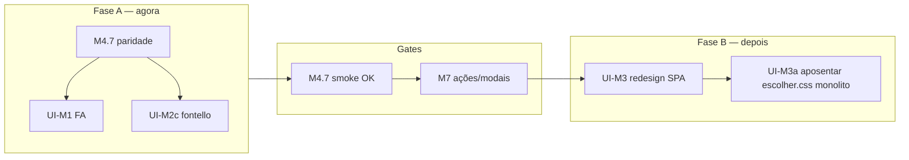

# Fontello + Font Awesome 4.7 — legado prod × Core homolog (marcos)

**Trilha:** EQ-R · **Prod ref (①):** `RDO-APP/Equipamentos` · `Assets/Styles/fonts.css`, `Assets/Fonts/fontello.*`  
**Homolog (②):** `Migration2Core` · `RdoApp.Core/wwwroot/css/escolher.css`, `client/src/cards-page.css`  
**Atualizado:** 2026-10-25

**Relacionados:** [`pendencias-melhorias-ui-stack.md`](pendencias-melhorias-ui-stack.md) · [`ORQUESTRADOR-MIGRACAO.md`](../ORQUESTRADOR-MIGRACAO.md) · manual **§10.7** · [`m4-execucao-checklist.md`](m4-execucao-checklist.md)

---

## O que é Fontello (e por que aparece no Core)

**Fontello** é um pacote de **fonte de ícones** (glifos em `.woff`/`.ttf`), gerado a partir de SVGs. No prod Equipamentos, classes como `icon-rdo-gerar-novo` ou `icon-logo` usam `:before { content: '\e824'; }` com `font-family: fontello` — mesmo padrão do **Font Awesome 4.7**, outra família de fonte.

**Sim, é 100% legado do operador web ①.** O homolog **não** roda Angular; a SPA React **reutiliza** nomes de classe e um **recorte** de CSS/fontes para **parecer** prod (estratégia **híbrida H**).

**Obstáculo Kiro (2025–2026):** misturar “modernizar CSS/ícones” com big-bang quebrou modais e init Angular. **Decisão vigente:** duas fases distintas — **paridade primeiro (M4.7)**, **troca de motor depois (UI-M3)**.

---

## Duas fases — não confundir

| Fase | Nome | Marco / IDs | Quando abre | O que fazer |
|------|------|-------------|-------------|-------------|
| **A** | **Paridade híbrida** (copiar legado) | **M4.7** · **UI-M1**, **UI-M2**, **UI-M2b**, **UI-M2c** | **Agora** (até smoke Lucio P2/P3 fechar M4.7) | Completar glifos FA 4.7 + fontello faltantes; flex/layout; **não** trocar tecnologia de ícone |
| **B** | **Motor visual moderno** (aposentar legado na SPA) | **UI-M3** (+ **UI-M3a** fontes/CSS · **UI-M3b** Razor morto) | **Só após** gates abaixo | Design tokens / CSS modules (ou equivalente); ícones SVG ou lib única; **sem** `panel-*`/`col-xs` copiados; página a página |

### Gates da fase B (UI-M3) — todos obrigatórios

1. **M4.7 ☑** — paridade P2/P3 aceita (incl. toolbar/header ícones).
2. **M7 estável** — modais/ações P3/P4 mapeados (RBAC fino); não refatorar visual no meio de M7.
3. **Branch dedicada** + ordem **Escolher → Cards → Login (M4.8)** — **nunca** swap global de CSS (regra **anti-Kiro**).

---

## Fase A — entregáveis e arquivos

| Entregável | Onde no Core | Fonte prod ① |
|------------|--------------|--------------|
| `@font-face` fontello + FA base | `wwwroot/css/escolher.css` | `Assets/Styles/fonts.css` |
| Ícones header (logo, dashboard, RDO) | `escolher.css` | `Client/nav.html` + `fonts.css` |
| Toolbar P3 (Gerar RDO, efetivo, etc.) | `escolher.css` + `client/src/cards-page.css` | `Client/Views/Tarefa/cards.html` |
| Card tarefa (status, trator, datas) | `cards-page.css` + trechos `escolher.css` | `custom.css` + `fonts.css` |

**Inventário vivo (P3 toolbar — copiar codepoint do legado):**

| UI prod | Classe | Codepoint legado (`fonts.css`) | Homolog deve ter em |
|---------|--------|--------------------------------|---------------------|
| Gerar RDO | `icon-rdo-gerar-novo` | `\e824` | `escolher.css` + `cards-page.css` |
| RDO header | `icon-rdo-novo_2` | `\e825` | `escolher.css` |
| Dashboard obra | `icon-dashboard` | `\e808` | `escolher.css` |
| Editar obra | `fa fa-edit` | `\f044` | `escolher.css` |
| Efetivo diário | `fa fa-list-alt` | `\f022` | `escolher.css` |
| Filtro / tarefa / etapa | `fa-filter`, `fa-clipboard`, `fa-file-o`, `fa-columns` | ver `fonts.css` | `escolher.css` |

**Critério de fechamento M4.7 (ícones):** smoke visual Lucio — toolbar linha título com **três** ícones visíveis (RDO, editar, efetivo) + header fontello; DevTools confirma glifos, não retângulos vazios.

---

## Fase B — o que muda (UI-M3 / UI-M3a)

| Hoje (híbrido) | Alvo UI-M3 |
|----------------|------------|
| `escolher.css` monolítico (fontes + header + FA parcial) | Pasta explícita `client/src/legacy-parity/` **ou** pacote tokens até sumir |
| Fontello + FA 4.7 na SPA | Uma estratégia de ícone (ex. SVG inline, sprite, lib React) — **sem** depender de codepoints `\e8xx` |
| Classes BS3 (`panel`, `col-xs`, `btn-simple`) | Layout/componentes React nativos |
| Copiar trechos de `custom.css` | Estilos derivados de design system |

**Fora de escopo UI-M3:** API BFF, RDS, Apontador (**EQ-M**) — só **camada visual** operador web **EQ-R**.

---

## Manutenção — sempre atualizar estes arquivos

Sempre que fechar um sub-marco de ícones/CSS (ex. M4.7d, M4.7f) ou **mover** a data de UI-M3:

| Evento | Atualizar |
|--------|-----------|
| Novo glifo / codepoint corrigido | Esta página (tabela inventário) · [`p3-botoes-habilitacao-m7.md`](p3-botoes-habilitacao-m7.md) se for botão P3 |
| M4.7 parcial ou fechado | [`m4-execucao-checklist.md`](m4-execucao-checklist.md) · **Próxima ação** em [`ORQUESTRADOR-MIGRACAO.md`](../ORQUESTRADOR-MIGRACAO.md) |
| Mudança de gate UI-M3 | [`pendencias-melhorias-ui-stack.md`](pendencias-melhorias-ui-stack.md) · § **Pendências stack UI** no orquestrador |
| Decisão estratégica (ex. adiar UI-M3) | **Decisões abertas** / **Próximos passos** no orquestrador · 1 linha em [`dimas-tsk-rastreio-m.md`](dimas-tsk-rastreio-m.md) § front legado |

**Regra agente / Lucio:** commit docs só **`Migration2Core`** → push → [`sync-docs-onedrive-from-git.ps1`](sync-docs-onedrive-from-git.ps1).

---

## O que **não** fazer no meio da Fase A

- Regenerar fontello ou trocar família de ícones “por limpeza” antes de **M4.7 ☑**.
- Importar `custom.css` / material-kit inteiros na SPA (volta o problema Kiro de peso e colisão BS5).
- Tratar “migração fontello → Core” como **substituir prod ①** — prod continua Angular até strangler; homolog **espelha visual**, não o runtime.
