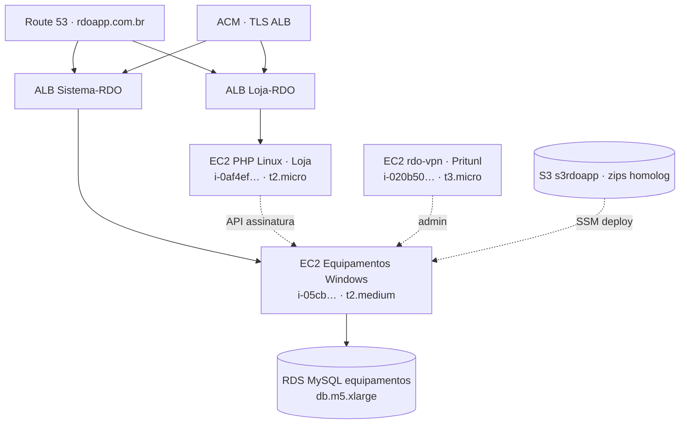

# Infraestrutura na nuvem (AWS) — RDO App

**Conta:** `775387704919` · **Região app:** `us-east-2` (Ohio)  
**Inventário verificado:** 2026-11-19 (CLI) · **Trilha:** I  
**Manual:** link em [`manual-frontend-rdo-equipamentos-prod-core-mobile.md`](../manual-frontend-rdo-equipamentos-prod-core-mobile.md) §14  
**Não é:** inventário Loja PHP operacional (chat Loja) — só o que existe na conta e como se acopla ao Sistema/homolog.

---

## 1. Mapa mental



**Fora da AWS (produto):** e-mail transacional frequentemente via **Locaweb** (`Smtp:*` na EC2) · domínio/Registro.br alinhado ao Route 53.

---

## 2. Compute — EC2

| Name | InstanceId | Tipo | OS | AZ | IP privado | IP público | Papel |
|------|------------|------|----|----|------------|------------|--------|
| **Equipamentos** | `i-05cb0003c031a26da` | **t2.medium** | **Windows** | us-east-2a | `172.31.2.89` | `13.59.68.235` | **Prod** `sistema` / `piscinas` (IIS :80 / :82) · homolog :5081 = **rollback W1** (fora do TG após L1) |
| **rdoapp-core-homolog-linux** | `i-0776acb09b8438f22` | **t3.small** | **Linux** AL2023 | us-east-2a | `172.31.2.111` | (dynamic) | **Homolog Core L1** · systemd :5081 · TG healthy (2026-11-19) |
| **PHP** | `i-0af4ef47531a19acb` | **t2.micro** | **Linux** | us-east-2c | `172.31.37.16` | `3.144.74.241` | **Loja** `loja.rdoapp.com.br` (+ homolog.loja no mesmo ALB) |
| **rdo-vpn** | `i-020b501ad993f5084` | t3.micro | Linux | us-east-2a | `172.31.5.248` | `18.220.47.19` (EIP) | VPN Pritunl (acesso admin) |

- VPC comum: `vpc-ea507a82`.
- Equipamentos: SG `sg_Equipamentos` · IAM `NewInstanceRole` · key `acessoFull_EC2` · root `vol-07245ce0183089bd1` · **launch 2019-09-17**.
- PHP/Loja: SG `sg_PHP` · IAM `ssm-ec2` · launch 2026-02-13.
- VPN: SG `sg_vpn` · key `vpn-pritunl`.

**Pasta homolog Core (Windows):** `C:\inetpub\wwwroot\homologacao\rdoapp_core` · Staging fora do Git.  
**Prod legado:** `C:\inetpub\wwwroot\rdoapp` — **não** tocar em L1.

### 2.1 Por que **não** aproveitar a EC2 Linux da Loja para L1

| Critério | Loja `i-0af4ef…` | L1 desejado |
|----------|------------------|-------------|
| Capacidade | **t2.micro** (1 vCPU / ~1 GiB) | Core self-contained + SPA — precisa headroom |
| Blast radius | **Checkout / Moip / assinatura** em produção | Homolog pode reiniciar processo o dia inteiro |
| Rede / ALB | ALB **Loja-RDO** · TG `RDO-Loja` :80 | Host `homolog.sistema` → ALB **Sistema-RDO** · TG **5081** |
| SG | `sg_PHP` | Homolog Sistema alinhado a `sg_Equipamentos` (ALB→5081 já liberado) |
| Operação | Chat/deploy **Loja** (`Loja_PHP`) | Chat **Migração** · scripts `Migration2Core` |
| Isolamento L1 | Mistura PHP + .NET na mesma caixa | Decisão fixa: **nova** EC2 Linux só homolog |

**Decisão (2026-11-19):** L1 = **nova** Amazon Linux na VPC do Sistema · **não** co-hospedar em `PHP` / Loja. Reuso eventual só como referência de “como rodar Linux+SSM na conta”, não como host.

---

## 3. Dados — RDS

| Campo | Valor |
|-------|--------|
| Identifier | `equipamentos` |
| Endpoint | `equipamentos.cslrikufb7hm.us-east-2.rds.amazonaws.com:3306` |
| Engine | MySQL **8.4.9** |
| Class | **db.m5.xlarge** |
| Storage | 20 GiB **gp3** · encrypted |
| Multi-AZ | **não** |
| Backup | 7 dias · janela `04:33–05:03` UTC |
| AZ | us-east-2a |
| Publicly accessible | **sim** (acesso DBeaver/dev via SG) |
| SG | `sg-043fb48adf74bdcac` |

**Catálogos (mesma instância):** ver [`rds-equipamentos-governanca-catalogos.md`](../rds-equipamentos-governanca-catalogos.md) — prod Equipamentos `novo_rdoapp` · homolog Core `homol_rdoapp` · Piscinas `piscinas_rdoapp` (+ homologa).

---

## 4. Entrada — ALB + Target Groups + DNS + TLS

### 4.1 Application Load Balancers

| ALB | DNS | Uso |
|-----|-----|-----|
| **Sistema-RDO** | `Sistema-RDO-674143510.us-east-2.elb.amazonaws.com` | `sistema` · `homolog.sistema` · `piscinas` · `hm` · `homologacao.piscinas` |
| **Loja-RDO** | `Loja-RDO-548272592.us-east-2.elb.amazonaws.com` | `loja` · `homolog.loja` |

SG ALB Sistema: `sg-00356b50f53dbbeee` (origem das regras 80/443/82/5081 no SG Equipamentos).

### 4.2 Target groups (us-east-2)

| TG | Porta | Destino típico |
|----|-------|----------------|
| **Ipv4-RDO** | 80 | Windows Equipamentos — **prod** `sistema` (healthy 2026-11-19) |
| **tg-equipamentos-homolog-5081** | 5081 | Windows homolog Core (W1) · alvo L1 Linux |
| **tg-equipamentos-hml-5081** | 5081 | TG legado/paralelo — **não** usar no cutover L1 sem conferir regras |
| **tg-piscinas-82** | 82 | Piscinas no Windows |
| **RDO-Loja** | 80 | Linux PHP — Loja (healthy) |

Regra Host **Priority 4** `homolog.sistema.rdoapp.com.br` → `tg-equipamentos-homolog-5081`.  
Host irmão Priority **3** `homologacao.piscinas…` → **mesmo** TG 5081 (cuidado ao cutover).

Health check homolog: path `/` matcher **200** — hoje Windows pode reportar **unhealthy** por **302**; ajustar path `/Account/Login` ou matcher `200,302` antes do L1.

### 4.3 Route 53 (zona `rdoapp.com.br` · `Z3MMCW2DDHV63Q`)

Alias A → ALB (amostra):

| Host | ALB |
|------|-----|
| `sistema.rdoapp.com.br` | Sistema-RDO |
| `homolog.sistema.rdoapp.com.br` | Sistema-RDO |
| `piscinas.rdoapp.com.br` | Sistema-RDO |
| `hm.rdoapp.com.br` | Sistema-RDO |
| `loja.rdoapp.com.br` | Loja-RDO |
| `homolog.loja.rdoapp.com.br` | Loja-RDO |

Outras zonas na conta (legado/marca): `relatoriodiariodeobra.com.br`, `livrodeordem.com.br`, `thermopyla.com.br`.

### 4.4 ACM (us-east-2)

- Certificados **ISSUED** para `rdoapp.com.br` (2 ARNs) e `homolog.loja.rdoapp.com.br`.
- TLS termina no **ALB** (origem EC2 em HTTP).

---

## 5. Outros serviços na conta (além de EC2 + RDS)

| Serviço | O que há | Papel RDO |
|---------|----------|-----------|
| **S3** | `s3rdoapp` (+ buckets CloudTrail/Config/TF/SSM diagnosis) | Zips publish/deploy homolog Core |
| **SSM** | Session Manager + Run Command | Deploy sem RDP/SSH; perfis `NewInstanceRole` / `ssm-ec2` |
| **EIP** | Vários; um preso ao VPN (`18.220.47.19`); outros **sem** associação | Reserva / legado |
| **SES** | Quota sandbox ~200/dia em us-east-1 e us-east-2 | **Não** é o SMTP principal do app (Staging usa Locaweb/`Smtp:*`) |
| **CloudFront** | Dist `E1LI0IUA4U7SYX` (`d17pkzve8mi08a…`) **sem** aliases | Provável órfão / teste — confirmar antes de apagar |
| **ElastiCache** | Nenhum | — |
| **SQS** | Fila Quick Setup lifecycle | Ops AWS, não app |
| **Lambda** | (lista operacional mínima / Quick Setup) | Não é runtime do Sistema |
| **IAM** | Instance profiles + user CLI Lucio | Deploy / SSM |
| **CloudWatch / Config / CloudTrail** | Buckets e telemetria conta | Auditoria AWS |

**Não inventariado aqui (fora AWS ou só na EC2):** Moip (Loja), Locaweb SMTP, Registro.br painel, APK stores.

---

## 6. Fluxos por host

| URL | Caminho |
|-----|---------|
| `https://sistema.rdoapp.com.br` | R53 → ALB Sistema → TG **Ipv4-RDO** :80 → IIS Windows → RDS `novo_rdoapp` |
| `https://homolog.sistema.rdoapp.com.br` | R53 → ALB Sistema → TG **homolog-5081** → Kestrel/IIS :5081 → RDS `homol_rdoapp` |
| `https://piscinas.rdoapp.com.br` | R53 → ALB Sistema → TG piscinas :82 → Windows → `piscinas_rdoapp` |
| `https://loja.rdoapp.com.br` | R53 → ALB Loja → TG **RDO-Loja** :80 → PHP Linux → (assinatura → API Sistema) |

---

## 7. L1 Linux (homolog Core) — encaixe

- **Nova** EC2 Amazon Linux · preferir VPC `vpc-ea507a82` · SG `sg_Equipamentos` (ou clone com ALB→5081) · IAM com SSM.
- **Não** usar `i-0af4ef…` (Loja).
- Windows permanece rollback no TG até smoke L1.
- Roteiro: [`../../RDO-CleanMigration-2026/DEPLOY-HOMOLOG-LINUX-EC2.md`](../../RDO-CleanMigration-2026/DEPLOY-HOMOLOG-LINUX-EC2.md) · plano [`plano-dia2-l1-linux.md`](plano-dia2-l1-linux.md).

---

## 8. Atualização deste inventário

Revalidar com CLI após mudanças de TG/EC2:

```powershell
aws ec2 describe-instances --region us-east-2 --filters "Name=instance-state-name,Values=running" --query "Reservations[].Instances[].{Id:InstanceId,Name:Tags[?Key=='Name']|[0].Value,Type:InstanceType,Platform:PlatformDetails}" --output table
```

```powershell
aws elbv2 describe-target-groups --region us-east-2 --query "TargetGroups[].{Name:TargetGroupName,Port:Port}" --output table
```
