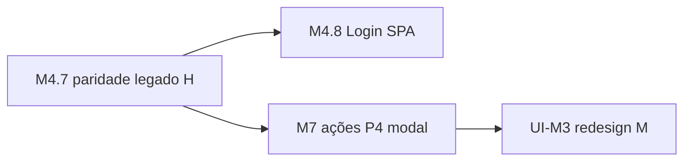

# Pendências — melhorias de stack UI (EQ-R homolog)

**Trilha:** EQ-R · **Repo:** `RDO-APP/Migration2Core` · **Atualizado:** 2026-10-24  
**Contexto:** paridade **P1–P3** (M4) usa DOM/classes do prod Angular/BS3 **sem** rodar Angular. Modernização “limpa” (item **UI-M3**) fica **depois** de M4.7 fechado + smoke — **não** big-bang no meio da paridade.

**Lição Kiro (2025–2026):** tentativa de substituir de uma vez Bootstrap/legado quebrou fluxo crítico (modal, scope, init). **Decisão:** strangler por **marco** (M4 pixel/dados → M7 ações → **UI-M3** redesign), não “parar tudo e refazer CSS”.

---

## Tabela P1–P4 — legado × homolog (camada por camada)

Legenda **Stack:** **L** = legado prod (EQ-L) · **M** = moderno Core · **H** = híbrido (React + pele legado).

| P | Página | Camada | Prod ① (EQ-L) | Homolog ② (Core + EQ-R) | Stack | Notas / pendência |
|---|--------|--------|---------------|-------------------------|:-----:|-------------------|
| **P1** | Login | UI runtime | AngularJS `#/login` | Razor `Account/Login` — CSS **inline**, sem CDN | **M** | **M4.8:** Login SPA opcional; EQ-W congelado |
| P1 | Login | Auth | `POST api/login/LoginUser` | Cookie MVC + sessão `LoginData` | **M** | TripleDES/sessão alinhada homolog |
| P1 | Login | Esqueci senha | Angular + API | Razor `EsqueciSenha` + SMTP | **H** | Smoke e-mail homolog pendente |
| **P2** | Escolher obra | UI runtime | Angular `escolher.html` | React SPA (`/app/`) servida em `/Obra/Escolher` | **M** | Sem `ng-view` |
| P2 | Escolher | JS libs na rota | BS3 + jQuery + Angular | React 19 + Vite; **sem** jQuery/Angular no `index.html` | **M** | |
| P2 | Escolher | CSS | `custom.css` + BS3 + FA 4.7 + fontello | BS **5.3** (link) + `header.css` + `escolher.css` (recorte prod) | **H** | **UI-M1:** BS5 + classes BS3 (`col-xs`, etc.) |
| P2 | Escolher | Ícones | FA + fontello completos | FA **parcial** em `escolher.css` + bundle | **H** | **UI-M2:** glifos card/toolbar |
| P2 | Escolher | Dados | `LoginObra` Web API | BFF `GET/POST /api/bff/obras` | **M** | |
| P2 | Escolher | Fallback Razor | — | `_LayoutEscolher` + jQuery + BS bundle (se SPA ausente) | **H** | Morto em deploy normal; manter até cutover |
| **P3** | Cards tarefa | UI runtime | Angular `cards.html` | React `CardsPage` + BFF agrupador | **M** | |
| P3 | Cards | Accordion | BS3 collapse + jQuery | React `useState` — classes `panel`/`accordion` legado | **H** | Comportamento moderno, markup legado |
| P3 | Cards | Card tarefa | `ng-repeat` + FA + fontello | `TaskCardAgrupador` — mesmas classes prod | **H** | **M4.7** paridade ícones/%/layout |
| P3 | Cards | Toolbar / modais | Bootstrap modal jQuery | Botões stub; **sem** modal medição | **M** parcial | **P4 → M7+** |
| P3 | Cards | CSS global prod | `custom.css` + material-kit (trechos) | **Não** carrega material-kit; subset `cards-page.css` | **H** | **UI-M3** pós-M4 |
| P3 | Cards | RBAC header | Diretivas Angular `permission` | BFF shell + `OperadorShell` | **H** | RBAC fino **M7+** |
| **P4** | Nova medição | UI | Modal `#nova-medicao-botao-rapido` + Angular | **Inexistente** homolog | **L** só prod | **M7+** — não antecipar no M4 |
| P4 | Mediçã | JS | `$('#…').modal('show')` | — | — | Kiro: exatamente onde quebrou |

### O que **não** roda no homolog (confirmado no código)

| Tecnologia | Prod | Homolog SPA |
|------------|:----:|:-----------:|
| AngularJS | ✅ | ❌ |
| jQuery | ✅ | ❌ (só Razor fallback) |
| Bootstrap 3 JS | ✅ | ❌ |
| ui-router / `ng-*` | ✅ | ❌ |

Backend homolog: **ASP.NET Core** + EF + BFF — **não** Web API legado `api/*` para telas operador.

---

## Lista de melhorias (backlog UI)

Prioridade **dentro do M4** antes de **UI-M3**:

| ID | Melhoria | Esforço | Marco | Status |
|----|----------|---------|-------|--------|
| **UI-M1** | Completar glifos **Font Awesome 4.7** (P3 card + toolbar) em `escolher.css` + bundle | P | **M4.7** | 🟡 em curso |
| **UI-M2** | Layout faixa ações card: flex puro, remover dependência `col-xs-*` / `pull-right` onde quebra BS5 | P | **M4.7** | 🟡 em curso |
| **UI-M2b** | Barra progresso P2/P3: cores `custom.css` (`#28496f` / `#eee`), % legível | P | **M4.7** | 🟡 em curso |
| **UI-M4** | Documentar hashes SPA pós-build no runbook deploy | P | I0 / ops | ☐ |
| **UI-M5** | Login: smoke Esqueci senha SMTP homolog | P | M4.8 | ☐ |

**Adiado de propósito (não fazer no meio do M4):**

| ID | Melhoria | Esforço | Marco | Status |
|----|----------|---------|-------|--------|
| **UI-M3** | **Redesign stack front operador:** tirar BS da SPA; CSS modules/design tokens; **sem** copiar `panel-*`/`col-xs`; opcionalmente um único `fonts.css` recortado | **G** | **Pós-M4.7** + gate M7 estável | ⏸ **adiado** |
| **UI-M3a** | Sub-item: eliminar `escolher.css` monolítico — extrair `@rdoapp/ui-tokens` ou pasta `client/src/legacy-parity/` explícita | G | com UI-M3 | ⏸ |
| **UI-M3b** | Sub-item: remover jQuery/BS JS dos layouts Razor mortos (`_LayoutEscolher`) após 100% SPA | M | pós UI-M3 | ⏸ |
| **UI-M6** | Unificar P1 Login na SPA (M4.8) **sem** refazer visual — só rota | M | M4.8 | ☐ planejado |

**Regra anti-Kiro:** **UI-M3** só abre quando (1) **M4.7☑** + smoke P2/P3 OK, (2) **M7** mapeou modais/ações, (3) branch dedicada + página por página (Escolher → Cards → Login), **nunca** “swap global de CSS”.

---

## Ordem recomendada (coragem incremental)

1. **Agora:** UI-M1, UI-M2, UI-M2b (terminar “parecer prod” com híbrido).  
2. **Depois:** M4.8, M7 (comportamento).  
3. **Por último:** UI-M3 (trocar motor visual) — o item que **não** pausar o resto.

---

## Links

- Paridade blocos: [`manual-frontend-rdo-equipamentos-prod-core-mobile.md`](../manual-frontend-rdo-equipamentos-prod-core-mobile.md) §10  
- M4 checklist: [`m4-execucao-checklist.md`](m4-execucao-checklist.md)  
- Decisão React vs Razor: [`migracao-frontend-razor-react-decisao.md`](../migracao-frontend-razor-react-decisao.md)  
- Orquestrador: [`ORQUESTRADOR-MIGRACAO.md`](../ORQUESTRADOR-MIGRACAO.md) § Pendências melhorias UI  
