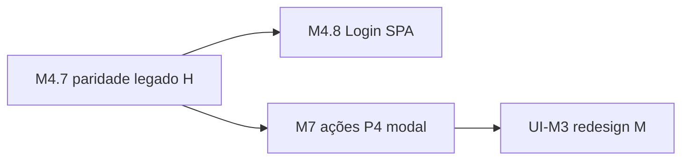

# Pendências — melhorias de stack UI (EQ-R homolog)

**Trilha:** EQ-R · **Repo:** `RDO-APP/Migration2Core` · **Atualizado:** 2026-11-21  
**Gate Lucio 18/11:** **3.1** · **CAT-PARALIZ-01** · e **todas** as melhorias desta lista (**M7-REL-***, I18N, DOC-FICHAS, UI-M3, foto-geo, etc.) **só** depois de (A) espelho aceito **e** (B) Core em **EC2 Linux (L1)**.  
**Dia 0 (19/11) FECHADO** — M0/M0′/W0.5/M3/M4/M5 web FECHADOS com residual abaixo.  
**Contexto:** paridade **P1–P5a** usa DOM/classes do prod Angular/BS3 **sem** rodar Angular. Modernização “limpa” (item **UI-M3**) fica **depois** de M4.7 fechado + **M7** estável — **não** big-bang no meio da paridade.

### Residual Dia 0 → pós-Linux (aceito 19/11)

| ID | Residual | Vinculo marco |
|----|----------|---------------|
| — | Branding homolog / E2 localhost | M0 |
| — | HAR API prod | M0′ |
| **UI-M1 / UI-M2c** | Fontello/FA fino (D1 ACEITAR) | M4 |
| **DOC-FICHAS** | Fichas manuais §13 restantes | M5 web |
| — | Polish tiles Chart | M5 web |
| **UI-M5** SMTP | Config SMTP EC2 homolog (D2 SIM) | P1 |
| **UI-M5b** | Esqueci senha polish fino (ícones/FA, faixa, tipografia) | P1 |
| **M7-REL-*** / I18N / UI-M3 / 3.1 / CAT / … | Já na tabela abaixo | M7+ |

**Não confundir:** endpoint BFF `GET /api/bff/rdos/cadastro/bootstrap` (dados iniciais do formulário M7) **≠** framework **Bootstrap** (CSS em `/lib/bootstrap/dist/css/bootstrap.min.css`).

**Fontello + FA 4.7 (legado → Core):** cronologia e gates em **[`fontello-fa-legado-marcos-ui.md`](fontello-fa-legado-marcos-ui.md)** — Fase A = **M4.7** (copiar glifos); Fase B = **UI-M3** (aposentar fontes legado na SPA).

**Lição Kiro (2025–2026):** tentativa de substituir de uma vez Bootstrap/legado quebrou fluxo crítico (modal, scope, init). **Decisão:** strangler por **marco** (M4 pixel/dados → M7 ações → **UI-M3** redesign), não “parar tudo e refazer CSS”.

**Prod ① (EQ-L):** Bootstrap **3.3.x** + jQuery + **Bootstrap 3 JS** + AngularJS.  
**Homolog SPA ②:** React 19 + Vite + Bootstrap **5 CSS** (link estático no `index.html`; **sem** `bootstrap` no `package.json`) + classes/markup copiados do prod (`form-control`, `btn-blue`, `col-md-*`, `panel-*`). **Sem** jQuery / BS JS na SPA.

**Impacto:** afeta **layout, ícones e esforço M7 (modais)** — **não** bloqueia BFF, RDS, deploy nem regras de negócio. Alternativas “melhores” (design tokens, Radix/shadcn, Tailwind) estão no marco **UI-M3** — adiadas para não repetir Kiro nem atrasar paridade funcional.

---

## Tabela por página — Bootstrap / stack legado (canônica)

Legenda **Stack:** **L** = só prod · **M** = moderno Core · **H** = híbrido (React + pele legado).

| Página / rota homolog | Homolog hoje | Legado (o quê) | Por que ainda está assim | Quando vamos mudar |
|------------------------|--------------|----------------|--------------------------|-------------------|
| **P1** `/Account/Login` | Razor · CSS **inline** (sem BS) | N/A (já fora do BS prod) | Controle total / incognito; fora da SPA | **M4.8 / UI-M6:** rota Login na SPA **sem** refazer visual · **UI-M3:** redesign visual |
| P1 Esqueci senha | Razor `EsqueciSenha` | Parcial H se reutilizar estilos | Fora do caminho crítico operador | **UI-M5** smoke SMTP · **UI-M3** com Login |
| **P2** `/Obra/Escolher` | React SPA | BS **5 CSS** + `escolher.css` + classes BS3 (`col-xs-*`, etc.) · FA/fontello **parcial** | Paridade visual com `escolher.html` sem reescrever CSS | **Agora M4.7:** **UI-M1**, **UI-M2c**, UI-M2, UI-M2b (copiar ícones/layout) · **UI-M3:** tirar BS/`escolher.css` monolítico (**UI-M3a**) |
| P2 fallback | Razor `_LayoutEscolher` | jQuery + bundle BS (se SPA ausente) | Contingência deploy | **UI-M3b:** remover após 100% SPA Escolher estável |
| **P3** `/Tarefa/Cards` | React SPA | BS5 CSS + `cards-page.css` + markup `panel`/accordion legado · modais prod = BS3+jQuery **ausentes** | Accordion/comportamento em React; visual clone prod | **M7+:** modais/ações (P4 medição) ainda em stack **H** · **UI-M3:** redesign página (pós-gates abaixo) |
| **P5a** `/Rdo/Index` | React SPA | BS5 + `rdo-index.css` + grid/filtros estilo prod | Mesma estratégia M5 web | **Agora:** **W3** / **UI-M1** (ícones PDF/assinar) · **M7** ações · **UI-M3:** layout sem BS legado |
| **P5a** `/Rdo/Cadastro` | React SPA (**M7 7a** · **7a-P5 ☑ T7h**) | BS5 + `rdo-cadastro.css` + radios/grid legado | Paridade cadastro novo RDO — gap: [`m7-rdo-cadastro-paridade-homolog-prod.md`](m7-rdo-cadastro-paridade-homolog-prod.md) | **M7-FOTOS-01/02** (thumbs + save imagens) · **7b–7d** · **UI-M3** |
| **P4** Nova medição | React `NovaMedicaoModal` (smoke 03/nov) | Prod: modal BS3 + Angular | Foto persist / NOVO* depois | **M7+:** polish · **UI-M3:** componente/modal moderno |
| **P5a** `/Chart/Index` · `/chart/rdos` | React SPA + BFF | CSS 5 faixas + ☰ export (**C1–C4** ☑, não Highcharts) | M5 web #2 | **DOC-FICHAS** · tiles `/chart/*` · **UI-M3** depois |
| **P5a** `/Dashboard/Index` | React SPA + BFF | CSS de paridade | M5 web #3 no ar | **DOC-FICHAS** · **UI-M3** depois |
| **Stubs** residuais (Paralizações CRUD, etc.) | Razor `EmMigracao` / SPA parcial | BS5 mínimo | Efetivo/Obra/LISTA já SPA `1bb526c` | **M7** Paralizações CRUD + CAT-PARALIZ-01 · **UI-M3** não prioriza stub |
| **Shell** header/menu (P2–P5a) | `OperadorShell` + `header.css` / `operador-shell.css` | FA/fontello parcial | RBAC + nav prod | **M4.7g / UI-M2d** drawer · **UI-M1/M2c** ícones · **UI-M3** tokens |

**Gates UI-M3 (Fase B — trocar motor visual):** (1) **M4.7 ☑** + smoke P2/P3 · (2) **M7** mapeou modais/ações principais · (3) branch dedicada · ordem **Escolher → Cards → RDO → Login** · ver [`fontello-fa-legado-marcos-ui.md`](fontello-fa-legado-marcos-ui.md).

**Referência cruzada:** manual §**10.7** · plano §**2.1** · orquestrador § **Pendências — melhorias (stack UI)**.

---

## Tabela P1–P4 — legado × homolog (camada por camada)

Legenda **Stack:** **L** = legado prod (EQ-L) · **M** = moderno Core · **H** = híbrido (React + pele legado).

| P | Página | Camada | Prod ① (EQ-L) | Homolog ② (Core + EQ-R) | Stack | Notas / pendência | Quando mudar |
|---|--------|--------|---------------|-------------------------|:-----:|-------------------|--------------|
| **P1** | Login | UI runtime | AngularJS `#/login` | Razor `Account/Login` — CSS **inline**, sem CDN | **M** | **M4.8:** Login SPA opcional; EQ-W congelado | **M4.8** rota SPA · **UI-M3** visual |
| P1 | Login | Auth | `POST api/login/LoginUser` | Cookie MVC + sessão `LoginData` | **M** | TripleDES/sessão alinhada homolog | **M6** JWT (paralelo) |
| P1 | Login | Esqueci senha | Angular + API | Razor `EsqueciSenha` + SMTP | **H** | Smoke e-mail homolog pendente | **UI-M5** |
| **P2** | Escolher obra | UI runtime | Angular `escolher.html` | React SPA (`/app/`) servida em `/Obra/Escolher` | **M** | Sem `ng-view` | — |
| P2 | Escolher | JS libs na rota | BS3 + jQuery + Angular | React 19 + Vite; **sem** jQuery/Angular no `index.html` | **M** | | — |
| P2 | Escolher | CSS | `custom.css` + BS3 + FA 4.7 + fontello | BS **5.3** (link) + `header.css` + `escolher.css` (recorte prod) | **H** | **UI-M1:** BS5 + classes BS3 (`col-xs`, etc.) | **M4.7** polish · **UI-M3** aposentar |
| P2 | Escolher | Ícones | FA + fontello completos | FA **parcial** + fontello **subset** em `escolher.css` | **H** | **UI-M1** (FA) · **UI-M2c** (fontello) | **M4.7** · **UI-M3** Fase B |
| P2 | Escolher | Dados | `LoginObra` Web API | BFF `GET/POST /api/bff/obras` | **M** | | — |
| P2 | Escolher | Fallback Razor | — | `_LayoutEscolher` + jQuery + BS bundle (se SPA ausente) | **H** | Morto em deploy normal; manter até cutover | **UI-M3b** |
| **P3** | Cards tarefa | UI runtime | Angular `cards.html` | React `CardsPage` + BFF agrupador | **M** | | — |
| P3 | Cards | Accordion | BS3 collapse + jQuery | React `useState` — classes `panel`/`accordion` legado | **H** | Comportamento moderno, markup legado | **UI-M3** |
| P3 | Cards | Card tarefa | `ng-repeat` + FA + fontello | `TaskCardAgrupador` — mesmas classes prod | **H** | **M4.7** paridade ícones/%/layout | **M4.7** · **UI-M3** |
| P3 | Cards | Toolbar / modais | Bootstrap modal jQuery | Botões stub; **sem** modal medição | **M** parcial | **P4 → M7+** | **M7+** funcional · **UI-M3** modal |
| P3 | Cards | CSS global prod | `custom.css` + material-kit (trechos) | **Não** carrega material-kit; subset `cards-page.css` | **H** | | **UI-M3** |
| P3 | Cards | RBAC header | Diretivas Angular `permission` | BFF shell + `OperadorShell` | **H** | RBAC fino **M7+** | **M7+** |
| **P4** | Nova medição | UI | Modal `#nova-medicao-botao-rapido` + Angular | **Inexistente** homolog | **L** só prod | **M7+** — não antecipar no M4 | **M7+** · **UI-M3** |
| P4 | Mediçã | JS | `$('#…').modal('show')` | — | — | Kiro: exatamente onde quebrou | **M7+** React · nunca BS3 JS na SPA |

### O que **não** roda no homolog (confirmado no código)

| Tecnologia | Prod | Homolog SPA |
|------------|:----:|:-----------:|
| AngularJS | ✅ | ❌ |
| jQuery | ✅ | ❌ (só Razor fallback) |
| Bootstrap 3 JS | ✅ | ❌ |
| ui-router / `ng-*` | ✅ | ❌ |

Backend homolog: **ASP.NET Core** + EF + BFF — **não** Web API legado `api/*` para telas operador.

---

## Lista de melhorias (backlog UI)

Prioridade **dentro do M4** antes de **UI-M3**:

| ID | Melhoria | Esforço | Marco | Status |
|----|----------|---------|-------|--------|
| **UI-M1** | Completar glifos **Font Awesome 4.7** (P3 card + toolbar) em `escolher.css` + bundle | P | **M4.7** | 🟡 em curso |
| **UI-M2c** | Completar **fontello** (codepoints `\e8xx` do prod) — header + toolbar P3; inventário em [`fontello-fa-legado-marcos-ui.md`](fontello-fa-legado-marcos-ui.md) | P | **M4.7** | 🟡 em curso (M4.7f+) |
| **UI-M2** | Layout faixa ações card: flex puro, remover dependência `col-xs-*` / `pull-right` onde quebra BS5 | P | **M4.7** | 🟡 em curso |
| **UI-M2b** | Barra progresso P2/P3: cores `custom.css` (`#28496f` / `#eee`), % legível | P | **M4.7** | 🟡 em curso |
| **UI-M4** | Documentar hashes SPA pós-build no runbook deploy | P | I0 / ops | ☐ |
| **UI-M2d** | **Drawer menu mobile:** CSS prod — gap **logo ↔ ☰**, hamburger 63px desktop · `operador-shell.css` **2026-10-26** | P | **M4.7g** | 🟡 smoke Lucio |
| **UI-P3-1.5a** | Cadastro etapa: botões **Voltar / SALVAR** inline | P | smoke 1.5 ✅ 05/11 | ✅ smoke Lucio 18/11 · tip `10616e0` · SALVAR ✓ opcional |
| **UI-M4-layout** | Faixa desktop **FILTRO / ADICIONAR TAREFA / ETAPA** — alinhamento e tamanho vs prod (Lucio aceita menor hoje; refinamento no redesign) | P | **UI-M3** (Fase B) | ⏸ |
| **UI-M5** | Esqueci senha: logo + fundo ☑ smoke 19/11 · **SMTP homolog** config EC2 · **UI-M5b** polish fino (ícones/FA, faixa vazia, tipografia ≈ prod Angular) = **pós-Linux** | P | M4.8 / gate L1 | 🟡 SMTP ☐ · polish **UI-M5b** ⏸ L1 |
| **M5-nav** | **Menu 9 itens:** cada `href` legado → MVC `EmMigracao` ou rota Core · mapa `LegacyOperadorRoutes` + `ModuloLegadoController` **2026-10-26** | M | **M5** + trilha **M4.7g** stubs | 🟡 smoke G5 |
| **M7-P3** | **SELECIONAR TUDO** — marcar cards + fluxo alterar status em massa (prod main.js + modal) | M | **M7** · não UI-M3 | ✅ smoke 05/11 |
| **CAT-PARALIZ-01** | **Códigos de paralisação por empresa** — hoje `tarefa_codigo_paralizacao` é **global** (PK = código 3 chars). Melhor: `tarcp_id_empresa` + PK composta `(empresa, código)`; telas/APIs filtram pela empresa da sessão/obra; migrar clonando os ~22 códigos por empresa; join descrição = código+empresa. **Evitar** prefixo no código e escopo por obra. Até o ALTER: **não** liberar CRUD de paralização a cliente (só admin RDO). Relacionado **3.1** (⋮ Pausada). **Proibido** `ALTER novo_rdoapp` sem Lucio. | G | **M7+** (dados/tenant) | ⬜ backlog 06/11 |
| **DOC-DNA-01** | **DNA perfis / #29 dono** — admin prod `380…` ≠ smoke homolog `538…`. Material CSV/prints 16/11 (GPA/acao/menu/pagina/parametro) no § abaixo. **Não** analisar agora; espelhar prod→homol primeiro. Canônico cms §0/§6 · **#29**. | M | **#29** pós-M7 · ≠ P6b M10 | ⬜ backlog · material 16/11 |
| **EQ-M-GPA-01** | **Apontador: ações por GPA (não CMS 1:1)** — mobile herda **ações** do `grupo` da obra (`grupo_pagina_acao` / flags no login·obra); **não** portar drawer `#/grupo` `#/menu` `#/pagina`. Hoje card campo tem menos botões (sem olho/lápis) por desenho de produto, **não** por CPF `380…`. Após DNA/#29 + Bearer BFF: expor flags → UI consome. Olho/lápis no app **só** se ação GPA + decisão de produto. | G | **M6+** / pós **DOC-DNA-01** · **≠** P6b | ⬜ decisão Lucio 21/11 · § abaixo |
| **I18N-ES-01** | **Espanhol nas páginas (UI)** — catálogo `pt-BR`/`es` só no React homolog (EQ-R); **sem** CPF/doc estrangeiro, máscaras, schema ou login identity. Plano fechado § abaixo. | M | **M7+** / pós-paridade tela · **antes** de DOC-ID-PAIS | ⬜ backlog 13/11 |
| **M7-FOTO-PERSIST** | **Gravar foto** em Nova Medição / cadastro tarefa: Escolher+Adicionar enviava só blob local; agora `listaImagens[].base64` → BFF → `Uploads/Imagens/{obra}/{tarefa}/{yyyyMM}/` + row `imagem`. | M | **M7+** P4 | 🟡 código 15/11 · smoke pós-deploy |
| **M7-FOTO-PASTA-MES** | Separar fotos (RDO fotográfico / Uploads) em **pastas por mês**. Save novo já grava `{yyyyMM}`; restante: consolidar paths legados + opcional agrupar no PDF. | M | **M7+** | 🟡 parcial (path novo) |
| **M7-EFETIVO-CARD** | **Efetivo Diário ↔ colabs do card:** estudar vínculos `obra_tarefa_colaborador` × efetivo do dia; propor UX (espelhar / sugerir / sync 1 clique); executar após aceite Lucio. | G | **M7+** | ⬜ estudar 15/11 |
| **M7-CRONO-EXCEL** | **Upload Excel → Etapa/Tarefa:** template colunas (etapa, tarefa, datas, qtd, unidade); BFF validar + preview + commit; dry-run obrigatório. | G | **M7+** / M9 | ⬜ estudar 15/11 |
| **M7-API-BI** | **APIs × BI:** inventariar BFF Chart/Dashboard/RDO/Efetivo já existentes; propor Power BI / export CSV-JSON read-only (sem write); LGPD/tenant. | M | **M7+** / pós-M6 OpenAPI | ⬜ estudar 15/11 |
| **M7-FOTO-GEO** | **Geo na foto:** lat/long (celular/PC) no capture **ou** API especialista (ex. PhotoStamp). Schema + LGPD + caminho Apontador. | G | **M7+** / EQ-M | ⬜ estudar 15/11 · § abaixo |
| **M7-PDF-FOTOS-LINHA** | **PDF fotográfico — qtd. fotos/linha:** no Novo RDO (antes de GERAR), usuário escolhe 1–4 (default **4** = prod `Rdo.rdlc` 4 cm). Hoje fixo paridade prod. | M | **M7+** · após smoke layout F7 | ⬜ backlog 16/11 |
| **M7-PDF-FOTO-GEO-LEG** | **Legenda com coordenadas** no PDF (lat/long sob cada foto). Depende **M7-FOTO-GEO** (schema + capture). | M | **M7+** pós GEO | ⬜ backlog 16/11 |
| **M7-PDF-FOTO-LEGENDA** | **Legenda manual** antes de imprimir: campo texto por foto na galeria do Novo RDO → persiste → imprime sob a miniatura no PDF. | M | **M7+** | ⬜ backlog 16/11 |
| **M7-REL-EFETIVO-LAYOUT** | Relatório Efetivo PDF/Excel ≈ RDLC. **PDF logo OK**. Excel layout OK (17/11). Célula texto **rdo** = placeholder HTML — **trocar por logo bitmap** (foto obra / brand) via **ClosedXML** no mesmo PR que Medição. | M | **M7+** | 🟡 layout OK · **logo bitmap Excel = item Lucio 17/11** |
| **M7-REL-MEDICAO-LAYOUT** | Relatório Medição: PDF tabela OK (M6). Excel grade OK; logo = mesmo placeholder **rdo**. **Item:** logo bitmap Excel Medição **+** Efetivo juntos (ClosedXML). | M | **M7+** | 🟡 M6 smoke · **logo bitmap = item** 17/11 |
| **M7-REL-HORAS-XLS** | Impressora Controle de Horas: **22/11** Core → **`.xlsx` OOXML** (I5; HTML-.xls quebrava no Excel Android). Residual: logo bitmap obra (célula **rdo**); polish layout vs RDLC. PDF QuestPDF OK. | M | **M7+** | 🟡 xlsx código · logo bitmap = backlog |
| **M7-COLAB-TERCEIRIZADO** | Perfil **Terceirizado** no dropdown: gap era **DML** — homol sem row; prod já tinha `34`. **INSERT** `grupo` 34 em `homol_rdoapp` 16/11 (espelho prod). Código extras + smoke pós-deploy. | M | **M7+** | 🟡 DML OK · smoke UI pendente |
| **M7-REL-EFETIVO-HIST** | **Histórico de relatórios de Efetivo Diário** (como listagem de RDOs): tabela com período gerado, quem gerou, data/hora da geração, botões Excel/PDF (re-download), filtros. Exige persistir metadados a cada GERAR (schema + LGPD). | G | **M7+** | ⬜ backlog 16/11 |
| **M7-EFETIVO-NOVO-MODAL** | **Adicionar Colaborador** no Efetivo: hoje botão → `/Colaborador/Cadastro` + ícone `fa-users`; paridade prod = modal `#novo-colaborador` na própria página. | M | **M7+** | ⬜ parcial (botão+rota+ícone) 16/11 |

**Adiado de propósito (não fazer no meio do M4):**

| ID | Melhoria | Esforço | Marco | Status |
|----|----------|---------|-------|--------|
| **UI-M3** | **Redesign stack front operador:** tirar BS da SPA; CSS modules/design tokens; **sem** copiar `panel-*`/`col-xs`; **aposentar fontello + FA parcial** na SPA | **G** | **Pós-M4.7 ☑** + **M7** estável — gates em [`fontello-fa-legado-marcos-ui.md`](fontello-fa-legado-marcos-ui.md) | ⏸ **adiado** |
| **UI-M3a** | Sub-item: eliminar `escolher.css` monolítico — extrair `@rdoapp/ui-tokens` ou pasta `client/src/legacy-parity/` explícita; **substituir** dependência de `Assets/Fonts/fontello.*` legado | G | com UI-M3 | ⏸ |
| **UI-M3b** | Sub-item: remover jQuery/BS JS dos layouts Razor mortos (`_LayoutEscolher`) após 100% SPA | M | pós UI-M3 | ⏸ |
| **UI-M6** | Unificar P1 Login na SPA (M4.8) **sem** refazer visual — só rota | M | M4.8 | ☐ planejado |
| **UI-P1-01** | Campo **CPF**: ao focar vazio, Chrome não deve listar **e-mails** (“Gerenciar endereços…”). **CPF salvo** pode aparecer **depois** de começar a digitar (gerenciador de senhas do site) — aceite ≈ prod | P | M4.8 | ☑ código · smoke Lucio: e-mail sumiu · CPF ao digitar OK |

**Regra anti-Kiro:** **UI-M3** só abre quando (1) **M4.7☑** + smoke P2/P3 OK, (2) **M7** mapeou modais/ações, (3) branch dedicada + página por página (Escolher → Cards → Login), **nunca** “swap global de CSS”.

---

## Ordem recomendada (coragem incremental)

1. **Agora:** UI-M1, **UI-M2c**, UI-M2, UI-M2b (terminar “parecer prod” com híbrido — **copiar** legado, não modernizar ícones).  
2. **Depois:** M4.8, M7 (comportamento).  
3. **Por último:** UI-M3 (trocar motor visual + **Fase B** fontello/FA) — o item que **não** pausar o resto.

---

---

## Catálogo tenant — códigos de paralisação (06/11)

**Problema:** tabela `tarefa_codigo_paralizacao` compartilhada por todas as empresas no mesmo RDS; CRUD de uma afeta as outras.

**Decisão (melhor forma):** escopo por **empresa** (não por obra).

| Passo | Ação |
|-------|------|
| 1 | Coluna `tarcp_id_empresa` (FK empresa) |
| 2 | PK composta `(tarcp_id_empresa, tarcp_codigo_paralizacao)` (ou surrogate + unique) |
| 3 | Listagem/CRUD/combo Pausada filtram pela empresa da sessão/obra |
| 4 | Migração: clonar códigos atuais (~22) **por empresa** (ou defaults + cópia na 1ª edição) |
| 5 | `tarefa.tar_codigo_paralizacao` segue varchar(3); descrição via join código **+** empresa da obra |

**ID backlog:** **CAT-PARALIZ-01** · marco **M7+** · ver também orquestrador **3.1**.

---

## DNA / dono da assinatura (DOC-DNA-01)

**Problema:** DNA de perfis é o núcleo do produto; #29 (dono atribui perfil) não pode começar sem ficha fechada. Admin plataforma (CPF `380.181.694-03` / `col_st_admin`) **≠** dono da assinatura **≠** Operador na obra.

**Material 16/11 (não analisar agora — foco = espelhar prod→homol):** dumps Desktop Lucio `grupo_pagina_acao_202611162240.csv` · `pagina_202611162242.csv` · `pagina_acao_202611162243.csv` + prints `acao` · `menu` · `menu_pagina` · `parametro`. DER poderes: `acao` → `pagina_acao` → `grupo_pagina_acao` ← `grupo`; drawer = `menu` + `menu_pagina` + `pagina`. **CPF:** prod admin `380…` · homolog smoke `538.219.635-49`. Análise profunda = sessão futura DOC-DNA-01.

**Já documentado (não reabrir):** cms §0 · 15 templates · 2 menus · P6a vs P6b · dono só atribui 5 papéis da licença · sem CMS/checkboxes no cliente.

**Gaps a fechar na ficha (quando Lucio pedir — sem análise agora):**

| # | Gap |
|---|-----|
| 1 | Snapshot CPF admin → `colaborador` / `col_st_admin` / empresa (prod × homol) |
| 2 | Lista canônica dos 15 `gru_id` × licença (ids RDS) |
| 3 | Export GPA completo (`grupo ⋈ grupo_pagina_acao ⋈ pagina ⋈ acao`) |
| 4 | Modelo dono: empresa Loja × `obra.obr_id_dono` × usuário que atribui |
| 5 | Fluxo UI #29 + efeito de troca de plano Loja |
| 6 | § único: admin CPF ≠ dono ≠ Operador obra |
| 7 | **EQ-M-GPA-01** — mapa ações GPA → flags no contrato mobile (login/obra); sem CMS drawer no APK |

**ID backlog:** **DOC-DNA-01** · issue **#29** · **≠** P6b (M10) · ver [`cms-grupo-menu-pagina-prod.md`](cms-grupo-menu-pagina-prod.md).

---

## EQ-M — GPA no Apontador (EQ-M-GPA-01) · decisão 21/11

**Problema:** card mobile tem menos botões que o web (sem olho/lápis; Chart oculto no flavor Apontador). Isso é **desenho de campo**, não GPA do CPF admin `380…`.

**Decisão Lucio (21/11):** no futuro o mobile **segue o espírito** do DNA — herda **ações** do `grupo` da obra — **não** o CMS menu/página 1:1.

| Camada | Web | Mobile alvo |
|--------|-----|-------------|
| Drawer `#/grupo` `#/menu` `#/pagina` | P6b / admin | **não** portar |
| Ações GPA (editar, status, gerar RDO, …) | shell / GPA | **sim** — flags no login/obra |
| Admin `380…` / P6b | plataforma | **fora** do Apontador |

**Pré-requisitos:** **DOC-DNA-01** / **#29** · Bearer BFF (M6) · contrato de flags. Olho/lápis no app só se ação GPA **e** produto quiser cadastro no campo.

**ID backlog:** **EQ-M-GPA-01** · trilha **EQ-M** · **≠** P6b.

---

## I18N — espanhol nas páginas (I18N-ES-01) · plano fechado 13/11

**Problema:** cliente/obra em espanhol precisa **ler a UI** em ES; o produto ainda não tem i18n. Misturar isso com “CPF de outro país” atrasa as duas frentes.

**Decisão:** **idioma (UI) ≠ identidade (documento)**. Traduzir páginas **antes** de alterar acesso via CPF/doc estrangeiro.

### Escopo (fazer)

| # | Ação |
|---|------|
| 1 | Só **texto de UI** — labels, botões, toasts, títulos, empty states, tooltips de chrome |
| 2 | Só **React homolog (EQ-R)** `Migration2Core/client` — **não** traduzir Angular EQ-L (descartável no cutover) |
| 3 | Lib leve (`i18next` ou equivalente) + pastas `locales/pt-BR.json` · `locales/es.json` · chaves estáveis (`dashboard.title`, …) |
| 4 | Locale por **empresa/usuário** (cookie / `localStorage` / flag sessão) — **não** inferir pelo CPF |
| 5 | Default **`pt-BR`**; `es` opt-in |
| 6 | Ordem de telas: Login → Escolher → Cards → RDO → Dashboard → cadastros P6a (1 tela piloto antes de espalhar) |
| 7 | Dados de negócio (status no RDS, cargos, códigos paralização): **não** ALTER; só rótulo UI se necessário |

### Fora de escopo (outra frente — depois)

| ID sugerido | Tema |
|-------------|------|
| **DOC-ID-PAIS** (futuro) | CPF vs CI/DNI/RUT, máscaras, unicidade, validação de login por país |
| — | PDF/RDLC, e-mails, formatos data/número/moeda por país (2ª onda locale) |
| — | EQ-M Apontador (coordenar depois se compartilharmos pacote de strings) |

### Critério de pronto (I18N-ES-01)

- [ ] Infra i18n no client + seletor/locale persistido  
- [ ] Piloto 1 tela (ex. Dashboard) `pt-BR`/`es` sem regressão  
- [ ] Jornada P1–P3 + P5a RDO + Dashboard com strings externas (sem hardcode ES no JSX)  
- [ ] Doc curto no runbook / manual §10: como adicionar chave  

**ID backlog:** **I18N-ES-01** · trilha **EQ-R** · **≠** DOC-DNA-01 · **≠** DOC-ID-PAIS · **não** bloqueia M5/M7 smoke atual.

## Propostas Lucio 15/11 (estudar → executar)

### M7-EFETIVO-CARD — Efetivo Diário × colabs do card

**Problema:** efetivo e `obra_tarefa_colaborador` não conversam na SPA.  
**Proposta:** (A) no Efetivo, botão “Trazer do dia / das tarefas Em Execução”; (B) no card, atalho “Ver no efetivo”; (C) sync 1-way no save da medição (opcional). Começar por **A** (read-only suggest) sem alterar prod.  
**Aceite:** smoke Georges — marcar colabs no card → sugeridos no efetivo do mesmo dia.

### M7-CRONO-EXCEL — Upload Excel Etapa/Tarefa

**Problema:** cronograma nasce tela a tela.  
**Proposta:** template `.xlsx` (etapa, ordem, tarefa, status inicial Planejada, datas, qtd, unidade); BFF `POST /api/bff/obras/{id}/cronograma/preview` + `/commit`; dry-run lista erros de linha; commit em transação.  
**Aceite:** obra vazia → upload → N etapas/tarefas no P3.

### M7-API-BI — APIs para BI

**Já existe (homolog BFF):** Chart, Dashboard, RDO lista, Efetivo, etapas/cards — cookie/session hoje.  
**Proposta:** (1) inventário OpenAPI dos GETs agregados; (2) export CSV diário por obra (read-only); (3) Power BI via gateway só após **M6** JWT/client-credentials + escopo tenant. **Não** expor write.  
**Aceite:** doc de endpoints + 1 dataset Chart/Dashboard consumível em Power BI Desktop (homolog).

### M7-FOTO-GEO — Latitude / longitude na foto (ou PhotoStamp)

**Problema:** evidência fotográfica sem localização → disputa em medição/fiscalização B2G.  
**LGPD:** coordenada = dado pessoal potencial (localização). Base legal + aviso no App/web; retenção alinhada à foto; não logar GPS em texto livre.

#### Opções

| Via | Como | Prós | Contras |
|-----|------|------|---------|
| **A — Browser / Apontador** | `navigator.geolocation` (web) ou Expo Location (EQ-M) no momento **Adicionar foto**; enviar `lat`/`lng`/`accuracy`/`capturedAt` no mesmo POST da foto | Controle nosso; sem vendor | PC desktop muitas vezes sem GPS; usuário pode negar permissão; spoof possível |
| **B — EXIF da imagem** | Ler GPS IFD do JPEG no BFF ao salvar | Zero UX extra se a câmera já gravou | Muitos celulares **strip** EXIF; web `input file` nem sempre traz EXIF |
| **C — Especialista (PhotoStamp-like)** | API/SDK carimba foto (geo + tempo + hash); guardar `provider`, `stampId`, `payload` | Carimbo + antifraude de mercado | Custo, contrato, subprocessador LGPD, lock-in; PoC antes de prod |

**Recomendação (strangler):**  
1. **Fase 1 (homol):** schema + Via **A** no upload já feito (**M7-FOTO-PERSIST**); Via **B** best-effort se EXIF existir.  
2. **Fase 2:** Apontador (EQ-M) — GPS nativo + mesma API.  
3. **Fase 3 (opcional):** PoC **PhotoStamp** (ou similar BR) só se fiscal exigir carimbo externo — espelhar resultado nas colunas `provider_*`, sem substituir o arquivo nosso.

#### Schema proposto (só `homol_rdoapp` primeiro)

Tabela **`imagem`** (aditivo — **proibido** `ALTER novo_rdoapp` sem Lucio):

| Coluna | Tipo | Nota |
|--------|------|------|
| `ima_nr_latitude` | `decimal(10,7) NULL` | WGS84 |
| `ima_nr_longitude` | `decimal(10,7) NULL` | WGS84 |
| `ima_nr_accuracy_m` | `float NULL` | precisão GPS (m) |
| `ima_dt_geo` | `datetime NULL` | instante da leitura GPS |
| `ima_ds_geo_source` | `varchar(32) NULL` | `browser` · `apontador` · `exif` · `photostamp` |
| `ima_ds_geo_provider_id` | `varchar(100) NULL` | id externo (PhotoStamp etc.) |

Índice opcional `(ima_id_tarefa, ima_dt_geo)` para listagens.

#### Execução (ordem)

1. Doc + aceite Lucio deste § (feito como proposta).  
2. Script SQL **só** `homol_rdoapp` + EF entity `Imagem`.  
3. Client: pedir geo no **Adicionar foto** (fail-open se negar).  
4. BFF: gravar colunas no `SyncNovasImagensAsync`.  
5. RDO PDF / galeria: badge “com GPS” (opcional).  
6. Avaliar PhotoStamp em PoC separada (custo + DPA).

**Aceite Fase 1:** foto nova no homolog com lat/long no RDS quando o dispositivo autorizar; foto sem permissão continua salvando (geo NULL).

## Links

- Paridade blocos: [`manual-frontend-rdo-equipamentos-prod-core-mobile.md`](../manual-frontend-rdo-equipamentos-prod-core-mobile.md) §10  
- M4 checklist: [`m4-execucao-checklist.md`](m4-execucao-checklist.md)  
- Decisão React vs Razor: [`migracao-frontend-razor-react-decisao.md`](../migracao-frontend-razor-react-decisao.md)  
- Orquestrador: [`ORQUESTRADOR-MIGRACAO.md`](../ORQUESTRADOR-MIGRACAO.md) § Melhorias produto · § DNA / **#29** · **EQ-M-GPA-01**  
- CMS DNA: [`cms-grupo-menu-pagina-prod.md`](cms-grupo-menu-pagina-prod.md) §0 / §6  

