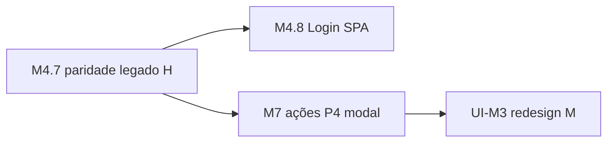

# Pendências — melhorias de stack UI (EQ-R homolog)

**Trilha:** EQ-R · **Repo:** `RDO-APP/Migration2Core` · **Atualizado:** 2026-10-27  
**Contexto:** paridade **P1–P5a** usa DOM/classes do prod Angular/BS3 **sem** rodar Angular. Modernização “limpa” (item **UI-M3**) fica **depois** de M4.7 fechado + **M7** estável — **não** big-bang no meio da paridade.

**Não confundir:** endpoint BFF `GET /api/bff/rdos/cadastro/bootstrap` (dados iniciais do formulário M7) **≠** framework **Bootstrap** (CSS em `/lib/bootstrap/dist/css/bootstrap.min.css`).

**Fontello + FA 4.7 (legado → Core):** cronologia e gates em **[`fontello-fa-legado-marcos-ui.md`](fontello-fa-legado-marcos-ui.md)** — Fase A = **M4.7** (copiar glifos); Fase B = **UI-M3** (aposentar fontes legado na SPA).

**Lição Kiro (2025–2026):** tentativa de substituir de uma vez Bootstrap/legado quebrou fluxo crítico (modal, scope, init). **Decisão:** strangler por **marco** (M4 pixel/dados → M7 ações → **UI-M3** redesign), não “parar tudo e refazer CSS”.

**Prod ① (EQ-L):** Bootstrap **3.3.x** + jQuery + **Bootstrap 3 JS** + AngularJS.  
**Homolog SPA ②:** React 19 + Vite + Bootstrap **5 CSS** (link estático no `index.html`; **sem** `bootstrap` no `package.json`) + classes/markup copiados do prod (`form-control`, `btn-blue`, `col-md-*`, `panel-*`). **Sem** jQuery / BS JS na SPA.

**Impacto:** afeta **layout, ícones e esforço M7 (modais)** — **não** bloqueia BFF, RDS, deploy nem regras de negócio. Alternativas “melhores” (design tokens, Radix/shadcn, Tailwind) estão no marco **UI-M3** — adiadas para não repetir Kiro nem atrasar paridade funcional.

---

## Tabela por página — Bootstrap / stack legado (canônica)

Legenda **Stack:** **L** = só prod · **M** = moderno Core · **H** = híbrido (React + pele legado).

| Página / rota homolog | Homolog hoje | Legado (o quê) | Por que ainda está assim | Quando vamos mudar |
|------------------------|--------------|----------------|--------------------------|-------------------|
| **P1** `/Account/Login` | Razor · CSS **inline** (sem BS) | N/A (já fora do BS prod) | Controle total / incognito; fora da SPA | **M4.8 / UI-M6:** rota Login na SPA **sem** refazer visual · **UI-M3:** redesign visual |
| P1 Esqueci senha | Razor `EsqueciSenha` | Parcial H se reutilizar estilos | Fora do caminho crítico operador | **UI-M5** smoke SMTP · **UI-M3** com Login |
| **P2** `/Obra/Escolher` | React SPA | BS **5 CSS** + `escolher.css` + classes BS3 (`col-xs-*`, etc.) · FA/fontello **parcial** | Paridade visual com `escolher.html` sem reescrever CSS | **Agora M4.7:** **UI-M1**, **UI-M2c**, UI-M2, UI-M2b (copiar ícones/layout) · **UI-M3:** tirar BS/`escolher.css` monolítico (**UI-M3a**) |
| P2 fallback | Razor `_LayoutEscolher` | jQuery + bundle BS (se SPA ausente) | Contingência deploy | **UI-M3b:** remover após 100% SPA Escolher estável |
| **P3** `/Tarefa/Cards` | React SPA | BS5 CSS + `cards-page.css` + markup `panel`/accordion legado · modais prod = BS3+jQuery **ausentes** | Accordion/comportamento em React; visual clone prod | **M7+:** modais/ações (P4 medição) ainda em stack **H** · **UI-M3:** redesign página (pós-gates abaixo) |
| **P5a** `/Rdo/Index` | React SPA | BS5 + `rdo-index.css` + grid/filtros estilo prod | Mesma estratégia M5 web | **Agora:** **W3** / **UI-M1** (ícones PDF/assinar) · **M7** ações · **UI-M3:** layout sem BS legado |
| **P5a** `/Rdo/Cadastro` | React SPA (**M7 7a** `498ebc4`) | BS5 + `rdo-cadastro.css` + radios/grid legado | Paridade cadastro novo RDO | **M7 7b–7d** editar/PDF/assinar antes de **UI-M3** · **UI-M3:** redesign |
| **P4** Nova medição | **Inexistente** homolog | Prod: modal BS3 + Angular | Escopo M7; Kiro quebrou ao trocar BS/JS cedo | **M7+:** modal em React (stack **H** primeiro) · **UI-M3:** componente/modal moderno |
| **Stubs** Chart, Dashboard, Efetivo, Tarefa/*, Obra/Cadastro… | Razor `EmMigracao.cshtml` | BS5 mínimo num card | Placeholder até SPA+BFF de cada rota ([`m5-web-paridade-prod-ordem.md`](m5-web-paridade-prod-ordem.md)) | **M5 web #2–#3** Chart/Dashboard · **M7** cadastros/listagens · stub some ao entregar SPA · **UI-M3** não prioriza stub |
| **Shell** header/menu (P2–P5a) | `OperadorShell` + `header.css` / `operador-shell.css` | FA/fontello parcial | RBAC + nav prod | **M4.7g / UI-M2d** drawer · **UI-M1/M2c** ícones · **UI-M3** tokens |

**Gates UI-M3 (Fase B — trocar motor visual):** (1) **M4.7 ☑** + smoke P2/P3 · (2) **M7** mapeou modais/ações principais · (3) branch dedicada · ordem **Escolher → Cards → RDO → Login** · ver [`fontello-fa-legado-marcos-ui.md`](fontello-fa-legado-marcos-ui.md).

**Referência cruzada:** manual §**10.7** · plano §**2.1** · orquestrador § **Pendências — melhorias (stack UI)**.

---

## Tabela P1–P4 — legado × homolog (camada por camada)

Legenda **Stack:** **L** = legado prod (EQ-L) · **M** = moderno Core · **H** = híbrido (React + pele legado).

| P | Página | Camada | Prod ① (EQ-L) | Homolog ② (Core + EQ-R) | Stack | Notas / pendência | Quando mudar |
|---|--------|--------|---------------|-------------------------|:-----:|-------------------|--------------|
| **P1** | Login | UI runtime | AngularJS `#/login` | Razor `Account/Login` — CSS **inline**, sem CDN | **M** | **M4.8:** Login SPA opcional; EQ-W congelado | **M4.8** rota SPA · **UI-M3** visual |
| P1 | Login | Auth | `POST api/login/LoginUser` | Cookie MVC + sessão `LoginData` | **M** | TripleDES/sessão alinhada homolog | **M6** JWT (paralelo) |
| P1 | Login | Esqueci senha | Angular + API | Razor `EsqueciSenha` + SMTP | **H** | Smoke e-mail homolog pendente | **UI-M5** |
| **P2** | Escolher obra | UI runtime | Angular `escolher.html` | React SPA (`/app/`) servida em `/Obra/Escolher` | **M** | Sem `ng-view` | — |
| P2 | Escolher | JS libs na rota | BS3 + jQuery + Angular | React 19 + Vite; **sem** jQuery/Angular no `index.html` | **M** | | — |
| P2 | Escolher | CSS | `custom.css` + BS3 + FA 4.7 + fontello | BS **5.3** (link) + `header.css` + `escolher.css` (recorte prod) | **H** | **UI-M1:** BS5 + classes BS3 (`col-xs`, etc.) | **M4.7** polish · **UI-M3** aposentar |
| P2 | Escolher | Ícones | FA + fontello completos | FA **parcial** + fontello **subset** em `escolher.css` | **H** | **UI-M1** (FA) · **UI-M2c** (fontello) | **M4.7** · **UI-M3** Fase B |
| P2 | Escolher | Dados | `LoginObra` Web API | BFF `GET/POST /api/bff/obras` | **M** | | — |
| P2 | Escolher | Fallback Razor | — | `_LayoutEscolher` + jQuery + BS bundle (se SPA ausente) | **H** | Morto em deploy normal; manter até cutover | **UI-M3b** |
| **P3** | Cards tarefa | UI runtime | Angular `cards.html` | React `CardsPage` + BFF agrupador | **M** | | — |
| P3 | Cards | Accordion | BS3 collapse + jQuery | React `useState` — classes `panel`/`accordion` legado | **H** | Comportamento moderno, markup legado | **UI-M3** |
| P3 | Cards | Card tarefa | `ng-repeat` + FA + fontello | `TaskCardAgrupador` — mesmas classes prod | **H** | **M4.7** paridade ícones/%/layout | **M4.7** · **UI-M3** |
| P3 | Cards | Toolbar / modais | Bootstrap modal jQuery | Botões stub; **sem** modal medição | **M** parcial | **P4 → M7+** | **M7+** funcional · **UI-M3** modal |
| P3 | Cards | CSS global prod | `custom.css` + material-kit (trechos) | **Não** carrega material-kit; subset `cards-page.css` | **H** | | **UI-M3** |
| P3 | Cards | RBAC header | Diretivas Angular `permission` | BFF shell + `OperadorShell` | **H** | RBAC fino **M7+** | **M7+** |
| **P4** | Nova medição | UI | Modal `#nova-medicao-botao-rapido` + Angular | **Inexistente** homolog | **L** só prod | **M7+** — não antecipar no M4 | **M7+** · **UI-M3** |
| P4 | Mediçã | JS | `$('#…').modal('show')` | — | — | Kiro: exatamente onde quebrou | **M7+** React · nunca BS3 JS na SPA |

### O que **não** roda no homolog (confirmado no código)

| Tecnologia | Prod | Homolog SPA |
|------------|:----:|:-----------:|
| AngularJS | ✅ | ❌ |
| jQuery | ✅ | ❌ (só Razor fallback) |
| Bootstrap 3 JS | ✅ | ❌ |
| ui-router / `ng-*` | ✅ | ❌ |

Backend homolog: **ASP.NET Core** + EF + BFF — **não** Web API legado `api/*` para telas operador.

---

## Lista de melhorias (backlog UI)

Prioridade **dentro do M4** antes de **UI-M3**:

| ID | Melhoria | Esforço | Marco | Status |
|----|----------|---------|-------|--------|
| **UI-M1** | Completar glifos **Font Awesome 4.7** (P3 card + toolbar) em `escolher.css` + bundle | P | **M4.7** | 🟡 em curso |
| **UI-M2c** | Completar **fontello** (codepoints `\e8xx` do prod) — header + toolbar P3; inventário em [`fontello-fa-legado-marcos-ui.md`](fontello-fa-legado-marcos-ui.md) | P | **M4.7** | 🟡 em curso (M4.7f+) |
| **UI-M2** | Layout faixa ações card: flex puro, remover dependência `col-xs-*` / `pull-right` onde quebra BS5 | P | **M4.7** | 🟡 em curso |
| **UI-M2b** | Barra progresso P2/P3: cores `custom.css` (`#28496f` / `#eee`), % legível | P | **M4.7** | 🟡 em curso |
| **UI-M4** | Documentar hashes SPA pós-build no runbook deploy | P | I0 / ops | ☐ |
| **UI-M2d** | **Drawer menu mobile:** CSS prod — gap **logo ↔ ☰**, hamburger 63px desktop · `operador-shell.css` **2026-10-26** | P | **M4.7g** | 🟡 smoke Lucio |
| **UI-M4-layout** | Faixa desktop **FILTRO / ADICIONAR TAREFA / ETAPA** — alinhamento e tamanho vs prod (Lucio aceita menor hoje; refinamento no redesign) | P | **UI-M3** (Fase B) | ⏸ |
| **UI-M5** | Login: smoke Esqueci senha SMTP homolog | P | M4.8 | ☐ |
| **M5-nav** | **Menu 9 itens:** cada `href` legado → MVC `EmMigracao` ou rota Core · mapa `LegacyOperadorRoutes` + `ModuloLegadoController` **2026-10-26** | M | **M5** + trilha **M4.7g** stubs | 🟡 smoke G5 |
| **M7-P3** | **SELECIONAR TUDO** — marcar cards + fluxo alterar status em massa (prod `main.js` + modal) | M | **M7** · não UI-M3 | ☐ |

**Adiado de propósito (não fazer no meio do M4):**

| ID | Melhoria | Esforço | Marco | Status |
|----|----------|---------|-------|--------|
| **UI-M3** | **Redesign stack front operador:** tirar BS da SPA; CSS modules/design tokens; **sem** copiar `panel-*`/`col-xs`; **aposentar fontello + FA parcial** na SPA | **G** | **Pós-M4.7 ☑** + **M7** estável — gates em [`fontello-fa-legado-marcos-ui.md`](fontello-fa-legado-marcos-ui.md) | ⏸ **adiado** |
| **UI-M3a** | Sub-item: eliminar `escolher.css` monolítico — extrair `@rdoapp/ui-tokens` ou pasta `client/src/legacy-parity/` explícita; **substituir** dependência de `Assets/Fonts/fontello.*` legado | G | com UI-M3 | ⏸ |
| **UI-M3b** | Sub-item: remover jQuery/BS JS dos layouts Razor mortos (`_LayoutEscolher`) após 100% SPA | M | pós UI-M3 | ⏸ |
| **UI-M6** | Unificar P1 Login na SPA (M4.8) **sem** refazer visual — só rota | M | M4.8 | ☐ planejado |

**Regra anti-Kiro:** **UI-M3** só abre quando (1) **M4.7☑** + smoke P2/P3 OK, (2) **M7** mapeou modais/ações, (3) branch dedicada + página por página (Escolher → Cards → Login), **nunca** “swap global de CSS”.

---

## Ordem recomendada (coragem incremental)

1. **Agora:** UI-M1, **UI-M2c**, UI-M2, UI-M2b (terminar “parecer prod” com híbrido — **copiar** legado, não modernizar ícones).  
2. **Depois:** M4.8, M7 (comportamento).  
3. **Por último:** UI-M3 (trocar motor visual + **Fase B** fontello/FA) — o item que **não** pausar o resto.

---

## Links

- Paridade blocos: [`manual-frontend-rdo-equipamentos-prod-core-mobile.md`](../manual-frontend-rdo-equipamentos-prod-core-mobile.md) §10  
- M4 checklist: [`m4-execucao-checklist.md`](m4-execucao-checklist.md)  
- Decisão React vs Razor: [`migracao-frontend-razor-react-decisao.md`](../migracao-frontend-razor-react-decisao.md)  
- Orquestrador: [`ORQUESTRADOR-MIGRACAO.md`](../ORQUESTRADOR-MIGRACAO.md) § Pendências melhorias UI  
