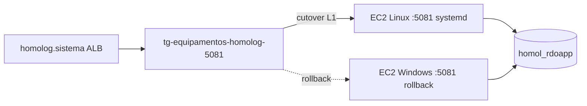

# Plano — Dia 2 / L1 Linux (homolog Core)

**Trilha:** I (infra) + smoke EQ-R · **Repo:** `RDO-APP/Migration2Core`  
**Atualizado:** 2026-11-19 · **Pré-condição:** smoke Dia 1 **O4/O5** OK (ou waiver)  
**Fora:** prod `sistema` `:80` · `novo_rdoapp` · melhorias pós-L1 (3.1/CAT/`/convidada`/clone listas) · EQ-M

**Canônicos relacionados:** [`plano-preparacao-migracao-homolog.md`](../plano-preparacao-migracao-homolog.md) §11 · [`estudo-ci-homolog-readiness-e6.md`](../estudo-ci-homolog-readiness-e6.md) §7 · [`roteiro-deploy-homolog-operador.md`](roteiro-deploy-homolog-operador.md) · [`ORQUESTRADOR-MIGRACAO.md`](../ORQUESTRADOR-MIGRACAO.md)

---

## Objetivo

Migrar `RdoApp.Core` homolog de EC2 **Windows** (W1) para EC2 **Linux** dedicada (L1).  
URL pública **não muda:** `https://homolog.sistema.rdoapp.com.br` — só troca o destino no target group.

| Hoje (W1) | Alvo (L1) |
|-----------|-----------|
| `i-05cb0003c031a26da` Windows · IIS/Kestrel **5081** | Nova EC2 Amazon Linux · **systemd** + Kestrel **5081** |
| Deploy PowerShell SSM | Deploy `AWS-RunShellScript` + scripts Linux |
| Mesma máquina que prod legado `:80` | Homolog **isolado** (prod Windows intocado) |

---

## Decisões fixas

1. **Nova EC2 Linux** só homolog (não reaproveitar Windows como host Linux).
2. **Não** reusar EC2 **PHP/Loja** `i-0af4ef47531a19acb` (`t2.micro` · ALB Loja · blast radius checkout) — ver [`infraestrutura-nuvem-aws-rdo.md`](infraestrutura-nuvem-aws-rdo.md) §2.1.
3. Porta / TG: **`tg-equipamentos-homolog-5081`** · health na **5081**.
4. Runtime: Kestrel `0.0.0.0:5081` + unit systemd (nginx só se o ALB exigir TLS na origem — hoje ALB termina TLS).
5. Publish: `dotnet publish -r linux-x64` (self-contained **ou** FDD + runtime no host — escolher um e documentar no DEPLOY).
6. Staging/`Smtp:*`/`ConnectionStrings` **fora do Git**; apply **não** sobrescreve `appsettings.Staging.json`.
7. Windows permanece **rollback** até smoke L1 OK (re-registrar no TG).
8. G3 mobile **não** bloqueia L1 (EQ-M adiado).

---

## Fase 0 — Inventário

- [x] Confirmar ALB / TG / SG / subnets de `homolog.sistema`.
- [x] Listar InstanceId Windows atual e regras SG (ALB→5081, egress RDS).
- [x] Localizar Staging na Windows (modelo para copiar à Linux).
- [x] Criar rascunho `RDO-CleanMigration-2026/DEPLOY-HOMOLOG-LINUX-EC2.md`.

**Snapshot (2026-11-19 · us-east-2):** ALB `Sistema-RDO` · rule P4 Host `homolog.sistema…` → `tg-equipamentos-homolog-5081` (HTTP 5081) · VPC `vpc-ea507a82` · subnet ref `subnet-c1a2ffa9` / **us-east-2a** · Windows `i-05cb0003c031a26da` (`172.31.2.89`) · SG `sg-0949364ef36d38331` (ingress ALB `sg-00356b50f53dbbeee`→5081; egress all) · Staging Windows `C:\inetpub\wwwroot\homologacao\rdoapp_core\appsettings.Staging.json` · doc L1 [`DEPLOY-HOMOLOG-LINUX-EC2.md`](../../RDO-CleanMigration-2026/DEPLOY-HOMOLOG-LINUX-EC2.md).

**Achado:** TG health path `/` matcher **200** → Windows **unhealthy** (resposta **302**). Antes do cutover L1: path `/Account/Login` **ou** matcher `200,302`.

**Próximo:** Fase 1 — Lucio provisiona EC2 Linux (ainda **sem** registrar no TG).

---

## Fase 1 — Provisionar EC2 (Lucio AWS)

- [x] Launch Amazon Linux 2023 na VPC/SG do TG homolog.
- [x] SSM Agent Online · pasta `/var/www/rdoapp_core` (ou equivalente).
- [x] Unit `rdoapp-core-homolog.service` (self-contained — sem runtime host).
- [x] InstanceId **`i-0776acb09b8438f22`** · IP `172.31.2.111` · t3.small.

---

## Fase 2 — Scripts e doc (Migration2Core)

| Artefato | Função |
|----------|--------|
| `scripts/publish-homolog-linux.ps1` | Publish `linux-x64` → zip S3 |
| `scripts/ec2-apply-rdoapp-core-linux.sh` | Extrai, preserva Staging, `systemctl restart`, smoke localhost + IP privado |
| `scripts/deploy-homolog-linux-ssm.ps1` | Upload S3 + SSM `AWS-RunShellScript` |
| `DEPLOY-HOMOLOG-LINUX-EC2.md` | Roteiro copy-paste Lucio |
| Atualizar `roteiro-deploy-homolog-operador.md` | Seção L1 + InstanceId |

**Regras (herança W1):** nunca path prod · smoke **ALB/IP privado** (não só localhost — lição 502) · um dono da 5081.

---

## Fase 3 — Deploy piloto + cutover

1. [x] Publish + deploy SSM → Linux (smoke localhost + IP privado **200**).
2. [x] Health TG path → `/Account/Login` (matcher 200).
3. [x] Registrar Linux no TG → **healthy**.
4. [x] Desregistrar Windows `i-05cb…:5081` (draining → fora).
5. [ ] Browser Lucio: Login → Escolher → Cards · O4/O5.

**Rollback:** `aws elbv2 register-targets ... Id=i-05cb0003c031a26da,Port=5081` · opcional `systemctl stop rdoapp-core-homolog` na Linux.

---

## Fase 4 — Fechar Dia 2

- [ ] ORQUESTRADOR: Dia 2 **L1 ☑** após smoke browser Lucio · Próxima ação = gate melhorias pós-L1.
- [x] M10: Linux homolog ≠ cutover RDS (`novo_rdoapp`) — cutover continua M10 depois.
- [ ] Commit/push Migration2Core + `sync-docs-onedrive-from-git.ps1`.

---

## Critério de pronto

| # | Critério |
|---|----------|
| 1 | `homolog.sistema` saudável no **Linux** |
| 2 | Login + Cards + O4/O5 OK |
| 3 | Rollback Windows documentado |
| 4 | Doc + scripts no Git |
| 5 | Prod `:80` / `novo_rdoapp` intocados |

---

## Depois do L1 (não neste plano)

Ordem sugerida pós-gate: SMTP homolog estável → `/convidada` → clone listas no Copiar → **3.1** / CAT → backlog UI (`pendencias-melhorias-ui-stack.md`).  
CI Actions Linux: reutilizar S3/OIDC; trocar runner PowerShell → shell (E6 §7) em ciclo à parte.

---

## Todos de execução

1. **l1-inv** — Inventário ALB/TG/SG + rascunho DEPLOY Linux ✅  
2. **l1-ec2** — Provisionar EC2 + systemd (Lucio)  
3. **l1-scripts** — publish / apply / deploy SSM Linux  
4. **l1-cutover** — Piloto + TG + smoke browser  
5. **l1-docs** — Fechar ORQUESTRADOR + commit/push/sync  
