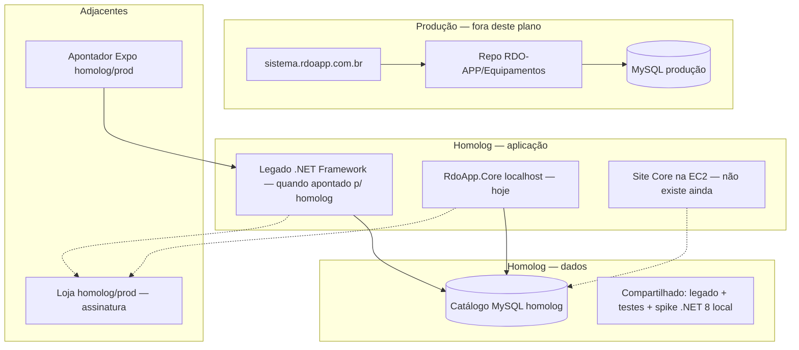

# Plano de preparação para migração RDO App (incl. homologação)

**Chat:** Migração .NET Core · **Atualizado:** 2026-10-17  
**Escopo:** preparar e retomar a migração — **não** cutover de produção.

**Sequência técnica (2026-10-17):**

1. **Política de banco** — **A fechado** — ver §8  
2. **E2E Fase 0** — validar fluxo Login → obra → `/Tarefa/Cards`  
3. **Homolog AWS (EC2)** — URL na nuvem para **OK visual do Lucio**

**Definição homolog (Lucio, 2026-10-17):** homologação **não** é “localhost no meu PC”. É **app publicado na EC2** (URL que você abre no browser e **aprova**). `dotnet run` local = **dev**; critério de aceite = **H2 na nuvem**.

**O que o agente Cursor consegue testar:** build, código, e browser **se** houver URL acessível (localhost **na sua máquina** com RDS, ou **URL EC2** depois do deploy). Da rede do agente o RDS costuma dar timeout — o E2E “de verdade” com banco homolog na **primeira** vez pode precisar ser **na EC2** (mesma VPC que o legado) ou **você** no browser local.

**Trilha revisada:** preparar deploy mínimo EC2 → publicar Fase 0 → você dá OK na URL → depois CI/evolução.

---

## 1. Objetivo

Sair de “estudo + spike ~35%” para um **ritmo sustentável de migração**, com **homologação definida em camadas**: o que já existe, o que falta, e em que ordem construir — sem misturar com deploy em `sistema.rdoapp.com.br` até a Onda 6 (cutover).

---

## 2. Mapa de ambientes (visão geral)



| Ambiente | O que é | Repo / artefato |
|----------|---------|------------------|
| **Produção web obras** | SaaS clientes | `RDO-APP/Equipamentos` → EC2 |
| **Homolog — banco** | Dados de teste no RDS operacional | Connection string homolog (legado / Migration2Core) |
| **Homolog — web legado** | Mesmo código Equipamentos com config homolog | Não é um produto separado no GitHub; é **config + deploy** |
| **Homolog — Migration2Core** | Hoje = **máquina dev** (`localhost:7176`) | `RDO-APP/Migration2Core` |
| **Homolog — mobile** | APK/API apontando backend homolog | `EquipamentosMobile` (outro chat / Onda 0) |
| **Homolog — Loja** | Compras teste / Mailhog local | `Loja_PHP` (chat Loja) |

---

## 3. O que **já tem**

### 3.1 Conhecimento e planejamento

| Item | Onde |
|------|------|
| Backlog Dimas TSK-01…56 (~346 h) | PDF + `docs/estudos-lucio-apps-plano-migracao-core/` |
| Ondas U-01…66 mescladas | `comparativo-e-plano-unificado.md` |
| Mapa Kiro × TSK × leitura | `docs/migracao-kiro-mapa-estudo.md` |
| DER / schema (48 entidades) | `Migration2Core/.../analysis/02-*.md`, `03-*.md` |
| Legado referência visual/regras | `EquipoToPiscina-1/RDO-Production-Gilberto/` |

### 3.2 Código migração (Migration2Core)

| Item | Estado |
|------|--------|
| Solution `RdoApp.Core` .NET 8 MVC | Existe |
| 48 entidades EF Core + Fluent API | Feito (Kiro) |
| Login + cookie auth (estilo legado) | Feito |
| Escolher obra + RBAC header | ~80% Kiro; Fase 0 seleção obra (Cursor) local |
| `Migration:DisableAssinaturaCheck` em Development | Feito |
| Guia homolog local | `RDO-CleanMigration-2026/HOMOLOGACAO_LOCAL.md` |
| Script build local | `RDO-CleanMigration-2026/scripts/test-local.ps1` |

### 3.3 Homologação — o que **já opera** na empresa

| Camada | Tem? | Notas |
|--------|------|--------|
| **RDS MySQL** (infra) | Sim | EC2 + RDS us-east-2 — operação SaaS |
| **Catálogo homolog Equipamentos (.NET 8)** | **Fechado** | **`homol_rdoapp`** — schema **47 tbl** (DDL 2026-10-17). Piscinas homolog: **`piscinas_rdoapp_homologa`** |
| **App .NET 8 publicado em homolog** | **Parcial** | Core na EC2 + E2E login 2026-10-17; **republicar** após DDL (`historico_login`, branding Equipamentos) |
| **Isolamento só migração** (DB clone / RDS dedicado) | **Não** | Opcional; não provisionado |
| **CI/CD Migration2Core** | **Não** | Push GitHub pendente de disciplina branch/secrets |
| **Feature flag mobile → Core** | **Não** | Onda 2 |

### 3.4 Processo

| Item | Tem? |
|------|------|
| Repositório canônico migração | `C:\Dev\Migration2Core` → GitHub |
| Workspace docs migração | `Equipamentos/docs/…` |
| Regra: prod = Equipamentos; migração = Migration2Core | Documentado |

---

## 4. O que **falta** (gaps)

### 4.1 Homologação (principal)

| Gap | Impacto | Prioridade preparação |
|-----|---------|------------------------|
| **Política de dados** (compartilhar homolog vs clone local) | Escritas no Core afetam mesmo DB que legado/mobile testam | **P0** — decisão Lucio |
| **Credenciais fora do git** (User Secrets / CI secrets) | Bloqueia push seguro | **P0** |
| **Teste E2E registrado** (login → obra → Cards) | Sem evidência de retomada | **P0** |
| **Assets** (fontes, `user.png`) | UI quebrada | **P1** (README Kiro) |
| **Ambiente Core na nuvem (homolog)** | QA de outras pessoas / URL fixa | **P2** (após slice local OK) |
| **Pipeline GitHub** (build + opcional deploy homolog) | Reprodutibilidade | **P2** |
| **Paridade assinatura Loja** (`DisableAssinaturaCheck: false` em homolog cloud) | Teste real de licença | **P3** (Onda 2 / ponte Loja) |

### 4.2 Migração produto (além de homolog)

| Gap | Onda ref. |
|-----|-----------|
| Clean Architecture / MediatR vs MVC monolito | Onda 1 — decisão estratégia C |
| JWT + API mobile | Onda 2 |
| React strangler | Onda 3 |
| RDO, Laudo, PDF, apontamento no Core | Onda 4–5 |
| ETL + desligar AngularJS | Onda 6 |
| Alinhamento formal Dimas + Onda 0 apps | Gestão |

---

## 5. Plano em fases (preparação + homolog)

### Fase A — Organização (1–2 dias)

| # | Entrega | Homolog |
|---|---------|---------|
| A1 | Branch `migracao-retomada-2026` no Migration2Core | — |
| A2 | Secrets: connection string **fora** do commit | Pré-requisito push |
| A3 | Confirmar **política de banco** (compartilhado / clone Docker / novo catálogo) | Define item H1 |
| A4 | Atualizar checklist §4 em `migracao-kiro-mapa-estudo.md` após primeira demo | Rastreio |

**Done:** build verde + git higienizado + política de dados escrita em 1 parágrafo.

---

### Fase B — Homolog local funcional (3–5 dias)

| # | Entrega | Homolog |
|---|---------|---------|
| B1 | `dotnet build` / `test-local.ps1` | Sem RDS |
| B2 | Copiar fontes/imagens legado → `wwwroot` | Visual = homolog visual |
| B3 | E2E: Login → Escolher → Selecionar obra → `/Tarefa/Cards` | **Homolog dados** (com autorização) |
| B4 | Checklist manual em `HOMOLOGACAO_LOCAL.md` assinado (data + OK/Falha) | Evidência |
| B5 | Commit/push branch (sem secrets) | Backup nuvem |

**Done:** evidência E2E + Fase 0 estável.

---

### Fase C — Homolog “equipe” (1–2 semanas, opcional até precisar)

| # | Entrega | Homolog |
|---|---------|---------|
| C1 | Definir URL alvo (subdomínio ou path na EC2 existente) | Decisão infra |
| C2 | Publicar `RdoApp.Core` (Kestrel + reverse proxy ou IIS) em **homolog** | **Novo** — hoje falta |
| C3 | Connection string + `ASPNETCORE_ENVIRONMENT=Staging` | Staging ≠ Development |
| C4 | GitHub Actions: build; deploy manual ou SSM | Falta |
| C5 | Smoke test remoto (mesmo checklist B3) | Homolog **app** na nuvem |

**Done:** URL acessível à equipe (não localhost).

---

### Fase D — Preparação Onda 1 técnica (paralelo / após B)

| # | Entrega |
|---|---------|
| D1 | Decidir: continuar MVC Kiro vs extrair Clean Arch (estratégia C) |
| D2 | Primeira página crítica pós-Cards (plano `4-CRITICAL-PAGES-IMPLEMENTATION-PLAN.md`) |
| D3 | Serilog + health check `/health` (mínimo operação) |
| D4 | Documentar divergências TSK-07 (cookie vs JWT) |

---

### Fase E — Homolog integrada (Onda 2+, futuro)

| # | Entrega |
|---|---------|
| E1 | Core homolog + mobile homolog (feature flag por endpoint) |
| E2 | Assinatura Loja contra homolog |
| E3 | PoC FAPESC / sidecar imutabilidade **sem** alterar pipeline prod |

---

## 6. Critérios: “homolog pronto **para esta etapa** da migração”

| Nível | Critério |
|-------|----------|
| **H0 (mínimo)** | Build local OK; política de banco definida |
| **H1 (retomada)** | E2E Fase 0 no localhost + homolog dados (ou Docker clone) documentado |
| **H2 (equipe)** | Site Core homolog na AWS + smoke test |
| **H3 (mobile/Core)** | Apontador aponta Core homolog em fluxos acordados |
| **H4 (cutover)** | Onda 6 — fora deste documento |

**Meta imediata recomendada:** **H1**, depois evoluir para **H2** quando alguém além de você precisar testar sem `localhost`.

---

## 7. Riscos

| Risco | Mitigação |
|-------|-----------|
| Homolog compartilhado — dados sujos | Obra/usuário de teste; ou clone local |
| Dois nomes de DB em docs (`_homolog` vs `_homologa`) | Confirmar catálogo vivo com DBA/legado Web.config |
| Spike MVC ≠ backlog Clean Arch | Decisão explícita Fase D1 |
| FAPESC + migração paralelos | PoC em homolog; não confundir com cutover |

---

## 8. Passo 1 — Política de banco

### Decisão registrada — **Opção A (compartilhado)**

**Data:** 2026-10-17 · **Contexto:** testes predominantemente solo; E2E Fase 0 exige fluxo + dados reais de homolog; catálogo novo no RDS adiado para homolog AWS (H2).

> Até concluir **E2E Fase 0** e enquanto testes forem predominantemente solo, o `RdoApp.Core` usa o **catálogo homolog compartilhado** (mesmo ambiente de dados que o legado em homolog). Credenciais **fora do Git** (User Secrets / local). Antes de desenvolvimento com **escrita intensa** ou retorno de **outros testadores** no homolog, migrar para **Opção B** (MySQL local via Docker + restore de dump). **Opção C** (catálogo dedicado no RDS) fica para **homolog AWS**, se necessário.

| Opção | Status |
|-------|--------|
| **A — Compartilhado** | **Em uso** |
| **B — Clone local** | Planejado antes de Onda 1 com CRUD pesado ou equipe no homolog |
| **C — Catálogo novo no RDS** | Opcional na fase homolog AWS (H2) |

Referência técnica (sem senha): host RDS operacional + catálogo homolog legado — ver `Migration2Core/.../HOMOLOGACAO_LOCAL.md` e `appsettings.example.json`.

---

## 9. A fechado — riscos e mitigações

### 9.1 O que **não** é risco

- **Produção** (`sistema.rdoapp.com.br`) usa **outro catálogo** — A não substitui prod desde que a connection string seja **homolog**, nunca produção.
- **GitHub / código** — risco de vazamento de credencial é independente de A/B; mitigação = User Secrets.

### 9.2 Riscos da opção A

| Risco | O que pode acontecer | Fase 0 (login → obra → Cards) | Depois (CRUD, RDO, medição, …) |
|-------|----------------------|-------------------------------|--------------------------------|
| Escrita no mesmo banco | Core e legado/mobile veem os mesmos dados | Baixo (sessão, histórico login, obra na sessão) | **Alto** |
| Bug grava dado errado | Update/delete/duplicata em tabelas de negócio | Baixo no slice atual | **Alto** |
| EF / migrations destrutivas | `drop`, `update` que altera schema | **Crítico** para legado no mesmo catálogo | **Crítico** |
| Homolog “suja” | Dados antigos inconsistentes; falso negativo no E2E | Médio | Médio |
| Rede / indisponibilidade RDS | Não testa local sem conectividade | Operacional | Operacional |
| Dados pessoais em homolog | CPF/nomes de teste — ambiente interno | Tratar como confidencial | Igual |
| Outros testadores no homolog | Conflito de dados e expectativa | Baixo **enquanto solo** | **Alto** → gatilho para **B** |

**Veredicto:** A é **aceitável** para E2E Fase 0 solo, com mitigações abaixo. **Não** manter A como política única quando houver escrita forte ou equipe compartilhando homolog.

### 9.3 Mitigações obrigatórias (com A)

| # | Regra |
|---|--------|
| 1 | **Proibido** `dotnet ef database drop` e migrations que **alterem schema** no homolog compartilhado — schema é do legado; EF Core só **mapeia**. |
| 2 | Preferir **usuário e obra de teste** conhecidos; evitar contas “de referência” de cliente se houver alternativa. |
| 3 | Connection string **somente** User Secrets / arquivo local ignorado pelo git — **nunca** senha no commit. |
| 4 | Confirmar **nome do catálogo** homolog vivo (docs antigos: `_homolog` vs `_homologa`) contra `Web.config` legado ou ops — uma vez, antes do E2E. |
| 5 | Registrar E2E com **data + OK/Falha**; se comportamento estranho, checar **dado** antes de refatorar código. |
| 6 | **Gatilho para Opção B:** primeiro CRUD relevante (tarefa/medição/RDO), **Dimas/outros** testando no mesmo homolog, ou qualquer dúvida sobre impacto de escrita. |

### 9.4 Trilha evolutiva (A → B → C)

```text
Agora (E2E Fase 0)        → A — homolog compartilhado
Antes de Onda 1 pesada    → B — Docker MySQL + dump do homolog
Homolog AWS (H2)          → C opcional — catálogo só Core na nuvem
```

---

## 10. Passos 2 e 3 da sequência

**Passo 2 — E2E:** checklist em [`docs/e2e-fase0-checklist.md`](e2e-fase0-checklist.md) + `HOMOLOGACAO_LOCAL.md`. **Homolog autorizado pelo Lucio:** 2026-10-17 (executar E2E na máquina local com rota ao RDS).

**Passo 3 — Homolog AWS:** URL, Staging, deploy manual ou CI; repetir checklist remoto. Trilha W1→L1: **§11**.

---

## 11. Trilha homolog app — Windows agora → Linux depois (Lucio, 2026-10-17)

**Contexto:** DNS/ALB/TG **`homolog.sistema`** já apontam para a EC2 **Windows** `(Equipamentos)` · **`i-05cb0003c031a26da`** · porta **5081**. Produção legado permanece site **`rdo`** (:80) na **mesma** máquina até cutover (Onda 6).

### 11.1 Fases da trilha

| Fase | Onde roda `RdoApp.Core` | Objetivo |
|------|-------------------------|----------|
| **W1 (agora)** | EC2 **Windows** atual · IIS · **5081** | Primeiro deploy Core · E2E Fase 0 · URL homolog oficial |
| **L1 (depois)** | EC2 **Linux** dedicada (homolog só) | Isolar homolog de prod · padrão para CI/CD e cutover futuro |

**URL pública:** **`https://homolog.sistema.rdoapp.com.br`** — **não muda** entre W1 e L1; só troca **destino** no target group.

### 11.2 Gatilho **L1** — quando migrar para Linux

**Não** provisionar Linux antes disso (evita duas frentes: app + VM nova).

Executar **L1** quando **todos** estiverem marcados:

| # | Critério |
|---|----------|
| G1 | **H2** atingido — Core acessível na AWS (não localhost) |
| G2 | **E2E Fase 0** concluído e registrado em [`e2e-fase0-checklist.md`](e2e-fase0-checklist.md) com base URL **`homolog.sistema`** |
| G3 | (Recomendado) Segundo testador **ou** mobile homolog apontando para Core homolog |

**Ação L1 (checklist alto nível):** nova EC2 Linux (VPC/SG compatível com ALB) · `dotnet publish -r linux-x64` · systemd/Kestrel (+ nginx se necessário) · registrar instância no TG **`tg-equipamentos-homolog-5081`** · desregistrar Windows na **5081** · doc `Migration2Core/.../DEPLOY-HOMOLOG-LINUX-EC2.md` (a criar na sessão L1).

### 11.3 Execução W1 — clique a clique

Guia operacional: [`trilha-core-homolog-clique-a-clique.md`](trilha-core-homolog-clique-a-clique.md) (Etapa 1 → 2 → 3).  
Deploy técnico: `C:\Dev\Migration2Core\RDO-CleanMigration-2026\DEPLOY-HOMOLOG-EC2.md`.

### 11.4 Lembrete no cronograma

| Momento | Lembrete |
|---------|----------|
| Ao marcar **H2** | Revisar §11.2 — Linux ainda **não** obrigatório |
| Ao fechar **E2E Fase 0** (G2) | **Agendar L1** se G3 também OK ou planejado |
| Início **Onda 2** (mobile/Loja homolog Core) | **Preferir** homolog já em **Linux** (G1–G3) |

---

## 12. Links rápidos

| Recurso | Caminho |
|---------|---------|
| **Route 53 / DNS homolog (técnico AWS)** | [`docs/aws-route53-rdoapp-dns-homolog-tecnico.md`](aws-route53-rdoapp-dns-homolog-tecnico.md) |
| Homolog local | `C:\Dev\Migration2Core\RDO-CleanMigration-2026\HOMOLOGACAO_LOCAL.md` |
| Mapa estudo | `docs/migracao-kiro-mapa-estudo.md` |
| Ondas U | `docs/estudos-lucio-apps-plano-migracao-core/comparativo-e-plano-unificado.md` |
| Homolog EC2 Migration2Core | [`docs/homolog-ec2-migration2core-proximo.md`](homolog-ec2-migration2core-proximo.md) |
| **Trilha W1→L1 + clique a clique** | [`docs/trilha-core-homolog-clique-a-clique.md`](trilha-core-homolog-clique-a-clique.md) · plano **§11** |
